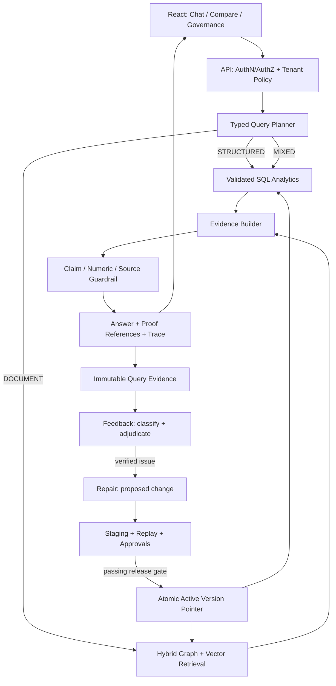
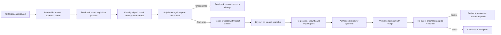

# AMC IMPLEMENTATION BLUEPRINT — SINGLE-FILE EDITION

Full text of all original Markdown specifications for direct reading or copy/paste. Structured CSV trackers remain in their separate files.


---

# SOURCE FILE: 01_SOURCE_REVIEW_AND_ROOT_CAUSES.md

# 01 — Source Review, Root Causes and Prioritized Diagnosis

**Review pin**: `e3c74e011d70e2921b8e0ee2287e6fc71cb30bb0` (`amc-dev`). GitHub file references below are for review provenance. The full live pipeline was not executed.

## A. CSV findings: grounded in examined source

| ID | Severity | Observed code behavior | Failure mechanism / remediation |
|---|---|---|---|
| CSV-01 | P0 | `engine/document_extractors.py::extract_csv_text_full` defaults to `CSV_MAX_PAGES` (50 × 25 rows) and stops once the page limit is reached. | In that extractor path, a 16,245-row file can be truncated to 1,250 records. A warning does not prevent incomplete publication. Use an explicit completeness check; canonical tabular ingest must process all rows. |
| CSV-02 | P1 | `ingestion/parsers/csv.py` groups several CSV rows as text sections; `scripts/ingest_csv.py` separately serializes individual rows to a vector store. | Competing ingestion representations make corpus parity and exact row addressing difficult. Consolidate one structured ingest pipeline; keep semantic row summaries as secondary retrieval artifacts. |
| CSV-03 | P0 | `services/scheme_aggregation_service.py::_aggregate_schemes` groups on `Scheme_Name`, and multiple methods calculate `SUM(Average_AUM_Cr)` directly over raw row variants. | Cross-AMC collisions, duplicates, mixed dates, repeated plan/option observations and incompatible AUM grains may yield incorrect financial totals. Define canonical identity, unit, time window, and metric rules with data steward. |
| CSV-04 | P1 | `get_top_schemes` emits `total_unique_schemes=len(top_schemes)`, hardcoded `data_completeness=0.98`, and per-scheme `plan_data_completeness=1.0` after dropping missing AUM rows. | Results contain misleading totals/completeness. Compute from source snapshot, using numerator, denominator, null count, and excluded records. |
| CSV-05 | P1 | `get_top_nav_schemes` defaults to `Open Ended`, `Equity`, `Growth`, and IDCW exclusion; the fast-path chooses filters via regex. | An unspecified question may silently become a filtered question. Use explicit filter parsing and echo applied filters in every result. |
| CSV-06 | P1 | The NAV ranking sorts numeric NAV without an explicit as-of-date requirement or same-date comparability rule. | Values from different dates can be compared as if simultaneous. Require `as_of` or a documented cutoff/comparability policy; disclose exclusions. |
| CSV-07 | P0 | Fast-path aggregation catches exceptions and returns `None`, causing ordinary vector/LLM retrieval to continue. | An exact numeric question can become an approximate generative response when its authority fails. Return `STRUCTURED_SOURCE_UNAVAILABLE`, not a false numeric answer. |
| CSV-08 | P1 | The fast-path constructs synthetic citation objects, quality_score=1.0, and fixed timing values (e.g. 2 ms in one trace). | Citations and telemetry are not independently anchored to actual source rows or measured execution. Build proof objects and instrument timings around actual operations. |
| CSV-09 | P1 | Several fast paths are keyword/regex based and the route definitions for scheme aggregation are absent from `main.py`'s central router registration list. | Misrouting and mismatched source links/API contracts are possible. Replace with a typed intent plan; mount and test intentionally supported routes. |
| CSV-10 | P1 | `backend/data/source_docs/chunks/manifest.json` declares 22 chunks covering 16,245 rows; there is no demonstrated end-to-end activation guarantee that all chunks are query-visible in graph and vector stores. | A manifest is not a reconciled materialization report. Compare raw row counts, unique row IDs, indexes, measures, and active data-plane versions before publish. |
| CSV-11 | P1 | Sample rows in chunk 001 have identical Launch_Date and Closure_Date; `is_active=pd.isna(Closure_Date)` in aggregation code. | The column's operational meaning is not established; active-state inference may be wrong. Validate source semantics and define closure state as explicit nullable, audited status. |
| CSV-12 | P1 | `get_dataset_summary()` returns a hardcoded `January - March 2026` string in some paths. | Can misstate the relevant reporting period when data changes. Derive reporting period from selected snapshot and reject mixed-period aggregation unless policy permits. |

## B. AMC, Feedback and Repair findings

| ID | Severity | Observed code behavior | Recommended control |
|---|---|---|---|
| GOV-01 | P0 | `compliance/security.py::get_client_role` derives role from `X-User-Role` and uses `Role.ADMIN` when absent. | Resolve authorization from authenticated server-managed principal and tenant; deny unauthenticated or ambiguous identity. |
| GOV-02 | P0 | Some `admin`, `ingest`, `graph`, `files`, and `query` endpoints declare no mandatory `CurrentUser` dependency. | Global deny-by-default auth plus per-route policy tests; limit public endpoints to documented health/static routes. |
| GOV-03 | P0 | `services/repair_integration.py` sets `approved=(confidence>=.95 and risk==LOW)` and can automatically promote patches. | Disable automatic publication of finance/regulatory changes. Confidence is never sufficient authorization. Require source proof, deterministic tests, reviewer approval and release. |
| GOV-04 | P0 | `retrieval/orchestrator.py::_apply_correction_patches` applies returned patches at confidence>=0.70 without requiring explicit published state in the shown branch. | Filter solely to `ACTIVE` approved, version-valid patches; quarantine pending patches and never present them as trusted source. |
| GOV-05 | P0 | `graph/correction_patch_layer.py::apply_patches_to_context` inserts an imperative instruction to use a pending correction where confidence>=0.70. | Never turn untrusted feedback into instructions; structured advisory annotation, not prompt content or truth override. |
| GOV-06 | P0 | `services/promotion_service.py::_execute_graph_mutation` may return when the Neo4j driver is unavailable; caller proceeds to mark proposal as applied. | Require mutation receipt/transaction ID and postcondition verification before SQL status becomes `APPLIED`; otherwise `RETRYABLE_FAILED`. |
| GOV-07 | P1 | Multiple local/HTTP repair adapters, graph patch layer, service client, feedback package and DB records coexist. | Select a single authoritative state store; adapters may cache read models but not invent independent truth. |
| GOV-08 | P1 | Feedback lifecycle has passive detectors, timeouts, issue matching, batch evaluation and approval paths. | Treat silence and abandonment as `UNKNOWN`; introduce evidence completeness, triage, conflicts, duplicate suppression and SLA rules. |
| GOV-09 | P1 | Repair task created through remote service before local DB `repair_task_id` commit. | Use transactional outbox and idempotency keys to recover from remote success/local commit failure. |
| GOV-10 | P1 | Graph and vector ingest are not jointly transactional; `ingestion/pipeline.py` catches partial graph-write failures and still proceeds to activation. | Stage, validate, atomically move active manifest pointer; degrade/read-only only when required data planes have consistent published version. |

## C. Assurance, operations, reporting findings

- The 25-case `run_phase5_evaluation_benchmark.py` embeds ground truth into both mock context and mock answer. Its result is **not** live RAG performance evidence. `app/evaluation/scorer.py` implements keyword-overlap heuristics, text-length-based recall, and derived relevance, not independently measured RAGAS. Its report marks 24.5% recall `PASSED` against >80%.
- `evaluation_metrics_report.json` (dated 2026-08-31) includes unrelated queries answered with borrowing-limit text and approximately 16.9-second average query durations. Historical evidence, **not** proof the exact failure persists at the reviewed branch head.
- `docker-compose.yml` references absent Dockerfiles, and a missing Streamlit service directory; no `.github/workflows` directory appears in the reviewed tree. It should not be assumed deployment-ready.
- Existing tests cover meaningful segments (authentication, session isolation, cache isolation, repairs, financial intent) but do not establish full cross-endpoint authorization or the live benchmark outcomes.
- The shared repo contains source documents, chunked CSV and vector/index artifacts; verify access rights, privacy classification, licensing and artifact retention before release.

## D. Root-cause tree for incorrect CSV answers

1. **Row coverage**: selected extractor truncation; inconsistent ingestion generations; non-atomic activation; index drift.
2. **Business semantics**: grain errors; wrong composite identity; period mismatch; NAV vs quarterly AAUM confusion; duplicates; null handling; unverified closure meaning.
3. **Query planning**: regex misrouting; ambiguous `average`/`top`; implicit default filters; wrong fallback to LLM.
4. **Computation**: direct sum of per-row AUM with unspecified additivity; raw floats; unnormalized units; group-by scheme display name.
5. **Explanation**: unverified citations; high confidence hardcoded; patched pending facts override documents; arbitrary narrative introduced.
6. **Measurement**: unit tests assert shape or keywords; simulated benchmark; no independent live golden-answer bank; dashboards overclaim performance.

## E. Bounded diagnosis workflow (do before coding)

1. Lock the branch SHA, active corpus version, data manifest, provider versions and local config; hash all inputs.
2. Capture at least 30 failing/ambiguous CSV queries and 15 correct PDF control queries, with actual response, trace, intended interpretation and expected answer.
3. For each CSV request persist plan (`intent`, `metric`, `filters`, `grouping`, `as_of`, `dataset_version`) and whether fast path, SQL, graph, vector or patch was involved.
4. Run source-row checksum reconciliation: 16,245 declared vs parsed vs validated vs staged vs published; check row-key collisions and all 22 chunk boundaries.
5. Recompute gold using direct SQL over a steward-approved canonical snapshot. Do not use LLM answers as labels.
6. Compare public API output to exact gold and inspect unsupported claims, missing evidence and source-period errors separately.
7. Failure categories must be mutually distinguishable (`ROUTING`, `ENTITY`, `ROW_COVERAGE`, `PERIOD`, `METRIC`, `AGGREGATION`, `CITATION`, `PATCH_CONTAMINATION`, `AUTH`, `UNKNOWN`).

## F. Source links (stable branch snapshot)

- https://github.com/nusummit-spg/amc-context-engineering-poc/blob/e3c74e011d70e2921b8e0ee2287e6fc71cb30bb0/backend/app/engine/document_extractors.py
- https://github.com/nusummit-spg/amc-context-engineering-poc/blob/e3c74e011d70e2921b8e0ee2287e6fc71cb30bb0/backend/app/ingestion/parsers/csv.py
- https://github.com/nusummit-spg/amc-context-engineering-poc/blob/e3c74e011d70e2921b8e0ee2287e6fc71cb30bb0/backend/app/services/scheme_aggregation_service.py
- https://github.com/nusummit-spg/amc-context-engineering-poc/blob/e3c74e011d70e2921b8e0ee2287e6fc71cb30bb0/backend/app/retrieval/fast_path_interceptor.py
- https://github.com/nusummit-spg/amc-context-engineering-poc/blob/e3c74e011d70e2921b8e0ee2287e6fc71cb30bb0/backend/app/services/repair_integration.py
- https://github.com/nusummit-spg/amc-context-engineering-poc/blob/e3c74e011d70e2921b8e0ee2287e6fc71cb30bb0/backend/app/graph/correction_patch_layer.py
- https://github.com/nusummit-spg/amc-context-engineering-poc/blob/e3c74e011d70e2921b8e0ee2287e6fc71cb30bb0/backend/app/services/promotion_service.py
- https://github.com/nusummit-spg/amc-context-engineering-poc/blob/e3c74e011d70e2921b8e0ee2287e6fc71cb30bb0/backend/scripts/run_phase5_evaluation_benchmark.py
- https://github.com/nusummit-spg/amc-context-engineering-poc/blob/e3c74e011d70e2921b8e0ee2287e6fc71cb30bb0/backend/app/evaluation/scorer.py


---

# SOURCE FILE: 02_TARGET_ARCHITECTURE_AND_CONTRACTS.md

# 02 — Target Architecture and Cross-Module Contracts

## 1. CTO decision and invariant

Keep three independently bounded logical modules: **AMC Core**, **Feedback**, **Repair**. They may initially run in one FastAPI deployment with explicit interfaces; deployment into separate processes is conditional on observed scale/availability needs, not a prerequisite for correctness. The modules share **contracts and immutable identifiers**, not a mutable domain object graph.

**Key rule:** authoritative fact changes are published via a controlled version switch. A user suggestion, confidence score or proposed graph mutation is never an authoritative fact.



## 2. Responsibilities and non-responsibilities

### AMC Core
- Owns source ingestion, canonical data definitions, data lineage, authoritative query execution, hybrid document/graph retrieval, result verification, user-facing answers, and immutable query evidence.
- Does **not** accept direct fact overrides from a feedback message or repair candidate; only reads an `ACTIVE` published corpus/version/patch manifest.
- For finance: execute exact typed calculations first; use LLM only to explain results and interpret documents.

### Feedback
- Owns feedback events, user attribution, issue grouping, triage, evidence completeness, error classification, review assignments, adjudication and status communication.
- Does **not** change canonical graph, source data, vector data, regulatory interpretation or financial calculations.
- Passive feedback provides **weak signal**, not proof of dissatisfaction or correctness. Silence is `UNKNOWN`, not `SATISFIED`.

### Repair
- Owns repair proposal generation, evidence verification, conflict resolution, risk assessment, staging, review, approval, execution receipts, versioned publication and rollback.
- Does **not** use its own model confidence as a bypass of human authorization for financial/regulatory changes.
- Repair actions are typed operations (`CORRECT_SOURCE_ROW`, `FIX_ENTITY_ALIAS`, `REBUILD_INDEX`, `UPDATE_RULE_VERSION`, `CORRECT_QUERY_PLAN`, `CORRECT_PROMPT`), never unrestricted generated Cypher/SQL as default.

### Shared Assurance Harness (cross-cutting capability, not a fourth core business module)
- Defines test cases, lineage/evidence checks, security and release gates, deployment verification, shadow/canary analysis and regression reports.
- May be deployed as CI/job support and shared packages; avoid creating another 24/7 microservice until needed.

## 3. Identity, tenancy and versioning contract

```
principal_id             authenticated user ID; never from X-User-ID
role_scopes              server-issued roles and specific operation scopes
tenant_id                server-bound tenant ID, compulsory for private resources
request_id / trace_id    unique request/tracing correlation
conversation_id          user-scoped and tenant-scoped
response_id              immutable answer response identifier
source_document_id       stable document identity
source_version_id        SHA/content-version of original document
schema_version           validated CSV/Excel contract version
dataset_version          immutable published tabular snapshot
corpus_version           published document/graph/vector snapshot
source_row_id            immutable source row anchor (dataset_version + row locator)
query_plan_id            hash of normalized typed plan + dataset_version + policy_version
feedback_event_id       immutable user/system evidence signal
issue_id                 deduplicated, tenant-scoped issue
repair_proposal_id       unique repair candidate
mutation_receipt_id      verifiable committed effect and compensation reference
release_id               signed gate result for snapshot/patch promotion
```

**Isolation:** All public/internal reads and writes must verify principal access, document class, tenant and namespace. Background jobs operate using a scoped service principal; never `system_user` as an authorization bypass.

## 4. Proposed source-truth selection rules

1. **Typed financial records** for NAV/AUM/rankings/filters/counts/averages: SQL query on immutable active dataset; no LLM-derived values.
2. **Current regulatory assertion:** the active regulation/circular, amendment, effective date, jurisdiction, approved rule mapping and precise source clauses.
3. **Narrative / explanation:** graph and vector evidence, with claim-level source support. Graph may assist identity and semantic relationships, not override inconsistent base numeric rows.
4. **Conflict:** do not average conflicting values. Resolve with explicit precedence, date and version rules or return `CONFLICT_REVIEW_REQUIRED`.
5. **Unapproved patch:** visible only in admin/review console, excluded from production answer context, caches, and golden labels.

## 5. Typed query plan contract

The planner is a restricted compiler target. The LLM (if used for interpretation) proposes a structured plan; validators reject unsupported fields, operators, tables, metrics, or incompatible units. The model cannot submit SQL directly.

```json
{
  "plan_version": "1.0",
  "intent": "AGGREGATION",
  "domain": "mutual_funds",
  "dataset_version": "<active-snapshot-id>",
  "metric": "total_aaum_cr",
  "aggregation": "SUM_VALIDATED",
  "entity_level": "amc",
  "group_by": ["amc_id"],
  "filters": {"aaum_quarter": "2026-Q1", "scheme_type": "Open Ended"},
  "order_by": [{"metric":"total_aaum_cr","direction":"DESC"}],
  "limit": 5,
  "as_of": null,
  "needs_explanation": true
}
```

Plan validation enforces required time dimension, dataset-version match, tenant filters, maximum result size, safe groups, approved metric semantics, query complexity limits, and explicit null/date policy. Use enums rather than arbitrary strings. `SUM_VALIDATED` is legal **only** for a data-steward-signed additive grain.

### Intent enum
`EXACT_LOOKUP`, `STRUCTURED_FILTER`, `AGGREGATION`, `RANKING`, `COMPARISON`, `TIME_SERIES`, `DOCUMENT_QA`, `REGULATORY_INTERPRETATION`, `HYBRID_EXPLAIN`, `AMBIGUOUS`.

### Routing policy
| Intent | Required executor | Allowed secondary context | Failure action |
|---|---|---|---|
| Exact NAV/AUM/ISIN | Typed SQL | source row / scheme graph identity | no numeric generative fallback |
| Counts, rankings, distributions | Typed SQL | brief narrative only | no generative fallback |
| Regulation or SID passage | graph + vector document retrieval | versioned regulatory graph | no claim without source clause |
| Mixed financial + regulatory question | SQL + document evidence joined by canonical entity/time | LLM explanation after both validate | return partial verified facts + explicit missing portion |
| Unknown/ambiguous | request disambiguation or controlled refusal | none | abstain; never guess data filters |

## 6. Answer API contract

Retain existing endpoints during migration, but add an additive `answer_contract_version`. Keep old fields in a compatibility adapter while new UI uses structured fields.

```json
{
  "answer_contract_version": "2.0",
  "response_id": "rsp_...",
  "query": "Top 5 AMCs by Q1 AAUM?",
  "status": "VERIFIED",
  "data_status": "ACTIVE",
  "route": "STRUCTURED_AGGREGATION",
  "dataset_version": "ds_...",
  "corpus_version": "corp_...",
  "normalized_plan": {"intent":"RANKING","metric":"total_aaum_cr"},
  "answer_text": "...",
  "structured_rows": [{"amc_id":"...","total_aaum_cr":"123.45"}],
  "units": {"total_aaum_cr":"INR_CRORE"},
  "source_refs": [{"source_document_id":"...","source_version_id":"...","row_ids":["..."],"hash":"..."}],
  "proof": {"query_plan_hash":"...","result_set_hash":"...","reconciliation_status":"PASS","excluded_count":0},
  "claim_verdicts": [{"claim_id":"c1","status":"SUPPORTED","source_ref_ids":["..."]}],
  "uncertainties": [],
  "trace_id": "tr_...",
  "observed_latency_ms": 104
}
```

- Numeric values are transmitted as decimal strings or exact scaled integers; never JSON floats as financial source-of-truth.
- `status` values: `VERIFIED`, `PARTIALLY_VERIFIED`, `INSUFFICIENT_EVIDENCE`, `AMBIGUOUS_QUERY`, `STRUCTURED_SOURCE_UNAVAILABLE`, `CONFLICT_REVIEW_REQUIRED`, `UNAUTHORIZED`.
- `confidence` is **calibrated from evaluated outcomes**, not copied from the model or hardcoded. Return a verdict and explain exclusions when calibration is unavailable.
- Source anchors are row IDs / clause references; synthetic answer-text snippets are not source evidence.

## 7. Version publication / consistency

Stages: `RECEIVED → PARSED → NORMALIZED → VALIDATED → STAGED → RECONCILED → APPROVED_FOR_RELEASE → ACTIVE`. Failure transitions to `QUARANTINED` or `FAILED`. Retire prior `ACTIVE` version only after new version activation succeeds.

Graph, vectors, typed tables and metadata may not share a distributed ACID transaction. Implement staging namespaces plus a **single transactional active-version manifest pointer** with invariant checks. Readers pin the active version at query start; caches include `tenant_id`, `dataset_version`, `corpus_version`, `query_plan_hash`, `policy_version`, and `published_patch_set_version`.

On failure after staging: do **not** move active pointer. On failure after activation but before complete cache invalidation: roll back pointer and invalidate affected namespaces using versioned keys (never depend solely on blanket cache clear).

## 8. Events and interoperability

Adopt an outbox/inbox event envelope with a stable idempotency key:

```json
{
  "event_id": "evt_...",
  "event_type": "feedback.issue.adjudicated.v1",
  "schema_version": 1,
  "occurred_at": "2026-11-03T00:00:00Z",
  "tenant_id": "tenant_...",
  "aggregate_id": "issue_...",
  "aggregate_version": 7,
  "causation_id": "response_...",
  "correlation_id": "trace_...",
  "idempotency_key": "issue_...:adjudicated:7",
  "actor": {"kind":"service","id":"feedback-worker"},
  "payload": {"verdict":"CONFIRMED_ERROR","evidence_pack_id":"evidence_..."}
}
```

Suggested events: `answer.issued.v1`, `feedback.recorded.v1`, `feedback.issue.created.v1`, `feedback.issue.adjudicated.v1`, `repair.proposal.created.v1`, `repair.proposal.reviewed.v1`, `repair.release.validated.v1`, `corpus.version.activated.v1`, `repair.release.rolled_back.v1`. At-least-once transport with deduplicated consumers; no fire-and-forget server-to-server mutation without receipts.

## 9. Public vs internal API boundaries

- AMC: `/api/query`, `/api/chat`, `/api/sessions`, `/api/sources/{id}`, `/api/query-plan/preview` (limited roles), `/api/datasets/{version}/health` (operators only).
- Feedback: `/api/feedback`, `/api/feedback/mine`, `/api/feedback/issues/{id}` (authorized roles), `/api/feedback/review-queue`.
- Repair: `/api/repair/proposals`, `/api/repair/proposals/{id}/validate`, `/api/repair/proposals/{id}/approve`, `/api/repair/releases/{id}/activate`, `/api/repair/releases/{id}/rollback`. Only scoped service identities can invoke data-plane mutation APIs.
- Do not expose internal mutation services to the public network; use service authentication, policy checks and private network where available.

## 10. Practical technology selection

Keep Python/FastAPI, React, Neo4j and current FAISS during first correctness remediation. Start with **SQLite or DuckDB** as a controlled typed analytical data plane (one writer/version at a time). Decide on Postgres when multi-tenant concurrency, durable writes, HA or distributed deployment justify it. Use `Decimal`, `pydantic` and parameterized SQL / fixed query templates; prefer an established SQL query engine to inventing a full SQL parser. Existing Redis optional: caching/event transport only after secure deployment and durable event semantics are established.

A dedicated graph database is useful for provenance, supersession, scheme identity and regulatory relations, but structured NAV/AUM should remain in typed relational facts. Do not generate uncontrolled Cypher or mutate canonical facts directly from LLM-produced strings.


---

# SOURCE FILE: 03_CSV_EXCEL_FINANCIAL_CORRECTNESS_SPEC.md

# 03 — CSV / Excel Financial Correctness: Implementation Specification

## 1. Primary objective

Make all CSV/XLSX-dependent questions about AMC/schemes, NAV, AAUM, rankings, counts and distributions return **exact, as-of-defined, reproducible, source-linked results**, or an explicit abstention. Re-ingestion of extra chunks is **not** a substitute for exact execution.

### Governing requirements
- Use **one canonical structured dataset importer**, not a collection of ad-hoc FAISS index scripts, graph embeddings and DataFrame singleton imports.
- Preserve exact imported values and source-location evidence; semantic search is secondary for discovery and explanations.
- No fabricated/fixed confidence, row counts, completeness, trace or citation.
- No numeric answer from LLM alone; no falling back to LLM on SQL/structured executor error.
- Preserve PDF/text quality by maintaining a versioned compatibility route and separate control-test suite.

## 2. Dataset inventory / observed source fields

The committed `chunks/manifest.json` declares **16,245 rows, 22 chunks (21 × 750 + 495)**. Columns in the viewed CSV chunk:

| Source field | Proposed canonical type | Interpretation / control |
|---|---|---|
| `Scheme_Code` | TEXT | Preserve leading zeros and source identity; do not assume it uniquely names a scheme across all times without steward approval |
| `Scheme_Name` | TEXT | Display name; not a safe sole grouping key |
| `AMC` | TEXT | Canonical AMC ID derived via alias table, retains original display |
| `Scheme_Type` | ENUM / TEXT | Normalize values with alias dictionary, preserve unknowns |
| `Scheme_Category` | ENUM / TEXT | Controlled taxonomy + source raw category and version |
| `Scheme_NAV_Name` | TEXT | Option/plan display string; derive plan/option only using reviewed mapping |
| `Scheme_Min_Amt` | DECIMAL(18,2) nullable | Source meaning/currency to verify |
| `NAV` | DECIMAL(20,6) nullable | Exact NAV per unit; no cross-date ranking without temporal policy |
| `Latest_NAV_Date` | DATE nullable | Date associated with NAV observation |
| `Average_AUM_Cr` | DECIMAL(24,6) nullable | AAUM in INR crore at **source record grain**; additive semantics require steward signoff |
| `AAUM_Quarter` | canonical quarter ENUM/date interval | Independent from NAV as-of date |
| `ISIN_Div_Payout/Growth` | TEXT nullable | Preserve punctuation/case and raw source; normalize missing `-` |
| `ISIN_Div_Reinvestment` | TEXT nullable | One of potentially several identifiers |
| `ISIN_Div_Payout/Growth/Div_Reinvestment` | TEXT nullable | May contain concatenated identifiers; never split by length without a validated parser |
| `Launch_Date` | DATE nullable | Needs source convention verification |
| `Closure_Date` | DATE nullable | Sample rows show same value as launch; **do not infer active status from presence alone** |

The manifest is a **declaration**, not proof of row-level completeness in the serving stores. Run sum of actual rows, header checks, unique row IDs, row checksums and business-key profiling. Also verify no mixed `AAUM_Quarter` or `Latest_NAV_Date` values get silently combined.

## 3. Grain, identity and metric dictionary

### Separate identifiers
- `source_row_id = sha256(dataset_version || logical_original_source_path || original_physical_row_number || raw_row_sha256)` as immutable provenance anchor. Path and row number refer to the **original unchunked logical source**, not the chunk file; row number is 1-based data row relative to that original source.
- `source_business_key`: source `Scheme_Code` + source plan/option identifier(s) + `NAV_date` or AAUM quarter **where appropriate**. Use nullable composite with collision handling, not unconditional uniqueness assumptions.
- `amc_id`: source-independent canonical ID resolved from a versioned aliases table; preserve original AMC text.
- `scheme_id`: steward-approved canonical scheme grouping; prefer AMC+source scheme identity mapping rather than `Scheme_Name` only.
- `plan_option_id`: distinguish Direct vs Regular, Growth vs IDCW and other variants, using reviewed rules.
- `observation_id`: unique fact row with metric, observation period, source and value.

### Metric specification registry (signed by business owner)
Each metric defines `metric_id`, `source_columns`, `unit`, `grain`, `valid_aggregation`, `as_of/period_rule`, `null_policy`, `duplicate_policy`, `permitted_filters`, and a known-answer fixture.

| Metric | Default safe treatment | Needs steward decision |
|---|---|---|
| `nav_per_unit` | Exact lookup by plan/option/ISIN + date; no SUM | Whether highest-NAV comparisons across differing dates are allowed |
| `aaum_cr` | Exact source AAUM observation; use SUM only if rows are demonstrably disjoint at approved grain | Plan/option overlap and quarter definition |
| `distinct_scheme_count` | COUNT DISTINCT canonical scheme ID, after entity resolution | Scheme status, cross-AMC mergers/renames |
| `plan_variant_count` | COUNT DISTINCT canonical plan_option ID | Multiple ISIN or option rows versus plan count |
| `amc_aum_cr` | Data-steward-approved aggregation of `aaum_cr` within one quarter | Can rows be summed without duplication? |
| `avg_scheme_aum_cr` | Explicit mean over approved denominator | Mean of plans vs schemes; weighted or unweighted |
| `market_share_pct` | Numerator/denominator from same unit, grain, period and population | Coverage and whether source is an industry-complete dataset |

**Critical rule:** Never label `SUM(Average_AUM_Cr)` as definitive industry AUM without a verified additivity rule and scope of the dataset. Label results as *dataset-derived*, not necessarily industry-wide, until coverage has been independently established.

## 4. Proposed normalized schema (SQLite/DuckDB draft; adapt per engine)

```sql
CREATE TABLE dataset_versions (
  dataset_version TEXT PRIMARY KEY,
  tenant_id TEXT NOT NULL,
  source_document_id TEXT NOT NULL,
  schema_version TEXT NOT NULL,
  source_sha256 TEXT NOT NULL,
  expected_rows INTEGER NOT NULL,
  parsed_rows INTEGER NOT NULL,
  valid_rows INTEGER NOT NULL,
  rejected_rows INTEGER NOT NULL,
  published_at TEXT,
  status TEXT NOT NULL CHECK(status IN
    ('RECEIVED','STAGED','VALIDATED','RECONCILED','ACTIVE','RETIRED','QUARANTINED','FAILED'))
);
CREATE TABLE source_rows (
  source_row_id TEXT PRIMARY KEY,
  dataset_version TEXT NOT NULL REFERENCES dataset_versions(dataset_version),
  source_filename TEXT NOT NULL,
  physical_row_number INTEGER NOT NULL,
  raw_row_sha256 TEXT NOT NULL,
  raw_json TEXT NOT NULL,
  validation_status TEXT NOT NULL,
  UNIQUE(dataset_version, source_filename, physical_row_number)
);
CREATE TABLE nav_observations (
  observation_id TEXT PRIMARY KEY,
  dataset_version TEXT NOT NULL REFERENCES dataset_versions(dataset_version),
  source_row_id TEXT NOT NULL REFERENCES source_rows(source_row_id),
  tenant_id TEXT NOT NULL,
  amc_id TEXT,
  scheme_id TEXT,
  plan_option_id TEXT,
  source_scheme_code TEXT,
  nav_date TEXT,
  nav_decimal TEXT,
  nav_unit TEXT NOT NULL DEFAULT 'INR_PER_UNIT'
);
CREATE TABLE aaum_observations (
  observation_id TEXT PRIMARY KEY,
  dataset_version TEXT NOT NULL REFERENCES dataset_versions(dataset_version),
  source_row_id TEXT NOT NULL REFERENCES source_rows(source_row_id),
  tenant_id TEXT NOT NULL,
  amc_id TEXT,
  scheme_id TEXT,
  plan_option_id TEXT,
  aaum_quarter TEXT,
  aaum_cr_decimal TEXT,
  valid_for_aggregation INTEGER NOT NULL DEFAULT 0
);
CREATE TABLE active_dataset_pointers (
  tenant_id TEXT NOT NULL,
  domain TEXT NOT NULL,
  dataset_version TEXT NOT NULL REFERENCES dataset_versions(dataset_version),
  generation INTEGER NOT NULL,
  PRIMARY KEY(tenant_id, domain)
);
```

The TEXT decimal is illustrative when SQLite Decimal fidelity is not implemented. Production should use exact scaled integers or a decimal-aware engine/adapter; conversion via Python `Decimal` must be round-trip tested. Do not run SQL `SUM()` on TEXT decimal values directly. For analytical use, implement a validated scaled-integer column (`aaum_micro_cr`) or engine-specific DECIMAL type. Reject overflow and unit mismatch.

## 5. Ingestion algorithm (two-track ingestion)

```
A. hash/source-register -> parse CSV/XLSX (streamed, no truncate)
B. validate schema, names, types, units, null/date conventions, row counts
C. assign immutable row anchors; quarantine invalid rows with reason
D. normalize AMC / scheme / plan / option / period in canonical tables
E. calculate summary and reconciliation report; hard fail on missing rows
F. stage typed source snapshot (authoritative for finance)
G. optionally generate search summaries from staged rows (for discovery)
H. optionally materialize graph relationships with source/version edges
I. validate row parity, aliases, provenance, index counts and cross-data-plane links
J. publish active manifest pointer **only if required checks pass**
K. invalidate/version-key caches and emit `corpus.version.activated.v1`
```

- Make all 22 chunks individually resumable but link to the original file hash and original row offsets. Reject gaps, overlaps, duplicate chunk ingestion and inconsistent header/order.
- Support XLSX sheet IDs, Excel date serials, formulas-vs-cached values, hidden rows and merged cells as **explicit policy decisions**; do not silently assume the first row always contains correct headers.
- Store an operator-visible `ingestion_run_id`, stage durations, errors, retry counters, row counts and validation checksums.
- If source is large, use a stream-based parser instead of `list(csv.reader(...))`. Restrict upload size, encoding, CSV injection and malformed records.
- Avoid calling the LLM to extract each numeric value. Entity/taxonomy enrichment must not block canonical row capture when optional.

### Acceptance criteria for ingestion
1. Actual row count equals manifest count (e.g. 16,245), all 22 chunks present, no gap/overlap, exact total hash parity with source.
2. Every accepted row has `source_row_id`, source version, typed metric fields and validation status.
3. Missing/duplicate/inconsistent rows prevent version activation; no partial graph or vector write can mark complete.
4. Re-ingesting identical content is idempotent; content change creates a new version and traceable diff.
5. Failure injection at parse, SQL, graph, vector, cache and activation stages either rolls back or leaves old active version serving.

## 6. Query planner and secure executor design

**Plan parse:** deterministic rules for exact key/date/metric extraction; LLM may supply a typed plan candidate for complex natural language. Entity resolver maps aliases and explicitly flags ambiguity. Validate against metric registry. No free-form SQL from model or user.

**Execution:** compile approved plan to fixed template or ORM query with bound parameters. All table/column/metric/order selections are from trusted enums. Enforce tenant and dataset-version filters in data access itself; never rely on planner prompt to add them.

**Result:** return `(rows, units, filters, exclusions, row_provenance, result_set_hash, executed_plan, observed_latency, reproducible_count)`.

Example conceptual plan execution, **valid only after data steward approves additivity**:

```sql
SELECT amc_id, SUM(aaum_micro_cr) AS total_aaum_micro_cr
FROM aaum_observations
WHERE tenant_id = :tenant_id
  AND dataset_version = :dataset_version
  AND aaum_quarter = :approved_quarter
  AND valid_for_aggregation = 1
GROUP BY amc_id
ORDER BY total_aaum_micro_cr DESC, amc_id ASC
LIMIT :limit;
```

In addition to result rows, return counts of exclusions, duplicate suppression, period violations and unresolved entities. Provide `result_set_hash` calculated on normalized output, not UI Markdown.

### Failure rules
- `STRUCTURED_SOURCE_UNAVAILABLE`: SQL store/index missing, inconsistent version, timeout; **never** silently route to approximate vector response.
- `AMBIGUOUS_QUERY`: scheme vs plan or `average` grain unspecified; ask one precise disambiguation or emit documented conservative assumption if approved.
- `INCOMPATIBLE_PERIODS`: NAV dates or AAUM quarters not comparable under selected metric rules.
- `UNSUPPORTED_METRIC`: no signed metric definition; no ad hoc arithmetic.
- `NO_MATCH`: explicit zero result with examined filters; distinct from data unavailability.

## 7. Retrieval and answer generation policy

- Route `count`, `top N`, `sum`, `ratio`, `average`, `NAV`, `AAUM`, `date`, `ISIN` through typed planner first.
- For mixed questions, construct separate verified financial result and document/regulatory evidence and synthesize **only explanations**.
- Disallow default filters (`Growth`, `Equity`, `Open Ended`, etc.) unless query or approved API default explicitly requests them; echo filters.
- When response is table-backed, emit a table directly. Do not ask LLM to recreate rows, compute percentages, derive numbers or invent footnotes.
- Include both `aaum_quarter` and `latest_nav_date` if mixed; no vague `latest` without dataset timestamp.
- Protect UI hyperlinks: source evidence should point to source document+row/line or a secured exact-fact endpoint, not unrelated API routes or synthetic pages.
- If the planner is uncertain between an exact fund name and a generic query, prioritize conservative resolution or show multiple candidates rather than guessing.

## 8. Golden test design

Use a curated, independently steward-labeled CSV gold dataset. Suggested distribution: 40 exact lookups, 40 filters/comparisons, 35 aggregations/rankings, 20 date/quarter variants, 20 ambiguous/no-answer cases, 20 adversarial values, 25 mixed CSV+PDF/regulation = **200 cases**. Add PDF control cases separately.

| Case | Example query | Required assertions |
|---|---|---|
| E01 | “NAV for scheme code 100033 on 2026-06-29” | Value 922.67 as shown in viewed chunk row; preserve source row anchor, units and date; verify against current dataset snapshot before treating as gold |
| E02 | “How many records are in this snapshot?” | Exactly 16,245 if manifest-source reconciliation passes; not a guessed phrase |
| E03 | “Top 5 AMCs by AAUM in Q1 2026” | SQL result equals independently computed gold; one quarter; deterministic tie-break; version |
| E04 | “Open ended versus close ended scheme distribution for top five AMCs” | Correct grouping and denominator; no duplicate schemes across categories; sum of percentages within tolerance |
| E05 | “Average AUM of SBI fund” | Requires ambiguity resolution: plan vs scheme vs AMC and period |
| E06 | “Highest NAV regardless of date” | Policy-based comparability or explicit clarification, not silently filtered equity-growth-only table |
| E07 | “No such scheme” | NO_MATCH, no fabricated NAV |
| E08 | “How many schemes are inactive?” | Do not infer using Closure_Date until field semantics verified |
| E09 | “NAV and SEBI investment limit for scheme X” | Structured NAV + authoritative dated source clause, no cross-source value invention |
| E10 | Corrupted chunk/duplicate row | Ingest quarantines and active version remains unchanged |
| E11 | Changed spreadsheet formula | Formula-value policy applied, result/lineage stable or rejected |
| E12 | Failed SQL driver | `STRUCTURED_SOURCE_UNAVAILABLE`, no LLM-generated numeric fallback |

**Every test must assert route, query plan, exact normalized result, source-row provenance, version, authorized principal, citations, failure semantics and latency from measured clock.** Keyword presence is insufficient.

## 9. Recommended code layout and migration

```
backend/app/tabular/
  contracts.py            # schema, metric enums and plan types
  source_registry.py      # registered sources and versions
  csv_excel_loader.py     # streaming, normalized parse
  canonical_identity.py   # AMC / scheme / plan / option mapping
  quality.py              # row-, column- and snapshot-level checks
  repository.py           # immutable typed dataset storage
  planner.py              # parse plan + ambiguity + validation
  executor.py             # parameterized safe queries
  proofs.py               # source-row anchors/result hashes
  publisher.py            # atomic active pointer and invalidation
  api.py                  # versioned read/admin endpoints
```

Adapt `scheme_aggregation_service.py` to a compatibility facade over `tabular.executor`. Refactor `fast_path_interceptor.py` to dispatch to that typed service and fail closed for structured questions. Retain graph+vector for PDF/text, plus optional CSV row discovery. Deprecate direct vector modification from `scripts/ingest_csv.py` after parity tests. Do not delete old paths until shadow comparison and rollback are proven.

## 10. Definition of done

The first CSV correctness release is complete only when (a) all accepted source rows are reconciled; (b) an agreed set of finance formulas is signed; (c) no observed critical exact-answer mismatches occur in gold evaluation; (d) every answer carries proof metadata; (e) protected users cannot read other tenants' data; (f) backend/React e2e passes for key cases; (g) failures abstain rather than hallucinate; (h) rollback returns old exact answers and source links.


---

# SOURCE FILE: 04_AMC_FEEDBACK_REPAIR_LIFECYCLE_SPEC.md

# 04 — AMC → Feedback → Repair: Lifecycle and Governance Specification

## 1. Assessment of the current three modules

The existing split is logical and valuable:
- **AMC Core:** answering, data ingestion, retrieval, synthesis, evidence and session APIs;
- **Feedback:** explicit feedback, passive signals, similarity-based issue matching, issue status and adjudication;
- **Repair:** correction extraction, draft patches, evaluations, governance review, cache/graph/vector changes.

The problem is **not the separation**. The problem is that trust boundaries, authority and state ownership are not yet uniformly enforced. In particular:

1. Feedback can be promoted from uncertain signal to a trusted correction without an independently verified source and reviewer action (`repair_integration.py` hands-free auto approval).
2. Pending corrections are inserted into retrieval context with instructions to use them (`correction_patch_layer.py`), creating a path for incorrect or malicious suggestions to contaminate future answers.
3. Multiple patch stores/adapters can disagree over whether a patch is active; the current retrieval patch merger filters by confidence, not consistently by authoritative publication status (`retrieval/orchestrator.py`).
4. Cross-database promotion status can diverge: a graph-driver-unavailable operation can still lead to an applied proposal (`promotion_service.py`).
5. Feedback issue ↔ repair task linkage is idempotent in normal read-before-write cases, but a network success followed by local commit failure risks duplicate task creation (`feedback/repair_linkage.py`).
6. Some role guards use client-supplied role headers and default to ADMIN, so approvals cannot be trusted until authorization is fixed.

## 2. End-to-end flow with trust checkpoints



There is no valid shortcut from an unverified user's correction to canonical financial or regulatory data. Only a release with proof and authorization is eligible for use in serving.

## 3. Precise state machines

### Feedback event
`RECORDED → ATTRIBUTED → CLASSIFIED → CORRELATED → ADJUDICATED`. Exceptional: `INVALID`, `INSUFFICIENT_EVIDENCE`, `DEFERRED`, `DUPLICATE`.

### Feedback issue
`OPEN → TRIAGED → IN_REVIEW → CONFIRMED_ERROR | REJECTED | NEEDS_MORE_EVIDENCE`. Confirmed path continues `REPAIR_PLANNED → REPAIR_IN_PROGRESS → VALIDATION_PENDING → RESOLVED → CLOSED`. `REOPENED` requires new evidence and version/recurrence reason. Do not mark `RESOLVED` merely because a task/patch exists.

### Repair proposal
`DRAFT → EVIDENCE_VERIFIED → STAGED → VALIDATED → APPROVAL_PENDING → APPROVED → PUBLISHING → ACTIVE → RETIRED`. Exceptional: `REJECTED`, `CONFLICTED`, `VALIDATION_FAILED`, `PUBLISH_FAILED`, `ROLLED_BACK`, `QUARANTINED`. Illegal states must fail validation (e.g. `DRAFT → ACTIVE`).

### Release attempt
`PREPARED → PRECHECK_PASS → APPLYING → RECEIPT_VERIFIED → ACTIVE → MONITORING → RETIRED`. On failure: `FAILED`, then `ROLLED_BACK` or `MANUAL_INTERVENTION_REQUIRED` if compensation is uncertain.

**Exact invariants:**
- `ACTIVE` implies all required reviewer, policy, test, source-evidence and postcondition receipts exist.
- `RESOLVED` implies original failure reproduced before fix, regression passed after fix, and affected user-visible output validated; not merely confidence threshold passed.
- Any mutation affecting source truth must reference `base_version`, `target_version`, `entity_id`, `metric_id`, `period`, `expected_old_value`, `proposed_new_value`, source evidence and deterministic precondition.
- Two conflicting proposals on the same fact cannot both be active; concurrency via optimistic version (`IF version=expected_version`) and deduplication.
- Change verification failures must not create an `ACTIVE` state through exception swallowing.

## 4. Evidence pack (Feedback input to Repair)

```json
{
  "evidence_pack_version": "2.0",
  "pack_id": "ep_...",
  "tenant_id": "...",
  "response_id": "...",
  "query_plan_hash": "...",
  "data_version": "...",
  "response_hash": "...",
  "original_user_query": "...",
  "normalized_query": "...",
  "route": "STRUCTURED_AGGREGATION",
  "source_row_ids": ["row_..."],
  "source_clauses": [],
  "claim_verdicts": [{"claim_id":"...","verdict":"UNSUPPORTED"}],
  "feedback": {"kind":"EXPLICIT","text":"...","actor_id":"..."},
  "root_cause_candidate": "METRIC_GRAIN",
  "reproducibility": {"test_case_id":"csv_rank_017","actual_hash":"...","expected_hash":"..."},
  "provenance": {"trace_id":"...","source_snapshot_hash":"..."}
}
```

**Evidence quality levels**: `COMPLETE`, `PARTIAL`, `MISSING`, `CONTRADICTORY`. `MISSING` cannot generate canonical mutation. Feedback supplied by a user is testimony; it must be corroborated against independently trusted data. Do not give a service confidence score the authority of proof.

## 5. Feedback subsystem design

### Intake
Support explicit thumbs, category checks, comments, corrected values and a “report incorrect value” form that requires identifying the claim/row/period. Passive signals should carry `signal_strength`, `source`, `confidence`, and `disclosure` separately, and never be treated as confirmed user dissatisfaction.

### Canonical issue identity
Deduplicate on `tenant_id + normalized_intent + canonical_entity_ids + metric_id + data_period + dataset_version + source_claim_id + failure_class`. Use semantic matching as a candidate generator only. If concrete entities/periods differ, do not merge solely because embeddings are similar.

### Adjudication
1. Verify user/tenant and response ownership.
2. Resolve evidence pack from immutable response ID.
3. Classify claim type, metric, source and risk.
4. Reproduce answer against original exact dataset/corpus versions.
5. Compare with independent ground truth or reviewed sources.
6. Determine `VALID_FEEDBACK`, `INVALID_FEEDBACK`, `SOURCE_CONFLICT`, `OUTDATED_SOURCE`, or `INSUFFICIENT_EVIDENCE`.
7. Only confirmed, reproducible issues may request repair creation.

### Queue, assignment and audit
Operators see reported issue, impact, affected dataset versions, similar incidents, evidence completeness and current state. Require actor ID and reason for transitions. Prioritize compliance-critical/numeric errors over stylistic complaints. Use SLA timers and notify owners; no hard-coded default reviewer identity.

## 6. Repair classification and target selection

| Root cause | Correct repair target | Invalid shortcut to avoid |
|---|---|---|
| Wrong source value | Steward-approved source correction / replacement snapshot | Append synthetic high-confidence vector note |
| Wrong CSV grain/formula | Metric registry + query compiler + tests | Prompt instruction to “use correct number” |
| Missing row/incomplete ingest | Re-ingest and reconcile snapshot | Manually patch an isolated graph node |
| Entity mismatch | Versioned canonical alias / identity map | Global string replacement |
| Bad regex intent | Query planner/router + regression cases | Rewrite final answer only |
| Wrong regulatory effective date | Versioned rule/document supersession | Overwrite current graph fact without date context |
| Citation mismatch | Evidence assembler / claim verifier | Append source marker at end |
| Hallucinated explanation | Synthesis prompt/guardrail/evaluation | Change numeric source |
| Unauthorized access | Security policy and principal binding | Feedback repair text |
| Cache staleness | Dataset-versioned cache key / invalidation | Global cache clear without proof |

This prevents the repair module from becoming an additional source of data drift.

## 7. Patch proposal schema and safety policy

```json
{
  "repair_proposal_id":"rp_...",
  "tenant_id":"...",
  "issue_id":"...",
  "root_cause":"METRIC_GRAIN",
  "target_component":"tabular.metric_registry",
  "repair_type":"UPDATE_FORMULA",
  "base_version":"v123",
  "expected_hash":"...",
  "proposed_change":{"metric_id":"amc_aum_cr","implementation_ref":"PR#..."},
  "source_evidence_refs":["..."],
  "risk":"HIGH",
  "validation_suite_ids":["csv-finance-gold","tenant-isolation"],
  "approval_policy":"FINANCE_FOUR_EYES",
  "status":"APPROVAL_PENDING"
}
```

For the first production hardening release, define `AUTO_PROMOTE_FINANCIAL_FACTS=false`, `AUTO_PROMOTE_REGULATORY_RULES=false`, and `SERVE_PENDING_PATCHES=false` as enforced server-side policies, not merely UI toggles. As a conservative default, **all canonical-data-changing proposals require authenticated human approval**. A future auto-approval policy may be introduced only for strictly non-authoritative low-risk metadata, never by a raw model confidence threshold.

## 8. Promotion transaction pattern

No single ACID transaction spans SQLite + Neo4j + FAISS + Redis. Use a **versioned release saga**, not cross-system optimistic assumptions:

1. Lock base snapshot pointer with optimistic version.
2. Stage a new typed dataset or graph namespace and index bundle (copy-on-write); validate exact diff.
3. Run targeted + broad golden suite and tenant/security regression.
4. Collect preconditions, signatures, risk and reviewer authorizations.
5. Persist `PREPARED` release plus transactional outbox event.
6. Apply the stage in deterministic order with idempotency key; collect receipts from each required system.
7. Verify postconditions by reading back data; required failure means do not change active pointer.
8. Atomically switch authoritative active manifest pointer.
9. Invalidate/version-key caches and publish activation event; requery original failure.
10. Monitor canary; on regression, atomically restore old pointer; quarantine proposed version; emit rollback receipt.

**Exactly-once effect** comes from idempotency and transactional state transitions, not assumed exactly-once delivery from HTTP or queue. Retry events safely across process restarts.

## 9. Serving patch rules (hard boundary)

- **Forbidden:** retrieving pending or merely model-proposed patches and prepending “use this corrected value” to LLM context.
- **Permitted:** `ACTIVE` patch with signed/recorded approval and target version matching pinned query snapshot; optionally show data freshness and supersession provenance.
- **For review UI only:** display draft patch in an isolated panel labeled “unverified, not live”, with original/candidate diff and evidence links.
- **No imperative source content:** any untrusted document, user feedback, search snippet or patch is **data**, never system instruction. Prompt-injection tests should include malicious feedback requesting privileged changes.
- **Correction precedence:** authenticated effective-dated source publication > approved dataset/version mapping > LLM explanation. A patch cannot override a more recent authoritative publication without explicit supersession review.

## 10. User-facing review/audit experience

Recommended operator workflow: issue list → issue evidence → reproduce original output → propose targeted fix → view impact analysis and diff → run assurance suite → approve/reject with comments → show activation receipt → monitor affected queries → close or reopen. Each page should expose exact source data/version and an audit-friendly timeline.

Feedback submission should return acknowledgement and status, not imply instant truth repair. Acknowledge the user's report, show `UNDER_REVIEW` or `REPAIR_PENDING`, and only assert correction after release activation.

## 11. Cross-module integration tests

Mandatory full workflows:
1. Incorrect NAV with exact source evidence → confirmed issue → corrected dataset → approved release → correct NAV response.
2. User-proposed incorrect NAV → disproven by source → feedback rejected; no patch or cache pollution.
3. Malicious “approve yourself” feedback → no role elevation, no serving instruction injection.
4. Duplicate feedback concurrently → one issue and one repair task with idempotency key.
5. Repair HTTP success followed by Feedback DB failure → reconciliation reuses existing remote task.
6. Neo4j unavailable during publish → no applied status, old active version stays live.
7. Redis/cache stale after publish → versioned cache key prevents stale answer.
8. Patch approved for one dataset/tenant, query another → not applied.
9. New regulation supersedes old → older context is excluded or temporally qualified.
10. Repair fixes original query but breaks 20 related questions → release gate blocks or rolls back.
11. Ingestion validation fails after partial graph write → staging quarantined; not published.
12. Passive timeout with no explicit correction → unknown satisfaction; no auto mutation.

## 12. Code migration touchpoints

- `backend/app/retrieval/orchestrator.py`: remove confidence-only patch overlay; read only active version-approved patch manifest.
- `backend/app/graph/correction_patch_layer.py`: remove imperative LLM instructions for pending corrections; replace with typed advisory/approved read models.
- `backend/app/services/repair_integration.py`: disable hands-free canonical promotion and synthetic patch chunk injection from pending claims; use proposal events.
- `backend/app/services/promotion_service.py`: fail closed on missing graph driver and prove commit effects before applied state.
- `backend/app/feedback/repair_linkage.py`: outbox-based remote task creation, retry and reconciliation.
- `backend/app/evaluation/batch_consumer.py` and `evaluation_router.py`: require complete immutable evidence and outcome taxonomy.
- `packages/amc-feedback-loop/` and `packages/amc-repair-engine/`: standardize contract versions, persistence ownership, idempotency, service auth and audit receipts.
- `backend/app/api/routes/governance.py`: bind authenticated actor, policy and approval to every transition; segregate draft review from active publication.

## 13. Done criteria

No unapproved correction can influence any user answer; no correction is published based solely on a model score; all accepted source-affecting repairs are versioned, authorized, replay-tested and reversible; all cross-service retries preserve idempotence; audit evidence can reconstruct who proposed, verified, approved, published, and rolled back each change.


---

# SOURCE FILE: 05_ASSURANCE_SECURITY_RELEASE_GATES.md

# 05 — Security, Assurance Harness, Operations and Release Gates

## 1. Release philosophy

Trust should be earned through executable evidence. README badges, successful starts, 100% synthetic scores and the existence of test files are not sufficient. A release is the exact commit + immutable dataset/corpus version + configurations + model versions + executed gate outputs.

## 2. Urgent security changes

**P0: protect before expanding functionality.**

1. Require a verified principal for all sensitive APIs. Assign least privilege per route, operation, and resource. Allow anonymous health check only where appropriate; redact internal information.
2. Replace `get_client_role(X-User-Role)` with identity-provider-/server-backed role resolver; do not default to ADMIN. Ignore/reject caller role headers for authorization.
3. Guard `POST /api/admin/users`, all mutation paths, query/graph/documents/ingest, compliance analytics/reports, governance and repair endpoints with `CurrentUser` and explicit policies.
4. Remove predictable default credentials, default Neo4j passwords from production manifests, password reflection in responses, and insecure dev secret fallback in any non-local environment; rotate any credential that might have been used beyond test environments.
5. Enforce tenant and document ACL at physical data access (SQL, graph, FAISS payloads, source files), not only in UI or last-step postfilter. Deny access if principal/tenant missing for private data.
6. Fix quota enforcement: actor/tier derived from verified identity, not `X-User-ID` or `X-User-Tier`; secure reverse-proxy IP handling.
7. Secure internal service calls (JWT/mTLS as environment supports), enforce inbound scope, request size, timeout, rate, idempotency, service identity and operation allowlist.
8. Static content and source downloads must verify resource ownership/classification; respond with consistent 404/403 without leaking location.
9. Uploaded CSV/Excel/PDF parsing occurs with size, format, encoding, antivirus/sandbox as appropriate and zip-bomb/injection checks.
10. PII handling requires explicit retention, redaction, encryption-at-rest and access log policy; do not persist raw feedback/source snippets in overly broad logs.

**Security-test examples**: missing token on every API class, header spoof, role escalation, cross-tenant retrieval, protected source download, anonymous ingestion, arbitrary Cypher/SQL attempts, path traversal, user account management, false approval, malicious CSV value, prompt injection from feedback, replayed event and stale token.

## 3. Assurance Harness — test taxonomy

| Gate | Purpose | Required evidence |
|---|---|---|
| SEC | AuthN/AuthZ, tenancy and service identity | DAST/negative API tests, SAST, secrets and dependency scan, routes matrix |
| DATA | Source completeness, metric grammar, version | row and checksum parity, duplicate/null report, schema registry approval |
| RAG | Retrieval, citation, response safety | gold query report by intent, claim-level source support, false-claim analysis |
| NUM | Exact NAV/AUM/aggregate correctness | typed-value parity vs independent steward gold; units, dates, filters |
| FB | Feedback ownership, classification and triage | confusion matrix, dedup and escalation SLA tests, mock/passive safeguards |
| REP | Repair promotion and rollback | permission evidence, dry-run diff, idempotency, pre/postcondition receipts |
| REG | Regulatory temporal correctness | source applicability/effective date/supersession cases |
| OPS | Load, resilience and recovery | latency histograms, cold/warm/stream, chaos tests, backup/restore |
| UX | Chat/Compare/CSV provenance rendering | browser E2E screenshot/DOM assertions, accessibility, source links |

### Independent benchmark methodology

- Build and freeze a stratified evaluation set **before** tuning and never insert expected answer into the prompt/context. Label by a separate data steward.
- Keep dev/test/holdout partition; split across entities, documents and date ranges to avoid train/test leakage.
- Evaluate same query under traditional vector, current v2 and new typed-query route in shadow with identical corpus versions.
- Score separately: numeric exact match, recall@k of **gold source rows**, retrieval precision, citation support, completeness, answer correctness, abstention appropriateness, temporal correctness, security and latency.
- Compare adverse effects on PDF/text controls; the CSV fix must not degrade current strengths.
- Report confidence intervals for sampled metrics and absolute failure counts, especially zero-tolerance categories. Large score changes require human error analysis, not automatic success labels.
- RAGAS or NLI may complement, not replace, exact numeric tests, independent labels and human reviewer calibration.

### Baseline evaluation cohort (minimum)

| Cohort | Count | Key pass condition |
|---|---:|---|
| CSV exact lookups (NAV/AAUM/ISIN) | 40 | exact typed match, source-row anchor, approved date |
| CSV filters, comparison, aggregation and distribution | 75 | correct normalized filters, grouping, units, denominators |
| CSV time/grain ambiguity and abstention | 40 | fail-safe or explicit clarification, never fabricate |
| CSV + regulatory/PDF mixed | 25 | verified numeric plus authoritative source clause |
| CSV adversarial/no match | 20 | safe rejection or no match; no unauthorized data |
| PDF/text control tests | 50 | no statistically meaningful regression |
| Feedback/Repair lifecycle | 40 | workflow/correctness/security and rollback assertions |

Coverage is a proposed start, not evidence that thresholds are met.

## 4. Production gate targets (proposed; calibrate on pilot)

**Release blocking:**
- P0/P1 security vulnerabilities: **zero open P0**, risk acceptance required for remaining P1; cross-tenant leaks **zero**.
- Financial critical cohort: **100% exact** normalized NAV/AUM and signed formula answers on designated critical cases.
- Regulatory critical cohort: **zero unsupported material regulatory claims** in reviewed sample.
- Source completeness: **100% of expected rows accounted for** (accepted + explicit quarantined); no unaccounted source/chunk gap.
- Release approval: **100% of active repairs have valid authorizer, test and postcondition receipt**.
- Gated suite pass: all tests designated release-blocking pass against exact commit/data version.

**Operational SLOs (initial candidates, not current claims):**
- Structured-query availability ≥99.9% on target deployment (exclude approved maintenance only under clear rules).
- p95 structured-query response ≤2 s and p95 document answer ≤10 s at agreed representative load; calibrate after measured baselines.
- Correlation completeness ≥99% for query→evidence→feedback→repair events; 100% for release-gate receipts.
- Bounded resource usage: specify max memory and concurrent model calls from profiling; enforce timeouts and queue limits.
- Track p50/p95/p99 latency, cold starts, cache hit and correctness separately; never substitute a hardcoded 2ms trace for measurement.

## 5. Full test layers

1. **Unit**: metric registry, type conversion, as-of comparison, identity mapping, intent parsing, policy, evidence matching, patch transitions.
2. **Property-based/metamorphic**: reorder rows, split/rejoin chunks, duplicate a row, change CSV line endings, rename labels, random nulls, shift dates, remove data. Results should remain invariant or fail explicitly per policy.
3. **Contract**: OpenAPI schema, event schemas, consumer compatibility, tenant-bound IDs, idempotency and validation errors.
4. **Component**: SQL transaction/rollback, graph query, vector scope and rerank, feedback adjudication, repair staging.
5. **Integration**: SQL+graph+FAISS source parity, user ownership, service-to-service calls, release pointer switch.
6. **End-to-end**: full authenticated browser/chat journey, wrong answer report, review, correction and post-release answer.
7. **Chaos/recovery**: Neo4j down, SQL down, index missing, Redis down, network timeout, duplicate event, partial stage and failed promote.
8. **Security**: 401/403 matrix for all routes, privilege/header spoof, tenant cross-access, prompt injection, unsafe query and file handling.
9. **Performance**: cold and warm load, p95/p99, memory leak, vector scan cost, lifecycle worker concurrency, startup readiness.

## 6. Observability model

For each query: `trace_id`, `response_id`, `user_hash`, `tenant_id`, `intent`, `plan_hash`, `serving_engine`, `source_versions`, `dataset_version`, `model_id`, `route_decision`, `cache_namespace`, `relevant_row_count`, `evidence_source_ids`, `claim_verdicts`, actual elapsed times, input/output tokens and cost estimate. Do not log raw secrets or unrestricted PII.

For each ingestion: source hash, schema, expected/parsed/valid/rejected counts, stage timings, row checksum report, graph/vector activation receipts, retries and active-pointer generations.

For each feedback and repair: issue ID, evidence completeness, classifier verdict, root cause, proposal ID, approval actor, base/target version, validation report, commit receipt, rollback status, user notification.

Dashboards: wrong-answer by intent/metric, unsupported-claim rate, CSV completeness, source staleness, pending corrections, rollback incidents, failed cross-module messages, p95, cold start, cost/answer, token consumption and release-candidate gate status. Establish alert thresholds with pilot baselines.

## 7. CI/CD and deployment

- New GitHub Actions workflow: build/lint/typecheck, dependency and secret scan, unit/contract tests, integration stack, gold tests, browser E2E smoke, promotion/rollback chaos, SBoM and release artifact signing.
- Validate `docker-compose.yml` via `docker compose config` and actual clean build. Remove/refactor references to missing Streamlit and Dockerfiles; provide a supported dev Compose and an independently tested prod deployment topology.
- Pin core dependencies and model IDs; record schema versions and data manifests in release bundle. Check Python/Node supported versions in environment matrix.
- No startup task may mutate canonical graph or seed production content without a guarded migration operator action.
- Background schedulers: ensure one leader/worker, durable leases, no duplicate jobs under multi-process deployment.
- Database migrations: forward/backward compatibility, backup, restore drill, required schema checks and failure rollback.
- Use staged config, secret manager and network restrictions; tests must prove public ports have no privileged mutations.
- Shadow then canary rollout, using the same gold and live sampled outcomes; rollback by version pointer/config with time-bounded verification.

## 8. Release acceptance template

Every goal/PR should attach:

```
Change ID / goal / tasks:
Source base SHA / target SHA:
Dataset/corpus schema and version:
Risk classification / security impact:
Functional description and interface diff:
Exact unit/contract/integration/E2E test commands + results:
Gold benchmark before/after with failure cases:
Staging and production canary plan:
Reproducible evidence links/artifacts:
Rollback command and observed drill result:
Reviewer approvals and date:
Unresolved findings and documented risk acceptance:
```

## 9. Re-audit checkpoints

- **Gate A — Containment:** verify auth denial, no automatic canonical repair and no pending patch influence.
- **Gate B — CSV Alpha:** reconcile all source rows, prove typed queries on static 200-case dataset, no generative fallback for financial questions.
- **Gate C — Cross-module Beta:** verify feedback→repair state, approvals, immutable receipts, negative tests and rollback.
- **Gate D — Release Candidate:** deployment from clean checkout, full suite, SLO/load evidence, secure network configuration, data/version retention.

Do not claim a gate passed without attached logs and hashes produced in the target environment.


---

# SOURCE FILE: 06_GOALS_AND_TASKS.md

# 06 — Engineering Goals and 196 Executable Tasks

**Each goal has exactly 14 tasks.** Tasks are proposed; none is recorded as executed. Goal IDs and task IDs are stable for issue tracking. Each task has an action and independently verifiable acceptance evidence. Dependencies are suggested logical sequencing, not exhaustive change dependencies.

## Priority legend
- **P0**: urgent security/truth safety, baseline correctness or release gate prerequisite.
- **P1**: required hardening before broad production rollout.
- **P2**: optional optimization after correctness (covered in P1 goal workstreams but may be scheduled later).

## Goal index

| Goal | Title | Priority | Dependencies | Tasks |
|---|---|---|---|---:|
| G01 | Reproducible baseline and CSV incident diagnosis | P0 | — | 14 |
| G02 | Access control, identity and immediate safety controls | P0 | G01 | 14 |
| G03 | Canonical financial data model, identity and metric dictionary | P0 | G01 | 14 |
| G04 | Completeness-safe CSV/XLSX ingestion and version publication | P0 | G02, G03 | 14 |
| G05 | Typed deterministic financial query engine | P0 | G03, G04 | 14 |
| G06 | Intent routing, hybrid retrieval and context engineering | P1 | G04, G05 | 14 |
| G07 | Claim-level grounding, citations and confidence integrity | P1 | G05, G06 | 14 |
| G08 | AMC Core boundaries, data stewardship and API compatibility | P1 | G03, G05 | 14 |
| G09 | Feedback intake, issue intelligence and adjudication | P1 | G02, G07, G08 | 14 |
| G10 | Repair governance, patch isolation, safe publication and rollback | P0 | G02, G05, G07 | 14 |
| G11 | Cross-module messages, idempotency and failure recovery | P1 | G08, G09, G10 | 14 |
| G12 | Regulatory currency, source lineage and domain governance | P1 | G03, G04, G07, G10 | 14 |
| G13 | Independent benchmark, assurance harness and fail-closed gates | P0 | G01, G03, G05, G07, G10 | 14 |
| G14 | CI/CD, deployment reproducibility, operations and sustainable scaling | P1 | G02, G04, G08, G11, G13 | 14 |


## G01 — Reproducible baseline and CSV incident diagnosis

**Priority:** P0  
**Depends on:** None  
**Code areas:** `backend/app/retrieval, backend/app/services/scheme_aggregation_service.py, backend/scripts, mf-context-engine`  
**Goal acceptance:** Frozen failing examples, execution-path evidence and classification of exact CSV correctness defects.

1. **G01-T01 — Pin branch SHA and all runtime data/model/config versions.** Acceptance: Manifest lists exact SHA, providers, active corpus and dataset hash.
2. **G01-T02 — Export current OpenAPI schema and all mounted routes.** Acceptance: Route inventory includes methods, auth and response contracts.
3. **G01-T03 — Record active graph/vector/SQL/index manifests without secrets.** Acceptance: Read-only inventory shows counts and version for each plane.
4. **G01-T04 — Collect 30 observed incorrect CSV user questions.** Acceptance: Each incident contains actual response, expected interpretation and timestamp.
5. **G01-T05 — Collect 15 good PDF/TXT control questions.** Acceptance: Control set is fixed before CSV remediation.
6. **G01-T06 — Tag each CSV error by root-cause taxonomy.** Acceptance: Every incident assigned primary and secondary fault category.
7. **G01-T07 — Capture route-level query traces under instrumented mode.** Acceptance: Each trace shows chosen fast path, SQL, graph, vector and patch calls.
8. **G01-T08 — Build source-row and chunk reconciliation probe.** Acceptance: Reports raw row count, sum of 22 chunk counts and gaps/overlaps.
9. **G01-T09 — Profile Scheme_Code/ISIN/name/AMC collisions and nulls.** Acceptance: Duplicate and ambiguous-key report available for steward review.
10. **G01-T10 — Profile AAUM quarters, NAV dates and closure-date conventions.** Acceptance: Report shows date distributions and questionable status inference.
11. **G01-T11 — Compute independently reviewed exact-answer pilot gold.** Acceptance: Gold includes source_row_id and approved metric interpretation.
12. **G01-T12 — Re-run current pipeline without changes against fixed probes.** Acceptance: Baseline result hashes and pass/fail table frozen.
13. **G01-T13 — Create sanitized reproducibility bundles for top failures.** Acceptance: Each bundle reproduces without production secret or PII leakage.
14. **G01-T14 — Publish prioritized fault ledger with trace/evidence links.** Acceptance: P0/P1 issue owners, fix scope and regression tests assigned.

**Goal gate:** All 14 tasks have test commands, logs, code references, and an approved risk/rollback note. No task is marked DONE solely on code existence.

## G02 — Access control, identity and immediate safety controls

**Priority:** P0  
**Depends on:** G01  
**Code areas:** `backend/app/api, backend/app/compliance/security.py, backend/app/config.py, backend/app/auth, packages/*`  
**Goal acceptance:** No unauthenticated mutation, client-header privilege, cross-tenant leakage, or unapproved truth override.

1. **G02-T01 — Inventory public and protected routes with threat model.** Acceptance: Every route classified by principal, tenant, role and operation.
2. **G02-T02 — Enforce default-deny authentication at API boundary.** Acceptance: Sensitive anonymous requests yield 401 in automated matrix.
3. **G02-T03 — Replace X-User-Role and default ADMIN role resolver.** Acceptance: Role authorization comes only from verified server identity.
4. **G02-T04 — Bind tenant and scopes to authenticated principal.** Acceptance: Request-provided tenant/user/tier cannot elevate privileges.
5. **G02-T05 — Require admin permissions for user creation/deletion/listing.** Acceptance: Unauthorized requests return 403 without disclosure.
6. **G02-T06 — Require scoped ingestion and source-download permissions.** Acceptance: Anonymous upload/download and cross-tenant access denied.
7. **G02-T07 — Protect graph, compliance and governance routes.** Acceptance: Role matrix regression covers all methods.
8. **G02-T08 — Remove predictable new-user password and password reflection.** Acceptance: Password setup uses one-time expiring enrollment flow.
9. **G02-T09 — Validate prod configuration and rotate nonlocal default credentials.** Acceptance: Startup fails if insecure prod secrets are in use.
10. **G02-T10 — Bind quotas to verified principal and plan.** Acceptance: Spoofed X-User-ID/X-User-Tier has no effect on quota bucket.
11. **G02-T11 — Require authenticated service-to-service identity and scopes.** Acceptance: Untrusted internal HTTP request denied.
12. **G02-T12 — Disable automatic canonical repair promotion in config and code.** Acceptance: No feedback can change active facts without approval.
13. **G02-T13 — Exclude pending repairs from all serving paths and caches.** Acceptance: Adversarial pending patch cannot alter answer.
14. **G02-T14 — Automate SAST, secrets, access-negative and threat-model gates.** Acceptance: Security evidence saved with immutable CI run IDs.

**Goal gate:** All 14 tasks have test commands, logs, code references, and an approved risk/rollback note. No task is marked DONE solely on code existence.

## G03 — Canonical financial data model, identity and metric dictionary

**Priority:** P0  
**Depends on:** G01  
**Code areas:** `backend/app/tabular/contracts.py, models/scheme_aggregation.py, data dictionary`  
**Goal acceptance:** Steward-signed semantics for 16 source fields, entity hierarchy, temporal definitions and permitted calculations.

1. **G03-T01 — Inventory CSV/XLSX fields and all observed aliases.** Acceptance: Published schema registry includes raw and normalized types.
2. **G03-T02 — Define AMC, scheme, plan and option identity hierarchy.** Acceptance: Diagram and unique/collision rules signed by data steward.
3. **G03-T03 — Separate Scheme_Code, ISIN, display name and source row identifiers.** Acceptance: Composite identity tests prevent name-only conflation.
4. **G03-T04 — Define immutable source_row_id and observation_id.** Acceptance: Stable row anchors across chunking; changed content creates new ID.
5. **G03-T05 — Specify AAUM grain, aggregation safety and data quarter.** Acceptance: Every SUM/AVG rule approved with examples and exclusions.
6. **G03-T06 — Specify NAV per-unit metric and as-of date policy.** Acceptance: No implicit mixed-date NAV ranking.
7. **G03-T07 — Define fund status semantics and Closure_Date interpretation.** Acceptance: Sample launch=closure case does not misclassify without proof.
8. **G03-T08 — Define category/type normalization tables and unknown handling.** Acceptance: Unrecognized variants are retained and flagged.
9. **G03-T09 — Define source unit conversion and Decimal precision.** Acceptance: Rounding, overflow and null policies tested.
10. **G03-T10 — Define missing, zero, placeholder and invalid values.** Acceptance: Dash or blank inputs never silently convert to zero.
11. **G03-T11 — Define duplicate record and cross-quarter aggregation policies.** Acceptance: Tests cover repeated plan and overlapping periods.
12. **G03-T12 — Version metric definitions separately from raw datasets.** Acceptance: Plan hash records metric_registry_version.
13. **G03-T13 — Implement entity alias registry and conflict review process.** Acceptance: Ambiguous canonical matches cannot silently merge.
14. **G03-T14 — Sign and freeze representative known-answer dataset.** Acceptance: Independent source-row gold approved by business owner.

**Goal gate:** All 14 tasks have test commands, logs, code references, and an approved risk/rollback note. No task is marked DONE solely on code existence.

## G04 — Completeness-safe CSV/XLSX ingestion and version publication

**Priority:** P0  
**Depends on:** G02, G03  
**Code areas:** `backend/app/ingestion, backend/app/engine/document_extractors.py, backend/app/tabular, backend/app/vector/client.py`  
**Goal acceptance:** All required rows parsed and validated, typed snapshot published atomically; no partial activation.

1. **G04-T01 — Implement streaming full-file CSV parser with explicit encoding.** Acceptance: Full source row count accounted for; no silent max_pages truncate.
2. **G04-T02 — Add XLSX sheet/formula/date handling policy and parser.** Acceptance: Golden workbook fixtures match approved Excel interpretation.
3. **G04-T03 — Validate input types, size, field names, schema version and malware policy.** Acceptance: Malformed/oversize inputs rejected safely.
4. **G04-T04 — Reconcile all 22 chunks with original source hash and offsets.** Acceptance: No duplicate, gap, missing chunk or conflicting header activates.
5. **G04-T05 — Create typed staging tables for source rows, NAV and AAUM.** Acceptance: Row anchors and decimal fidelity validated by round trip.
6. **G04-T06 — Canonicalize identity and retain raw values with normalization audit.** Acceptance: Every transformed value traces to original field.
7. **G04-T07 — Quarantine invalid rows with reason, severity and source location.** Acceptance: No discarded row without documented reason.
8. **G04-T08 — Implement idempotent ingest ledger and durable stage checkpoints.** Acceptance: Retries do not duplicate observations or vector IDs.
9. **G04-T09 — Generate graph facts from validated typed rows only.** Acceptance: Each graph fact links to row and dataset version.
10. **G04-T10 — Generate secondary semantic summaries for discovery only.** Acceptance: Text index cannot override canonical numeric result.
11. **G04-T11 — Verify graph/vector/typed-store presence for required artifacts.** Acceptance: Publication gate fails when any mandatory plane inconsistent.
12. **G04-T12 — Make version activation a single guarded pointer change.** Acceptance: Readers always see coherent prior or new snapshot.
13. **G04-T13 — Invalidate version-namespaced caches and emit activation event.** Acceptance: Old cached values cannot cross dataset boundary.
14. **G04-T14 — Test failure injection, backfill, diff and rollback of snapshot.** Acceptance: Old active version remains readable on every staged failure.

**Goal gate:** All 14 tasks have test commands, logs, code references, and an approved risk/rollback note. No task is marked DONE solely on code existence.

## G05 — Typed deterministic financial query engine

**Priority:** P0  
**Depends on:** G03, G04  
**Code areas:** `backend/app/tabular/planner.py, executor.py, repository.py, backend/app/services/scheme_aggregation_service.py`  
**Goal acceptance:** Exact lookups and aggregations use validated typed plans, stable formulas and independently verifiable result proofs.

1. **G05-T01 — Specify enumerated intents, metrics and operations.** Acceptance: Unsupported metrics/operators fail validation.
2. **G05-T02 — Define typed QueryPlan schema and version.** Acceptance: JSON Schema/Pydantic tests reject unknown fields or unsafe SQL.
3. **G05-T03 — Parse exact key, date and period constraints.** Acceptance: NAV query requires plan identity and approved date rule.
4. **G05-T04 — Create explicit filter and grouping inference policy.** Acceptance: No silent equity/growth/open-ended filters.
5. **G05-T05 — Handle ambiguous scheme, option, date and average grain.** Acceptance: AMBIGUOUS_QUERY returns candidate choices instead of guessing.
6. **G05-T06 — Compile only whitelisted SQL templates with bound parameters.** Acceptance: Injection strings cannot alter SQL plan.
7. **G05-T07 — Enforce tenant and published dataset version inside repository.** Acceptance: Cross-tenant and stale-pointer queries rejected.
8. **G05-T08 — Implement Decimal/scaled-integer math and correct unit rendering.** Acceptance: Test extreme values, nulls, overflow and rounding.
9. **G05-T09 — Implement exact NAV/AAUM lookup and cross-date comparison policies.** Acceptance: Date comparability violations are explicit.
10. **G05-T10 — Implement scheme/AMC/type/category totals via signed metric registry.** Acceptance: All aggregate gold cases exact and independently checked.
11. **G05-T11 — Implement counts, percentages and stable tie-breaking.** Acceptance: Different row ordering yields identical ranked results.
12. **G05-T12 — Produce source-row proof, result hash and excluded-row counts.** Acceptance: Every number can be reconstructed via query-plan receipt.
13. **G05-T13 — Replace existing aggregation implementation with compatibility facade.** Acceptance: Old API contract preserved or versioned migration proven.
14. **G05-T14 — Fail closed on store/query error without generative numeric fallback.** Acceptance: SQL failure yields typed error and no fabricated result.

**Goal gate:** All 14 tasks have test commands, logs, code references, and an approved risk/rollback note. No task is marked DONE solely on code existence.

## G06 — Intent routing, hybrid retrieval and context engineering

**Priority:** P1  
**Depends on:** G04, G05  
**Code areas:** `backend/app/retrieval/fast_path_interceptor.py, orchestrator.py, planner.py, context.py`  
**Goal acceptance:** Correct executor selected for financial, regulatory, document and mixed questions with explicit uncertainty.

1. **G06-T01 — Inventory current regex routes and priorities.** Acceptance: Routing decision table includes all existing query families.
2. **G06-T02 — Introduce typed financial/document/mixed classifier.** Acceptance: Test set reports per-intent confusion matrix.
3. **G06-T03 — Resolve scheme and AMC aliases before executor choice.** Acceptance: Ambiguous names cannot select arbitrary entity.
4. **G06-T04 — Separate financial query execution from narrative retrieval.** Acceptance: Numeric operations always use trusted typed result.
5. **G06-T05 — Prevent fallback to vector on typed-executor exceptions.** Acceptance: No wrong number produced on SQL outage.
6. **G06-T06 — Keep PDF/TXT graph+vector retrieval with unchanged controls.** Acceptance: 50 PDF/TXT gold controls show no regression.
7. **G06-T07 — Attach per-result taxonomy/entity/tenant/data-version restrictions.** Acceptance: Cross-namespace retrieval forbidden.
8. **G06-T08 — Improve lexical retrieval with indexed BM25 or equivalent.** Acceptance: Benchmark shows corpus-scale complexity and quality.
9. **G06-T09 — Use reranker only after permission and source filters.** Acceptance: Reranked sources cannot expand authorized result set.
10. **G06-T10 — Join structured data and document evidence by canonical IDs.** Acceptance: Mixed query provenance retains both data versions.
11. **G06-T11 — Plan query decomposition with bounded concurrency and budgets.** Acceptance: A multi-hop query has deterministic max cost.
12. **G06-T12 — Clarify as-of terms and temporal perspective in answer context.** Acceptance: Latest is derived from active snapshot, not wall clock alone.
13. **G06-T13 — Make semantic cache keys include tenant/plan/versions/policy.** Acceptance: No outdated or cross-tenant cached answer reused.
14. **G06-T14 — Shadow-compare old and new routes before cutover.** Acceptance: Logged agreement, mismatches and reversible feature flags.

**Goal gate:** All 14 tasks have test commands, logs, code references, and an approved risk/rollback note. No task is marked DONE solely on code existence.

## G07 — Claim-level grounding, citations and confidence integrity

**Priority:** P1  
**Depends on:** G05, G06  
**Code areas:** `backend/app/retrieval/synthesizer.py, context.py, evaluation/, schemas`  
**Goal acceptance:** Every material numeric/regulatory assertion has real evidence or is withheld and logged.

1. **G07-T01 — Define claim and source-attribution schema.** Acceptance: Source anchors include row/line, hash, effective date and access policy.
2. **G07-T02 — Emit row-based citations from typed engine.** Acceptance: Source links resolve to true protected source rows.
3. **G07-T03 — Emit clause/page citations from PDF/TXT evidence.** Acceptance: All regulatory claims have document-version and locator.
4. **G07-T04 — Remove automatic insertion of citation markers on absent support.** Acceptance: Unsupported claim fails citation validation.
5. **G07-T05 — Implement claim splitting and type classification.** Acceptance: Numbers, dates and obligations are separately verifiable claims.
6. **G07-T06 — Verify numeric claims against typed result rows.** Acceptance: Exactly matched values and units required.
7. **G07-T07 — Verify textual claims against authorized source excerpts.** Acceptance: NLI + human calibration distinguish entailment and contradiction.
8. **G07-T08 — Check date, jurisdiction and supersession before regulatory claim.** Acceptance: Outdated citations cannot imply current rule.
9. **G07-T09 — Replace hardcoded high confidence and 1.0 quality scores.** Acceptance: Confidence calibrated from real evaluation evidence.
10. **G07-T10 — Separate provenance, citation and confidence UI fields.** Acceptance: End-user can inspect why answer is supported.
11. **G07-T11 — Return explicit PARTIAL/ABSTAIN results when evidence insufficient.** Acceptance: No narrative fills unsupported numeric gaps.
12. **G07-T12 — Include excluded rows, filters, period and data completeness.** Acceptance: Metadata computed from source not fixed percentages.
13. **G07-T13 — Instrument real timing and token values.** Acceptance: No constant fabricated 2 ms trace or invented token savings.
14. **G07-T14 — Run adversarial unsupported-citation regression.** Acceptance: No citation laundering on unretrieved/irrelevant sources.

**Goal gate:** All 14 tasks have test commands, logs, code references, and an approved risk/rollback note. No task is marked DONE solely on code existence.

## G08 — AMC Core boundaries, data stewardship and API compatibility

**Priority:** P1  
**Depends on:** G03, G05  
**Code areas:** `backend/app/api/routes, app/core, app/engine, app/models, frontend API client`  
**Goal acceptance:** AMC service owns approved data and execution contracts while legacy code migrates without regressions.

1. **G08-T01 — Define bounded context ownership for AMC Core, Feedback and Repair.** Acceptance: Architecture decision record assigns authoritative stores and permissions.
2. **G08-T02 — Create internal interface for typed query planning and execution.** Acceptance: AMC API uses injected services rather than global singleton state.
3. **G08-T03 — Remove duplicate graph/vector client behavior or route through facade.** Acceptance: One implementation owns each authoritative operation.
4. **G08-T04 — Split oversized retrieval orchestrator into tested stages.** Acceptance: Small modules have clear typed input/output contracts.
5. **G08-T05 — Unify central router registration and API versioning.** Acceptance: Aggregation routes discoverable and their citations resolve correctly.
6. **G08-T06 — Create source document and dataset catalogs with retention.** Acceptance: Every published source has owner, class and active version.
7. **G08-T07 — Add approved source refresh policy and ingestion scheduling.** Acceptance: Refresh cannot mutate live corpus without gated validation.
8. **G08-T08 — Make user/session/query evidence ownership consistent.** Acceptance: Cross-user and cross-tenant response access denied.
9. **G08-T09 — Implement domain glossary for plan, scheme, option, AMC, NAV and AAUM.** Acceptance: UI and backend use identical financially accurate labels.
10. **G08-T10 — Keep controlled legacy/v2/shadow/canary settings.** Acceptance: Routing choices tested and deprecated endpoints documented.
11. **G08-T11 — Move mutable global caches/jobs to injected lifecycle-managed services.** Acceptance: Multi-worker process starts do not create duplicate jobs.
12. **G08-T12 — Version OpenAPI and client response models with migration adapters.** Acceptance: React Chat/Compare preserve documented behavior.
13. **G08-T13 — Add change-impact inventory linking schema, query and UI consumers.** Acceptance: Every code change identifies affected API/tests.
14. **G08-T14 — Approve architecture ADR and deprecation timeline.** Acceptance: No unowned old path or unsupported endpoint remains.

**Goal gate:** All 14 tasks have test commands, logs, code references, and an approved risk/rollback note. No task is marked DONE solely on code existence.

## G09 — Feedback intake, issue intelligence and adjudication

**Priority:** P1  
**Depends on:** G02, G07, G08  
**Code areas:** `backend/app/feedback, app/api/routes/feedback.py, packages/amc-feedback-loop, backend/app/evaluation`  
**Goal acceptance:** All feedback tied to verifiable response evidence, correctly triaged and separated from authority to change data.

1. **G09-T01 — Define feedback event schema and immutable attribution.** Acceptance: Each event links verified actor, response, tenant and timestamp.
2. **G09-T02 — Validate feedback ownership of target response and source access.** Acceptance: Unauthorized actor cannot raise/read another tenant issue.
3. **G09-T03 — Separate explicit feedback from passive inference.** Acceptance: No feedback timeout is labeled as confirmed satisfaction or error.
4. **G09-T04 — Provide claim-specific numeric correction UX.** Acceptance: User can identify exact row/value/date rather than free-text alone.
5. **G09-T05 — Build evidence-pack completeness validator.** Acceptance: Missing response or source prevents automatic repair work.
6. **G09-T06 — Deduplicate issues by entity, metric, intent, period, version and tenant.** Acceptance: Similar but distinct facts remain separate issues.
7. **G09-T07 — Use semantic matching only as triage candidate.** Acceptance: Entity/taxonomy mismatch rejects false merges.
8. **G09-T08 — Define root-cause taxonomy and priority matrix.** Acceptance: Routing error, data error, staleness, citation, auth separately labeled.
9. **G09-T09 — Reproduce reported failure against pinned source and plan.** Acceptance: Stored reproduction hash matches observed output.
10. **G09-T10 — Implement independent adjudication verdicts.** Acceptance: VALID, INVALID, INSUFFICIENT, CONFLICT and STALE outcomes tested.
11. **G09-T11 — Build authenticated reviewer assignment and SLA timeline.** Acceptance: Actor, comment and decision are audited.
12. **G09-T12 — Enforce guarded issue state transitions.** Acceptance: Illegal closure or reopening without evidence blocked.
13. **G09-T13 — Make duplicate feedback concurrent-safe with database unique key.** Acceptance: One logical issue despite multiple simultaneous submissions.
14. **G09-T14 — Render user-facing status without false correction claim.** Acceptance: UI distinguishes RECEIVED, REVIEW, CONFIRMED, FIX RELEASED.

**Goal gate:** All 14 tasks have test commands, logs, code references, and an approved risk/rollback note. No task is marked DONE solely on code existence.

## G10 — Repair governance, patch isolation, safe publication and rollback

**Priority:** P0  
**Depends on:** G02, G05, G07  
**Code areas:** `backend/app/services/repair_integration.py, promotion_service.py, app/graph/correction_patch_layer.py, app/api/routes/governance.py, packages/amc-repair-engine`  
**Goal acceptance:** No unapproved patch affects answers; all canonical fact changes use independently verified staged releases.

1. **G10-T01 — Disable hands-free auto approval of finance/regulatory corrections.** Acceptance: Model confidence cannot cause active graph/vector mutation.
2. **G10-T02 — Remove pending-patch instruction text from retrieval context.** Acceptance: Unapproved feedback can never override numeric answers.
3. **G10-T03 — Require published ACTIVE status/version on every patch lookup.** Acceptance: Draft, conflicted and stale patches excluded from serving.
4. **G10-T04 — Define typed repair types and allowed mutation targets.** Acceptance: Generated arbitrary Cypher/SQL not accepted as default patch.
5. **G10-T05 — Bind repair proposal to immutable evidence pack and source base version.** Acceptance: Missing source proof blocks proposal validation.
6. **G10-T06 — Implement source/diff/precondition checks before staging.** Acceptance: Changed base value causes conflict, not overwrite.
7. **G10-T07 — Run deterministic and NLI/LLM assisted checks only as distinct signals.** Acceptance: High model score never substitutes for evidence.
8. **G10-T08 — Use staged isolated dataset/graph/index namespace for mutation.** Acceptance: Production source remains unchanged before approval.
9. **G10-T09 — Enforce least-privilege four-eyes approval for financial/regulatory facts.** Acceptance: Proposer cannot self-approve critical change.
10. **G10-T10 — Make missing graph driver an explicit apply failure.** Acceptance: No proposal marked APPLIED without mutation receipt.
11. **G10-T11 — Verify committed effect by read-back and hash proof.** Acceptance: After-apply postcondition must match expected value.
12. **G10-T12 — Implement atomic active-version switch plus cache-version bump.** Acceptance: Queries pin exactly one published repair-set version.
13. **G10-T13 — Implement durable compensating rollback, quarantine and audit.** Acceptance: Failed canary restores old version and records root cause.
14. **G10-T14 — Replay original bug and broad regression before resolving issue.** Acceptance: Issue close requires passing post-release evidence.

**Goal gate:** All 14 tasks have test commands, logs, code references, and an approved risk/rollback note. No task is marked DONE solely on code existence.

## G11 — Cross-module messages, idempotency and failure recovery

**Priority:** P1  
**Depends on:** G08, G09, G10  
**Code areas:** `backend/app/clients, app/feedback/repair_linkage.py, app/services, packages/*, schema/event modules`  
**Goal acceptance:** Reliable AMC→Feedback→Repair choreography even during partial failures and retries.

1. **G11-T01 — Define versioned events with correlation/causation IDs.** Acceptance: Schema registry validates all producers and consumers.
2. **G11-T02 — Bind tenant, actor scope and source version to every message.** Acceptance: Consumers reject missing/unauthorized identity.
3. **G11-T03 — Introduce transactional outbox in authoritative SQL database.** Acceptance: Local state commit and event enqueue cannot diverge.
4. **G11-T04 — Introduce idempotent consumer inbox and event dedupe keys.** Acceptance: At-least-once delivery produces exactly-one logical effect.
5. **G11-T05 — Unify feedback issue and repair task identity mapping.** Acceptance: Remote success/local crash reconciles without duplicate task.
6. **G11-T06 — Define retry policy, dead-letter, backoff and poison events.** Acceptance: Stuck operations visible and replayable by authorized operator.
7. **G11-T07 — Make state transitions optimistic-version-checked.** Acceptance: Concurrent reviewer decisions cannot silently overwrite.
8. **G11-T08 — Implement signed repair action receipts and linkage to issue.** Acceptance: Audit proves approval actor, hash and transaction outcome.
9. **G11-T09 — Use correlation propagation through HTTP and workers.** Acceptance: Single trace reconstructs all three modules.
10. **G11-T10 — Define tenant-aware service availability and circuit breaker behavior.** Acceptance: Outage degrades safely without patch fallback contamination.
11. **G11-T11 — Implement worker leadership or durable lease to prevent duplicates.** Acceptance: Multi-process deployment executes each scheduled job once logically.
12. **G11-T12 — Reconcile patch, proposal, status and active version read models.** Acceptance: Mismatches trigger quarantine not success banner.
13. **G11-T13 — Add end-to-end crash/timeout/duplicate-event chaos tests.** Acceptance: No phantom resolved issue or lost repair after restart.
14. **G11-T14 — Publish data ownership and inter-service dependency map.** Acceptance: Services do not write directly to each other’s authoritative stores.

**Goal gate:** All 14 tasks have test commands, logs, code references, and an approved risk/rollback note. No task is marked DONE solely on code existence.

## G12 — Regulatory currency, source lineage and domain governance

**Priority:** P1  
**Depends on:** G03, G04, G07, G10  
**Code areas:** `backend/app/engine/regulatory_lifecycle_enricher.py, graph, ingestion, compliance, source registry`  
**Goal acceptance:** Regulatory answers are effective-date-aware, source-authoritative, and distinguish current rules from historical ones.

1. **G12-T01 — Inventory governing regulatory documents and jurisdiction scopes.** Acceptance: Each source has issuer, class, effective date and trust tier.
2. **G12-T02 — Define regulatory source precedence and supersession policy.** Acceptance: Circular/amendment relationship is deterministic and reviewed.
3. **G12-T03 — Attach original source hashes and exact clause/page locators.** Acceptance: All compliance evidence resolves to immutable document version.
4. **G12-T04 — Distinguish issue date, effective date, end date and retrieval date.** Acceptance: Historical queries select correct rule version.
5. **G12-T05 — Review existing SEBI domain taxonomy and alias coverage.** Acceptance: Unknown/risky classification is explicit rather than guessed.
6. **G12-T06 — Map signed regulatory rules to affected financial metrics.** Acceptance: Change-impact report lists queries and derived facts affected.
7. **G12-T07 — Validate source permissions/licensing and retention policy.** Acceptance: Only permitted documents enter published corpus.
8. **G12-T08 — Review proposed supersession edges before activation.** Acceptance: Unverified AI-discovered edges cannot hide authoritative sources.
9. **G12-T09 — Separate regulatory advice from factual lookup in answer schema.** Acceptance: High-impact interpretation labeled and appropriately reviewed.
10. **G12-T10 — Add staleness monitor and authoritative refresh workflow.** Acceptance: Source-age threshold triggers review not silent answer override.
11. **G12-T11 — Create multi-region rule boundaries rather than mixing jurisdictions.** Acceptance: SEBI, SEC and ESMA facts cannot cross without explicit query.
12. **G12-T12 — Record reasons for rejected/stale rules and document conflicts.** Acceptance: Audit supports regulator-facing reconstruction.
13. **G12-T13 — Build 30 temporal/supersession/mixed-data gold cases.** Acceptance: No obsolete obligation presented as current in critical cohort.
14. **G12-T14 — Require compliance owner signoff for rule updates.** Acceptance: Published rule registry contains approver and activation receipt.

**Goal gate:** All 14 tasks have test commands, logs, code references, and an approved risk/rollback note. No task is marked DONE solely on code existence.

## G13 — Independent benchmark, assurance harness and fail-closed gates

**Priority:** P0  
**Depends on:** G01, G03, G05, G07, G10  
**Code areas:** `backend/app/evaluation, backend/scripts/run_phase5_evaluation_benchmark.py, backend/tests, assurance/`  
**Goal acceptance:** Measured release verdict from live execution, independent gold and negative tests; no simulated success claim.

1. **G13-T01 — Stop labeling simulated 25-case benchmark as live production proof.** Acceptance: Report names methodology and cannot grant release PASS.
2. **G13-T02 — Replace heuristic context length recall with evidence-grounded retrieval metrics.** Acceptance: Recall@k uses annotated relevant row IDs/doc clauses.
3. **G13-T03 — Freeze 200-case finance gold with separate holdout split.** Acceptance: Labels independent of generated context/answer and reviewed.
4. **G13-T04 — Freeze 50-case PDF/TXT controls.** Acceptance: Any material regression blocks CSV fix release.
5. **G13-T05 — Add 40 AMC→Feedback→Repair end-to-end scenarios.** Acceptance: Includes false feedback, concurrency, recovery and rollback.
6. **G13-T06 — Implement deterministic financial exact-match scorer.** Acceptance: Comparison uses canonical values, dates, units, filters and tolerances.
7. **G13-T07 — Implement claim-level citation support scorer.** Acceptance: Unsupported claim and citation-laundering cases fail.
8. **G13-T08 — Implement secure authorization negative-test inventory.** Acceptance: Every sensitive route and tenant path covered.
9. **G13-T09 — Separate offline unit, mocked, integration and live benchmark labels.** Acceptance: Dashboards never collapse methodologies.
10. **G13-T10 — Capture precise observed timings, token usage and provider costs.** Acceptance: No static or fabricated trace metrics in reports.
11. **G13-T11 — Support regression by commit, dataset version and model ID.** Acceptance: Reports reproducible and diffs traceable.
12. **G13-T12 — Run chaos and fault injection against persistence/publish pipeline.** Acceptance: Any missing receipt prevents release PASS.
13. **G13-T13 — Emit signed machine-readable PASS/REVIEW/BLOCK gate result.** Acceptance: Gate includes failing cases and source-run hashes.
14. **G13-T14 — Validate harness itself with intentionally incorrect answers.** Acceptance: Known-bad answers must be detected before gate trusted.

**Goal gate:** All 14 tasks have test commands, logs, code references, and an approved risk/rollback note. No task is marked DONE solely on code existence.

## G14 — CI/CD, deployment reproducibility, operations and sustainable scaling

**Priority:** P1  
**Depends on:** G02, G04, G08, G11, G13  
**Code areas:** `.github/workflows, docker-compose.yml, backend/app/main.py, backend/app/monitoring, frontend, docs`  
**Goal acceptance:** Fresh-checkout deployment, bounded runtime, measured SLOs, safe rollouts and maintainable delivery.

1. **G14-T01 — Fix missing Dockerfiles/Streamlit references in Compose.** Acceptance: docker compose config and clean image build succeed.
2. **G14-T02 — Provide supported local dev stack with seed and fake secrets.** Acceptance: New developer can run independent smoke suite.
3. **G14-T03 — Implement CI build/lint/typecheck/security/license/SBOM jobs.** Acceptance: No critical finding silently bypassed.
4. **G14-T04 — Run unit, contract, integration and holdout E2E CI stages.** Acceptance: Release failures block merge and deployment.
5. **G14-T05 — Pin dependency versions, model IDs and runtime matrix.** Acceptance: Build manifest reproducible across test and prod.
6. **G14-T06 — Add migration governance with forward/backward and backup drill.** Acceptance: Schema upgrade failure safely rolls back.
7. **G14-T07 — Gate startup readiness on essential data plane health.** Acceptance: API not ready when FAISS/SQL/Neo4j mandatory dependency unusable.
8. **G14-T08 — Make schedulers single-leader and jobs idempotent.** Acceptance: Multiworker load test shows no duplicate mutation.
9. **G14-T09 — Instrument measured p50/p95/p99, error, cache and correctness SLO.** Acceptance: Dashboard uses real request spans and evaluation labels.
10. **G14-T10 — Profile vector lexical scan and memory at growing corpus sizes.** Acceptance: Benchmarked scale threshold and upgrade decision recorded.
11. **G14-T11 — Test load/concurrency/failover at representative AMC workloads.** Acceptance: Target SLO defined and evidence reported.
12. **G14-T12 — Deploy shadow→canary→full with automatic rollback trigger.** Acceptance: Comparative quality, access and latency gates attached.
13. **G14-T13 — Document operational runbooks, incident severity and restore steps.** Acceptance: Operators can reproduce source and repair rollback.
14. **G14-T14 — Conduct final architecture and security re-audit against exact release.** Acceptance: Critical findings closed, residual risks accepted and signed.

**Goal gate:** All 14 tasks have test commands, logs, code references, and an approved risk/rollback note. No task is marked DONE solely on code existence.


---

# SOURCE FILE: 07_CODEX_EXECUTION_PLAYBOOK.md

# 07 — Local Codex Execution Playbook and CTO Review Handoff

## 1. Ground rules

- Work only on a feature/remediation branch forked from locked baseline `e3c74e0`. Never rewrite `main` or `amc-dev` directly without normal review.
- No direct production execution, deployment, data deletion, password rotation or canonical-data mutation without authorized human operational approval.
- Treat repository source, documents and generated examples as proprietary unless their owners explicitly permit sharing; do not include source documents, database copies, secrets, private logs or full customer responses in public tickets.
- Prioritize one complete vertical slice (source→typed execution→response→proof→feedback→repair→release) over extending several agent implementations.
- Avoid adding libraries or microservices without a measured failure they resolve; prefer Python/FastAPI, Pydantic, SQL (SQLite/DuckDB as justified), Neo4j, FAISS, React.
- Do not silently weaken the PDF/TXT working path while fixing CSV.

## 2. Execution wave plan (parallel where dependencies allow)

### Wave 0 — Safe containment and reproducibility
`G01`, `G02`, immediate `G10` tasks T01–T03/T09–T11, initial `G14` task T01.

Deliver: baseline traces, captured gold set, access-control matrix, disabled pending-patch serving and canonical auto-promote, clean build config. No data migrations or public rollout.

### Wave 1 — Canonical tabular vertical slice
`G03` → `G04` → `G05` and first 40 exact source-row lookup tests from `G13`.

Deliver: read-only versioned dataset, exact NAV and AAUM by key/date/period, source-row proof, controlled activation. Verify 16,245 declared rows and 22 chunks without assuming validation passed.

### Wave 2 — Routing and answer correctness
`G06`, `G07`, AMC compatibility in `G08`; extend to 200-case CSV gold and 50 PDF/TXT controls.

Deliver: typed plans, fail-closed financial routing, real citations, accurate trace and confidence policy; canary only after gate.

### Wave 3 — Feedback/Repair system integration
`G09`, remaining `G10`, `G11`, plus `G12` regulatory lifecycle.

Deliver: immutable evidence, safe triage, authorized review, staged mutation, outbox retries, publication receipt and rollback; no approval-by-confidence.

### Wave 4 — Operational quality and release evidence
Complete `G13`, `G14` and remaining backlog. Audit security, correctness, load/recovery and repeatability. No broad production launch without signed release verdict.

## 3. How to run bulk Codex tasks safely

The 196 tasks are deliberately grouped into independent **goals**, not micro-prompts. Codex can take batches of 10–14 tasks for one goal after prerequisite gates. Suitable early work batches:

- Batch A: `G01-T01`–`G01-T14` plus `G14-T01` for baseline and reproducibility.
- Batch B: `G02-T01`–`G02-T14` plus `G10-T01`–`G10-T03` for containment (no canonical mutation).
- Batch C: `G03-T01`–`G03-T14` with steward review for metric decisions.
- Batch D: `G04-T01`–`G04-T14` after source semantics are signed.
- Batch E: `G05-T01`–`G05-T14` for typed financial query engine.
- Batch F: `G06`/`G07` (separate PRs, parallel shared contract review).
- Batch G: `G09`/`G10`/`G11` sequential integration PRs after safety policy is secured.
- Batch H: `G12`/`G13`/`G14` with staged verification and release evidence.

**Avoid** combining destructive migrations, authentication changes and repair auto-promotion changes in one unreviewable PR. A bulk slot may contain many tasks, but it should still produce an auditable logical change set with a rollback path.

## 4. Copy/paste primary Codex instruction

```text
You are implementing the NuSummit AMC Context Engineering CTO Remediation Blueprint.
Work from branch SHA e3c74e011d70e2921b8e0ee2287e6fc71cb30bb0.
Read README_START_HERE.md, 01_SOURCE_REVIEW_AND_ROOT_CAUSES.md,
02_TARGET_ARCHITECTURE_AND_CONTRACTS.md, 03_CSV_EXCEL_FINANCIAL_CORRECTNESS_SPEC.md,
04_AMC_FEEDBACK_REPAIR_LIFECYCLE_SPEC.md, 05_ASSURANCE_SECURITY_RELEASE_GATES.md,
06_GOALS_AND_TASKS.md and tasks.csv.

Current batch: <insert goal IDs/task IDs>.

Implement the full batch autonomously within the existing architecture.
Preserve the three logical modules AMC Core, Feedback and Repair.
Do not alter production or mutate live datasets. Use fixtures and an isolated
staging database. Never let pending/model-proposed patches influence user answers.
Financial numbers must come from approved typed source data, with exact date,
metric grain, row references and deterministic computation; no generative fallback.
Protect sensitive routes by verified identity and server-derived authorization.

For each task:
  1. inspect existing code and nearby tests;
  2. implement minimal necessary changes with tests;
  3. run named unit, contract, integration and golden regression checks;
  4. document before/after behavior and risk;
  5. record actual test logs and source hashes;
  6. document safe rollback and any blockers rather than inventing success.

Deliver a PR-ready change log mapping task IDs to file diffs and proof. Include
incomplete tasks, direct test commands, passing/failing cases, ADR updates,
security findings and release classification (PASS/REVIEW/BLOCK).
Do not mark a test passed if not executed. Do not produce simulated benchmark
scores labelled as actual RAG quality. Do not deploy without explicit approval.
```

## 5. Output structure requested from Codex at each batch

```
artifacts/<batch-id>/
  changes.md             # task ID → summary and files changed
  verification.md        # test command, environment, result, screenshots as appropriate
  benchmark.json         # actual live run results, date, corpus/model versions
  security_results.json  # applicable route tests, auth and tenant findings
  data_reconciliation.json # if ingestion/metric change
  release_gate.json      # PASS / REVIEW / BLOCK with reason and hash refs
  rollback.md            # actual tested restoration steps
  gaps.md                # open blockers, no concealed failures
```

For implementation PR: keep source code and tests in repository, store generated runtime evidence in sanitized CI artifacts. Add a small `README` explaining how to reproduce the output locally.

## 6. Gate review matrix (CTO audit on a follow-up)

| Checkpoint | Files / proof expected | Non-negotiable result |
|---|---|---|
| A — Containment | route inventory, auth tests, patch policy tests | no default-admin, anonymous sensitive route or pending-truth override |
| B — CSV | schema dictionary, manifest checksum report, gold cases | consistent typed numeric result and source row; fail-closed errors |
| C — AMC/Feedback/Repair | evidence packs, state transitions, approval audit, rollback drills | no unapproved promotion and no phantom `APPLIED`/`RESOLVED` |
| D — Production readiness | fresh checkout build, CI runs, load/SLO report, incident playbook | release candidate gates pass against exact SHA/data versions |

When requesting the next audit, supply the PR URL, release SHA, active dataset/corpus manifest, test output, sanitized failed query examples, CI logs and any rollout notes. The CTO review will compare each promised acceptance criterion against those artifacts, not against claims in docs.

## 7. GitHub issue structure

Create one epic issue per goal, 14 task issues or checklist items for its work. Suggested labels: `goal:Gxx`, `priority:P0/P1`, `module:amc/feedback/repair/shared`, `status:todo/doing/review/blocked/done`, `risk:security/correctness/reliability`, `needs:steward-signoff`, `test:gold/live/security`. Use `tasks.csv` for import or scripting; no issue creation was performed as part of this assessment.

## 8. Sequence exceptions / stop rules

Stop a batch and mark **BLOCK** if: the source/metric grain is ambiguous and affects financial totals; auth cannot be verified; tests show cross-tenant leakage; a proposed repair bypasses approval; stored artifact contains unauthorized sensitive data; or a migration lacks a recoverable old snapshot. Continue non-blocking code cleanup in separate isolated PRs, but do not force publication.


---

# SOURCE FILE: 08_OPEN_DECISIONS.md

# 08 — Open Decisions, Assumptions and Nonblocking Questions

No answer is required before beginning the **read-only baseline, security containment, API inventory and diagnostic harness**. Certain domain interpretations do require explicit business-owner acceptance before financial formulas become authoritative.

## Business semantics requiring approval

1. **Data source and trust:** Is `mutual_fund_data.csv` a canonical approved business dataset, a test export, or a merged convenience extract? Can it be described as industry-complete? **Conservative default:** call it a dataset snapshot, not the full market.
2. **AAUM additivity:** Is `Average_AUM_Cr` additive across the source's plan/option rows? Are some options duplicates or alternate identifiers? **Conservative default:** prohibit aggregations labelled authoritative until plan/option grain is signed.
3. **Time semantics:** Does `AAUM_Quarter` represent one reporting quarter across all records? Is `Latest_NAV_Date` consistent? **Conservative default:** require a quarter for AAUM and an as-of policy for NAV.
4. **Closure_Date:** Why do sample rows have `Launch_Date == Closure_Date`? Is the field genuine closure date, incorrectly populated, or period convention? **Conservative default:** do not derive active/inactive status from that field.
5. **Canonical identity:** Who approves AMC, scheme, plan and option alias mapping and ambiguity resolution? **Conservative default:** preserve all originals, quarantine ambiguous merges.
6. **Source refresh and ownership:** Who approves new CSV and SEBI data publication and effective-date applicability? **Conservative default:** authorized steward and compliance owner sign-off.

## Deployment/operating decisions

7. **Target tenancy:** Is this a single-organization internal application or multi-tenant SaaS? **Conservative default:** design explicit tenant boundaries and deny access on missing identity, even if initial deployment has one tenant.
8. **Hosting:** Which environment is authoritative for release (local, AWS, Cloudflare or other)? **Conservative default:** do not assume current Docker Compose is runnable; harden standalone first, deploy only to an authorized environment.
9. **Microservices requirement:** Are feedback and repair separate services today, or embedded by default? **Conservative default:** keep contract boundaries but do not force physical split without SLO evidence.
10. **Review policy:** Which roles may approve source-value and regulatory corrections? **Conservative default:** human reviewer(s) with independent approver for critical changes, no auto approval.
11. **Data handling:** Are there PII, internal fund material, nonpublic research, or licensing limits in source corpus? **Conservative default:** treat all documents as restricted until classified and authorized.
12. **Latency / scale targets:** Concurrency, corpus growth and p95/p99 targets? **Conservative default:** instrument baseline before choosing database/vector scaling technology.

## Decision records to create

`ADR-001 Truth hierarchy`, `ADR-002 Finance grain & metric registry`, `ADR-003 Source identity/versions`, `ADR-004 SQL-vs-graph-vs-vector routing`, `ADR-005 Pending patch isolation`, `ADR-006 Repair publication authorization`, `ADR-007 Data-plane activation consistency`, `ADR-008 Evaluation release gating`, `ADR-009 Service/deployment topology`.

## Review boundary

All design and backlog items are **proposals**, not proof of passing tests or completed code changes. Externally verifiable findings are linked to the pinned GitHub branch in `01_SOURCE_REVIEW_AND_ROOT_CAUSES.md`. Before making irreversible data decisions, reproduce in the user's authorized runtime with protected dataset exports and actual service credentials; do not share secrets with an AI reviewer.


---

# SOURCE FILE: README_START_HERE.md

# AMC Context Engineering — CTO Remediation Blueprint

**Baseline**: `nusummit-spg/amc-context-engineering-poc`, `amc-dev`, SHA `e3c74e011d70e2921b8e0ee2287e6fc71cb30bb0` (observed 2026-11-03).

**Assessment type**: remote static source review and specification. No test suites, infrastructure deployment, security exploitation, or production workload benchmarking have been executed. A proposed action is not a verified defect unless explicitly identified as observed in code.

## Outcome
Preserve **AMC Core → Feedback → Repair** as logical products/services, but establish one controlled source of truth and evidence contract across them. Execute CSV financial questions against an authoritative typed dataset, not an embedding-only approximation. Retire unapproved corrections from the serving path, eliminate implicit privileged roles, replace simulated benchmarks with measured end-to-end tests, and introduce guarded releases.

## Documents
1. `01_SOURCE_REVIEW_AND_ROOT_CAUSES.md`: observed code issues, failure hypotheses, severity, quick containment.
2. `02_TARGET_ARCHITECTURE_AND_CONTRACTS.md`: target design, dependencies, models, API/event contracts, state models, storage decisions.
3. `03_CSV_EXCEL_FINANCIAL_CORRECTNESS_SPEC.md`: CSV/Excel schema, canonical identity, ingestion, deterministic query planner, proof objects, tests.
4. `04_AMC_FEEDBACK_REPAIR_LIFECYCLE_SPEC.md`: end-to-end source/evidence/feedback/repair trust model, governance state machines and failure handling.
5. `05_ASSURANCE_SECURITY_RELEASE_GATES.md`: test strategy, production gates, SLOs, security requirements, rollback and audit design.
6. `06_GOALS_AND_TASKS.md`: **14 goals, 14 tasks per goal, 196 actionable tasks**, with acceptance evidence and dependencies.
7. `07_CODEX_EXECUTION_PLAYBOOK.md`: local Codex execution order, batch prompts, deliverables, review checklist, rollback.
8. `08_OPEN_DECISIONS.md`: bounded unresolved business semantics and environment decisions; conservative defaults provided.
9. `tasks.csv`, `goals.json`: machine-readable backlog.
10. `golden_test_case_template.csv`: 31 suggested validation scenarios, with independent gold-answer fields left blank; none executed.

## Immediate order of operations
**Freeze:** block externally reachable `/api/admin`, `/api/ingest`, graph, document-download and compliance-mutation routes until authentication is enforced; disable automatic repair promotion and prevent pending patches from influencing trusted answers. These are configuration/code changes to make in a controlled branch, not changes applied by this review.

**Reproduce:** record wrong and correct CSV examples as golden tests with query, active corpus version, expected normalized result, source row IDs, chosen retrieval path, and actual outputs.

**Replace:** publish a versioned canonical tabular snapshot and typed query execution API; route numeric requests there; forbid generative fallback after deterministic execution failure.

**Prove:** complete cross-system P0 security, numeric correctness, evidence consistency, and promotion rollback gates before canary rollout.

## Notable scope limits
- This plan does not change the target repository or its data, secrets, or production systems.
- `mutual_fund_data.csv` is described by its committed manifest as 16,245 rows in 22 chunks; the full CSV was not downloaded into the review environment.
- Industry formulas and financial labels (AUM granularity, folio vs plan vs option, fund identity, historical dates, closures) **must be signed off by an AMC data steward** before release.
- The committed README's production-ready claims and performance numbers are not relied upon as operational evidence.

## Engineering non-negotiables
1. No trust elevation from caller-provided headers or generated text.
2. No financial number without typed computation and traceable data provenance.
3. No source citation unless it supports the relevant claim.
4. No index activation after partial mandatory write failures.
5. No feedback-derived correction becomes serving truth without required authorization, validation and activation.
6. No passing benchmark constructed from the same ground truth used to compose the answer.
7. Every behavioral change has baseline, golden test, canary rule and rollback strategy.
10. `golden_test_case_template.csv`: 31 suggested validation scenarios with placeholders for independently approved expected answers; **none is marked executed**.
