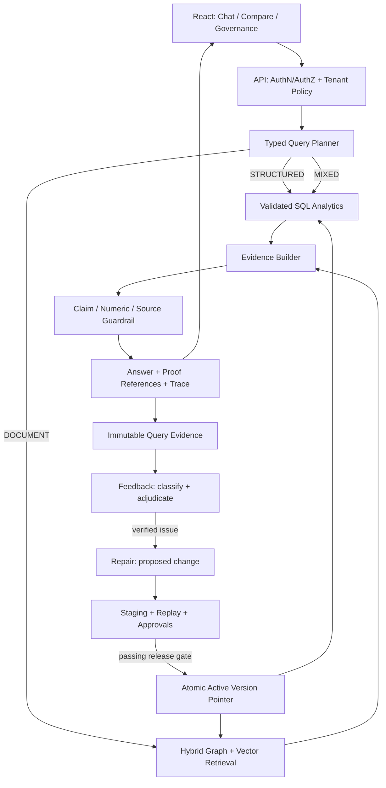

# 02 — Target Architecture and Cross-Module Contracts

## 1. CTO decision and invariant

Keep three independently bounded logical modules: **AMC Core**, **Feedback**, **Repair**. They may initially run in one FastAPI deployment with explicit interfaces; deployment into separate processes is conditional on observed scale/availability needs, not a prerequisite for correctness. The modules share **contracts and immutable identifiers**, not a mutable domain object graph.

**Key rule:** authoritative fact changes are published via a controlled version switch. A user suggestion, confidence score or proposed graph mutation is never an authoritative fact.



## 2. Responsibilities and non-responsibilities

### AMC Core
- Owns source ingestion, canonical data definitions, data lineage, authoritative query execution, hybrid document/graph retrieval, result verification, user-facing answers, and immutable query evidence.
- Does **not** accept direct fact overrides from a feedback message or repair candidate; only reads an `ACTIVE` published corpus/version/patch manifest.
- For finance: execute exact typed calculations first; use LLM only to explain results and interpret documents.

### Feedback
- Owns feedback events, user attribution, issue grouping, triage, evidence completeness, error classification, review assignments, adjudication and status communication.
- Does **not** change canonical graph, source data, vector data, regulatory interpretation or financial calculations.
- Passive feedback provides **weak signal**, not proof of dissatisfaction or correctness. Silence is `UNKNOWN`, not `SATISFIED`.

### Repair
- Owns repair proposal generation, evidence verification, conflict resolution, risk assessment, staging, review, approval, execution receipts, versioned publication and rollback.
- Does **not** use its own model confidence as a bypass of human authorization for financial/regulatory changes.
- Repair actions are typed operations (`CORRECT_SOURCE_ROW`, `FIX_ENTITY_ALIAS`, `REBUILD_INDEX`, `UPDATE_RULE_VERSION`, `CORRECT_QUERY_PLAN`, `CORRECT_PROMPT`), never unrestricted generated Cypher/SQL as default.

### Shared Assurance Harness (cross-cutting capability, not a fourth core business module)
- Defines test cases, lineage/evidence checks, security and release gates, deployment verification, shadow/canary analysis and regression reports.
- May be deployed as CI/job support and shared packages; avoid creating another 24/7 microservice until needed.

## 3. Identity, tenancy and versioning contract

```
principal_id             authenticated user ID; never from X-User-ID
role_scopes              server-issued roles and specific operation scopes
tenant_id                server-bound tenant ID, compulsory for private resources
request_id / trace_id    unique request/tracing correlation
conversation_id          user-scoped and tenant-scoped
response_id              immutable answer response identifier
source_document_id       stable document identity
source_version_id        SHA/content-version of original document
schema_version           validated CSV/Excel contract version
dataset_version          immutable published tabular snapshot
corpus_version           published document/graph/vector snapshot
source_row_id            immutable source row anchor (dataset_version + row locator)
query_plan_id            hash of normalized typed plan + dataset_version + policy_version
feedback_event_id       immutable user/system evidence signal
issue_id                 deduplicated, tenant-scoped issue
repair_proposal_id       unique repair candidate
mutation_receipt_id      verifiable committed effect and compensation reference
release_id               signed gate result for snapshot/patch promotion
```

**Isolation:** All public/internal reads and writes must verify principal access, document class, tenant and namespace. Background jobs operate using a scoped service principal; never `system_user` as an authorization bypass.

## 4. Proposed source-truth selection rules

1. **Typed financial records** for NAV/AUM/rankings/filters/counts/averages: SQL query on immutable active dataset; no LLM-derived values.
2. **Current regulatory assertion:** the active regulation/circular, amendment, effective date, jurisdiction, approved rule mapping and precise source clauses.
3. **Narrative / explanation:** graph and vector evidence, with claim-level source support. Graph may assist identity and semantic relationships, not override inconsistent base numeric rows.
4. **Conflict:** do not average conflicting values. Resolve with explicit precedence, date and version rules or return `CONFLICT_REVIEW_REQUIRED`.
5. **Unapproved patch:** visible only in admin/review console, excluded from production answer context, caches, and golden labels.

## 5. Typed query plan contract

The planner is a restricted compiler target. The LLM (if used for interpretation) proposes a structured plan; validators reject unsupported fields, operators, tables, metrics, or incompatible units. The model cannot submit SQL directly.

```json
{
  "plan_version": "1.0",
  "intent": "AGGREGATION",
  "domain": "mutual_funds",
  "dataset_version": "<active-snapshot-id>",
  "metric": "total_aaum_cr",
  "aggregation": "SUM_VALIDATED",
  "entity_level": "amc",
  "group_by": ["amc_id"],
  "filters": {"aaum_quarter": "2026-Q1", "scheme_type": "Open Ended"},
  "order_by": [{"metric":"total_aaum_cr","direction":"DESC"}],
  "limit": 5,
  "as_of": null,
  "needs_explanation": true
}
```

Plan validation enforces required time dimension, dataset-version match, tenant filters, maximum result size, safe groups, approved metric semantics, query complexity limits, and explicit null/date policy. Use enums rather than arbitrary strings. `SUM_VALIDATED` is legal **only** for a data-steward-signed additive grain.

### Intent enum
`EXACT_LOOKUP`, `STRUCTURED_FILTER`, `AGGREGATION`, `RANKING`, `COMPARISON`, `TIME_SERIES`, `DOCUMENT_QA`, `REGULATORY_INTERPRETATION`, `HYBRID_EXPLAIN`, `AMBIGUOUS`.

### Routing policy
| Intent | Required executor | Allowed secondary context | Failure action |
|---|---|---|---|
| Exact NAV/AUM/ISIN | Typed SQL | source row / scheme graph identity | no numeric generative fallback |
| Counts, rankings, distributions | Typed SQL | brief narrative only | no generative fallback |
| Regulation or SID passage | graph + vector document retrieval | versioned regulatory graph | no claim without source clause |
| Mixed financial + regulatory question | SQL + document evidence joined by canonical entity/time | LLM explanation after both validate | return partial verified facts + explicit missing portion |
| Unknown/ambiguous | request disambiguation or controlled refusal | none | abstain; never guess data filters |

## 6. Answer API contract

Retain existing endpoints during migration, but add an additive `answer_contract_version`. Keep old fields in a compatibility adapter while new UI uses structured fields.

```json
{
  "answer_contract_version": "2.0",
  "response_id": "rsp_...",
  "query": "Top 5 AMCs by Q1 AAUM?",
  "status": "VERIFIED",
  "data_status": "ACTIVE",
  "route": "STRUCTURED_AGGREGATION",
  "dataset_version": "ds_...",
  "corpus_version": "corp_...",
  "normalized_plan": {"intent":"RANKING","metric":"total_aaum_cr"},
  "answer_text": "...",
  "structured_rows": [{"amc_id":"...","total_aaum_cr":"123.45"}],
  "units": {"total_aaum_cr":"INR_CRORE"},
  "source_refs": [{"source_document_id":"...","source_version_id":"...","row_ids":["..."],"hash":"..."}],
  "proof": {"query_plan_hash":"...","result_set_hash":"...","reconciliation_status":"PASS","excluded_count":0},
  "claim_verdicts": [{"claim_id":"c1","status":"SUPPORTED","source_ref_ids":["..."]}],
  "uncertainties": [],
  "trace_id": "tr_...",
  "observed_latency_ms": 104
}
```

- Numeric values are transmitted as decimal strings or exact scaled integers; never JSON floats as financial source-of-truth.
- `status` values: `VERIFIED`, `PARTIALLY_VERIFIED`, `INSUFFICIENT_EVIDENCE`, `AMBIGUOUS_QUERY`, `STRUCTURED_SOURCE_UNAVAILABLE`, `CONFLICT_REVIEW_REQUIRED`, `UNAUTHORIZED`.
- `confidence` is **calibrated from evaluated outcomes**, not copied from the model or hardcoded. Return a verdict and explain exclusions when calibration is unavailable.
- Source anchors are row IDs / clause references; synthetic answer-text snippets are not source evidence.

## 7. Version publication / consistency

Stages: `RECEIVED → PARSED → NORMALIZED → VALIDATED → STAGED → RECONCILED → APPROVED_FOR_RELEASE → ACTIVE`. Failure transitions to `QUARANTINED` or `FAILED`. Retire prior `ACTIVE` version only after new version activation succeeds.

Graph, vectors, typed tables and metadata may not share a distributed ACID transaction. Implement staging namespaces plus a **single transactional active-version manifest pointer** with invariant checks. Readers pin the active version at query start; caches include `tenant_id`, `dataset_version`, `corpus_version`, `query_plan_hash`, `policy_version`, and `published_patch_set_version`.

On failure after staging: do **not** move active pointer. On failure after activation but before complete cache invalidation: roll back pointer and invalidate affected namespaces using versioned keys (never depend solely on blanket cache clear).

## 8. Events and interoperability

Adopt an outbox/inbox event envelope with a stable idempotency key:

```json
{
  "event_id": "evt_...",
  "event_type": "feedback.issue.adjudicated.v1",
  "schema_version": 1,
  "occurred_at": "2026-11-03T00:00:00Z",
  "tenant_id": "tenant_...",
  "aggregate_id": "issue_...",
  "aggregate_version": 7,
  "causation_id": "response_...",
  "correlation_id": "trace_...",
  "idempotency_key": "issue_...:adjudicated:7",
  "actor": {"kind":"service","id":"feedback-worker"},
  "payload": {"verdict":"CONFIRMED_ERROR","evidence_pack_id":"evidence_..."}
}
```

Suggested events: `answer.issued.v1`, `feedback.recorded.v1`, `feedback.issue.created.v1`, `feedback.issue.adjudicated.v1`, `repair.proposal.created.v1`, `repair.proposal.reviewed.v1`, `repair.release.validated.v1`, `corpus.version.activated.v1`, `repair.release.rolled_back.v1`. At-least-once transport with deduplicated consumers; no fire-and-forget server-to-server mutation without receipts.

## 9. Public vs internal API boundaries

- AMC: `/api/query`, `/api/chat`, `/api/sessions`, `/api/sources/{id}`, `/api/query-plan/preview` (limited roles), `/api/datasets/{version}/health` (operators only).
- Feedback: `/api/feedback`, `/api/feedback/mine`, `/api/feedback/issues/{id}` (authorized roles), `/api/feedback/review-queue`.
- Repair: `/api/repair/proposals`, `/api/repair/proposals/{id}/validate`, `/api/repair/proposals/{id}/approve`, `/api/repair/releases/{id}/activate`, `/api/repair/releases/{id}/rollback`. Only scoped service identities can invoke data-plane mutation APIs.
- Do not expose internal mutation services to the public network; use service authentication, policy checks and private network where available.

## 10. Practical technology selection

Keep Python/FastAPI, React, Neo4j and current FAISS during first correctness remediation. Start with **SQLite or DuckDB** as a controlled typed analytical data plane (one writer/version at a time). Decide on Postgres when multi-tenant concurrency, durable writes, HA or distributed deployment justify it. Use `Decimal`, `pydantic` and parameterized SQL / fixed query templates; prefer an established SQL query engine to inventing a full SQL parser. Existing Redis optional: caching/event transport only after secure deployment and durable event semantics are established.

A dedicated graph database is useful for provenance, supersession, scheme identity and regulatory relations, but structured NAV/AUM should remain in typed relational facts. Do not generate uncontrolled Cypher or mutate canonical facts directly from LLM-produced strings.
