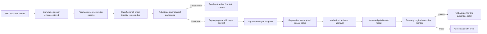

# 04 — AMC → Feedback → Repair: Lifecycle and Governance Specification

## 1. Assessment of the current three modules

The existing split is logical and valuable:
- **AMC Core:** answering, data ingestion, retrieval, synthesis, evidence and session APIs;
- **Feedback:** explicit feedback, passive signals, similarity-based issue matching, issue status and adjudication;
- **Repair:** correction extraction, draft patches, evaluations, governance review, cache/graph/vector changes.

The problem is **not the separation**. The problem is that trust boundaries, authority and state ownership are not yet uniformly enforced. In particular:

1. Feedback can be promoted from uncertain signal to a trusted correction without an independently verified source and reviewer action (`repair_integration.py` hands-free auto approval).
2. Pending corrections are inserted into retrieval context with instructions to use them (`correction_patch_layer.py`), creating a path for incorrect or malicious suggestions to contaminate future answers.
3. Multiple patch stores/adapters can disagree over whether a patch is active; the current retrieval patch merger filters by confidence, not consistently by authoritative publication status (`retrieval/orchestrator.py`).
4. Cross-database promotion status can diverge: a graph-driver-unavailable operation can still lead to an applied proposal (`promotion_service.py`).
5. Feedback issue ↔ repair task linkage is idempotent in normal read-before-write cases, but a network success followed by local commit failure risks duplicate task creation (`feedback/repair_linkage.py`).
6. Some role guards use client-supplied role headers and default to ADMIN, so approvals cannot be trusted until authorization is fixed.

## 2. End-to-end flow with trust checkpoints



There is no valid shortcut from an unverified user's correction to canonical financial or regulatory data. Only a release with proof and authorization is eligible for use in serving.

## 3. Precise state machines

### Feedback event
`RECORDED → ATTRIBUTED → CLASSIFIED → CORRELATED → ADJUDICATED`. Exceptional: `INVALID`, `INSUFFICIENT_EVIDENCE`, `DEFERRED`, `DUPLICATE`.

### Feedback issue
`OPEN → TRIAGED → IN_REVIEW → CONFIRMED_ERROR | REJECTED | NEEDS_MORE_EVIDENCE`. Confirmed path continues `REPAIR_PLANNED → REPAIR_IN_PROGRESS → VALIDATION_PENDING → RESOLVED → CLOSED`. `REOPENED` requires new evidence and version/recurrence reason. Do not mark `RESOLVED` merely because a task/patch exists.

### Repair proposal
`DRAFT → EVIDENCE_VERIFIED → STAGED → VALIDATED → APPROVAL_PENDING → APPROVED → PUBLISHING → ACTIVE → RETIRED`. Exceptional: `REJECTED`, `CONFLICTED`, `VALIDATION_FAILED`, `PUBLISH_FAILED`, `ROLLED_BACK`, `QUARANTINED`. Illegal states must fail validation (e.g. `DRAFT → ACTIVE`).

### Release attempt
`PREPARED → PRECHECK_PASS → APPLYING → RECEIPT_VERIFIED → ACTIVE → MONITORING → RETIRED`. On failure: `FAILED`, then `ROLLED_BACK` or `MANUAL_INTERVENTION_REQUIRED` if compensation is uncertain.

**Exact invariants:**
- `ACTIVE` implies all required reviewer, policy, test, source-evidence and postcondition receipts exist.
- `RESOLVED` implies original failure reproduced before fix, regression passed after fix, and affected user-visible output validated; not merely confidence threshold passed.
- Any mutation affecting source truth must reference `base_version`, `target_version`, `entity_id`, `metric_id`, `period`, `expected_old_value`, `proposed_new_value`, source evidence and deterministic precondition.
- Two conflicting proposals on the same fact cannot both be active; concurrency via optimistic version (`IF version=expected_version`) and deduplication.
- Change verification failures must not create an `ACTIVE` state through exception swallowing.

## 4. Evidence pack (Feedback input to Repair)

```json
{
  "evidence_pack_version": "2.0",
  "pack_id": "ep_...",
  "tenant_id": "...",
  "response_id": "...",
  "query_plan_hash": "...",
  "data_version": "...",
  "response_hash": "...",
  "original_user_query": "...",
  "normalized_query": "...",
  "route": "STRUCTURED_AGGREGATION",
  "source_row_ids": ["row_..."],
  "source_clauses": [],
  "claim_verdicts": [{"claim_id":"...","verdict":"UNSUPPORTED"}],
  "feedback": {"kind":"EXPLICIT","text":"...","actor_id":"..."},
  "root_cause_candidate": "METRIC_GRAIN",
  "reproducibility": {"test_case_id":"csv_rank_017","actual_hash":"...","expected_hash":"..."},
  "provenance": {"trace_id":"...","source_snapshot_hash":"..."}
}
```

**Evidence quality levels**: `COMPLETE`, `PARTIAL`, `MISSING`, `CONTRADICTORY`. `MISSING` cannot generate canonical mutation. Feedback supplied by a user is testimony; it must be corroborated against independently trusted data. Do not give a service confidence score the authority of proof.

## 5. Feedback subsystem design

### Intake
Support explicit thumbs, category checks, comments, corrected values and a “report incorrect value” form that requires identifying the claim/row/period. Passive signals should carry `signal_strength`, `source`, `confidence`, and `disclosure` separately, and never be treated as confirmed user dissatisfaction.

### Canonical issue identity
Deduplicate on `tenant_id + normalized_intent + canonical_entity_ids + metric_id + data_period + dataset_version + source_claim_id + failure_class`. Use semantic matching as a candidate generator only. If concrete entities/periods differ, do not merge solely because embeddings are similar.

### Adjudication
1. Verify user/tenant and response ownership.
2. Resolve evidence pack from immutable response ID.
3. Classify claim type, metric, source and risk.
4. Reproduce answer against original exact dataset/corpus versions.
5. Compare with independent ground truth or reviewed sources.
6. Determine `VALID_FEEDBACK`, `INVALID_FEEDBACK`, `SOURCE_CONFLICT`, `OUTDATED_SOURCE`, or `INSUFFICIENT_EVIDENCE`.
7. Only confirmed, reproducible issues may request repair creation.

### Queue, assignment and audit
Operators see reported issue, impact, affected dataset versions, similar incidents, evidence completeness and current state. Require actor ID and reason for transitions. Prioritize compliance-critical/numeric errors over stylistic complaints. Use SLA timers and notify owners; no hard-coded default reviewer identity.

## 6. Repair classification and target selection

| Root cause | Correct repair target | Invalid shortcut to avoid |
|---|---|---|
| Wrong source value | Steward-approved source correction / replacement snapshot | Append synthetic high-confidence vector note |
| Wrong CSV grain/formula | Metric registry + query compiler + tests | Prompt instruction to “use correct number” |
| Missing row/incomplete ingest | Re-ingest and reconcile snapshot | Manually patch an isolated graph node |
| Entity mismatch | Versioned canonical alias / identity map | Global string replacement |
| Bad regex intent | Query planner/router + regression cases | Rewrite final answer only |
| Wrong regulatory effective date | Versioned rule/document supersession | Overwrite current graph fact without date context |
| Citation mismatch | Evidence assembler / claim verifier | Append source marker at end |
| Hallucinated explanation | Synthesis prompt/guardrail/evaluation | Change numeric source |
| Unauthorized access | Security policy and principal binding | Feedback repair text |
| Cache staleness | Dataset-versioned cache key / invalidation | Global cache clear without proof |

This prevents the repair module from becoming an additional source of data drift.

## 7. Patch proposal schema and safety policy

```json
{
  "repair_proposal_id":"rp_...",
  "tenant_id":"...",
  "issue_id":"...",
  "root_cause":"METRIC_GRAIN",
  "target_component":"tabular.metric_registry",
  "repair_type":"UPDATE_FORMULA",
  "base_version":"v123",
  "expected_hash":"...",
  "proposed_change":{"metric_id":"amc_aum_cr","implementation_ref":"PR#..."},
  "source_evidence_refs":["..."],
  "risk":"HIGH",
  "validation_suite_ids":["csv-finance-gold","tenant-isolation"],
  "approval_policy":"FINANCE_FOUR_EYES",
  "status":"APPROVAL_PENDING"
}
```

For the first production hardening release, define `AUTO_PROMOTE_FINANCIAL_FACTS=false`, `AUTO_PROMOTE_REGULATORY_RULES=false`, and `SERVE_PENDING_PATCHES=false` as enforced server-side policies, not merely UI toggles. As a conservative default, **all canonical-data-changing proposals require authenticated human approval**. A future auto-approval policy may be introduced only for strictly non-authoritative low-risk metadata, never by a raw model confidence threshold.

## 8. Promotion transaction pattern

No single ACID transaction spans SQLite + Neo4j + FAISS + Redis. Use a **versioned release saga**, not cross-system optimistic assumptions:

1. Lock base snapshot pointer with optimistic version.
2. Stage a new typed dataset or graph namespace and index bundle (copy-on-write); validate exact diff.
3. Run targeted + broad golden suite and tenant/security regression.
4. Collect preconditions, signatures, risk and reviewer authorizations.
5. Persist `PREPARED` release plus transactional outbox event.
6. Apply the stage in deterministic order with idempotency key; collect receipts from each required system.
7. Verify postconditions by reading back data; required failure means do not change active pointer.
8. Atomically switch authoritative active manifest pointer.
9. Invalidate/version-key caches and publish activation event; requery original failure.
10. Monitor canary; on regression, atomically restore old pointer; quarantine proposed version; emit rollback receipt.

**Exactly-once effect** comes from idempotency and transactional state transitions, not assumed exactly-once delivery from HTTP or queue. Retry events safely across process restarts.

## 9. Serving patch rules (hard boundary)

- **Forbidden:** retrieving pending or merely model-proposed patches and prepending “use this corrected value” to LLM context.
- **Permitted:** `ACTIVE` patch with signed/recorded approval and target version matching pinned query snapshot; optionally show data freshness and supersession provenance.
- **For review UI only:** display draft patch in an isolated panel labeled “unverified, not live”, with original/candidate diff and evidence links.
- **No imperative source content:** any untrusted document, user feedback, search snippet or patch is **data**, never system instruction. Prompt-injection tests should include malicious feedback requesting privileged changes.
- **Correction precedence:** authenticated effective-dated source publication > approved dataset/version mapping > LLM explanation. A patch cannot override a more recent authoritative publication without explicit supersession review.

## 10. User-facing review/audit experience

Recommended operator workflow: issue list → issue evidence → reproduce original output → propose targeted fix → view impact analysis and diff → run assurance suite → approve/reject with comments → show activation receipt → monitor affected queries → close or reopen. Each page should expose exact source data/version and an audit-friendly timeline.

Feedback submission should return acknowledgement and status, not imply instant truth repair. Acknowledge the user's report, show `UNDER_REVIEW` or `REPAIR_PENDING`, and only assert correction after release activation.

## 11. Cross-module integration tests

Mandatory full workflows:
1. Incorrect NAV with exact source evidence → confirmed issue → corrected dataset → approved release → correct NAV response.
2. User-proposed incorrect NAV → disproven by source → feedback rejected; no patch or cache pollution.
3. Malicious “approve yourself” feedback → no role elevation, no serving instruction injection.
4. Duplicate feedback concurrently → one issue and one repair task with idempotency key.
5. Repair HTTP success followed by Feedback DB failure → reconciliation reuses existing remote task.
6. Neo4j unavailable during publish → no applied status, old active version stays live.
7. Redis/cache stale after publish → versioned cache key prevents stale answer.
8. Patch approved for one dataset/tenant, query another → not applied.
9. New regulation supersedes old → older context is excluded or temporally qualified.
10. Repair fixes original query but breaks 20 related questions → release gate blocks or rolls back.
11. Ingestion validation fails after partial graph write → staging quarantined; not published.
12. Passive timeout with no explicit correction → unknown satisfaction; no auto mutation.

## 12. Code migration touchpoints

- `backend/app/retrieval/orchestrator.py`: remove confidence-only patch overlay; read only active version-approved patch manifest.
- `backend/app/graph/correction_patch_layer.py`: remove imperative LLM instructions for pending corrections; replace with typed advisory/approved read models.
- `backend/app/services/repair_integration.py`: disable hands-free canonical promotion and synthetic patch chunk injection from pending claims; use proposal events.
- `backend/app/services/promotion_service.py`: fail closed on missing graph driver and prove commit effects before applied state.
- `backend/app/feedback/repair_linkage.py`: outbox-based remote task creation, retry and reconciliation.
- `backend/app/evaluation/batch_consumer.py` and `evaluation_router.py`: require complete immutable evidence and outcome taxonomy.
- `packages/amc-feedback-loop/` and `packages/amc-repair-engine/`: standardize contract versions, persistence ownership, idempotency, service auth and audit receipts.
- `backend/app/api/routes/governance.py`: bind authenticated actor, policy and approval to every transition; segregate draft review from active publication.

## 13. Done criteria

No unapproved correction can influence any user answer; no correction is published based solely on a model score; all accepted source-affecting repairs are versioned, authorized, replay-tested and reversible; all cross-service retries preserve idempotence; audit evidence can reconstruct who proposed, verified, approved, published, and rolled back each change.
