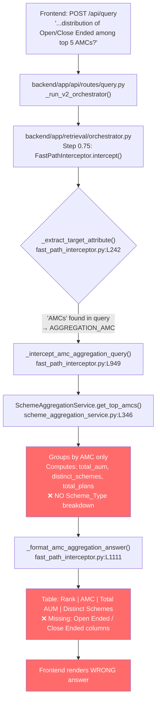

# End-to-End Query Trace & Bug Report

**Query:** _"What is the distribution of Open Ended vs. Close Ended schemes among the top 5 largest AMCs?"_

---

## Step 1 — Frontend: Query Submission

**File:** [`mf-context-engine/src/services/api.js`](file:///c:/Users/HemantMore/OneDrive%20-%20NuSummit%20Technologies%20Pvt%20Ltd/Desktop/amc-context-engineering-clean/mf-context-engine/src/services/api.js#L395-L406)

The frontend's `sendQuery()` function fires a **POST /api/query** with the body:

```json
{
  "query": "What is the distribution of Open Ended vs. Close Ended schemes among the top 5 largest AMCs?",
  "mode": "both",
  "top_k": 8
}
```

The raw backend response is adapted via `adaptHybridResponse()` and rendered in the UI.

---

## Step 2 — Backend API: Route Entry

**File:** [`backend/app/api/routes/query.py`](file:///c:/Users/HemantMore/OneDrive%20-%20NuSummit%20Technologies%20Pvt%20Ltd/Desktop/amc-context-engineering-clean/backend/app/api/routes/query.py)

The `POST /query` endpoint detects `query_engine = "v2"` and calls `_run_v2_orchestrator()`, which delegates to:

```python
resp_obj = await container.orchestrator.answer(query, top_k=..., ...)
```

---

## Step 3 — Orchestrator: Fast-Path Interception

**File:** [`backend/app/retrieval/orchestrator.py`](file:///c:/Users/HemantMore/OneDrive%20-%20NuSummit%20Technologies%20Pvt%20Ltd/Desktop/amc-context-engineering-clean/backend/app/retrieval/orchestrator.py#L756-L796)

At **Step 0.75**, the orchestrator tries the `FastPathInterceptor` before any LLM call:

```python
fast_path = get_fast_path_interceptor(self._repair_client)
fast_resp = await fast_path.intercept(query=effective_query, ...)
if fast_resp:
    return fast_resp   # ← Short-circuits the entire pipeline
```

---

## Step 4 — Fast-Path Interceptor: Route Classification

**File:** [`backend/app/retrieval/fast_path_interceptor.py`](file:///c:/Users/HemantMore/OneDrive%20-%20NuSummit%20Technologies%20Pvt%20Ltd/Desktop/amc-context-engineering-clean/backend/app/retrieval/fast_path_interceptor.py#L230-L264)

`_extract_target_attribute()` evaluates the query against each route in order:

| Check | Method | Result |
|---|---|---|
| Dataset summary? | `_is_dataset_summary_query()` | ❌ No — has "top" keyword |
| Category breakdown? | `_is_category_aggregation_query()` | ❌ No — no category term ("categor", "asset class") |
| **AMC aggregation?** | `_is_amc_aggregation_query()` | ✅ **YES** |
| NAV query? | `_is_nav_aggregation_query()` | Not reached |

**Why `_is_amc_aggregation_query()` returns `True`:**
- `has_amc_ref = True` — "AMCs" appears in the query
- The AMC ranking regex fires: `\b(?:top)\s+(\d+\s+)?(?:amcs?)\b` matches **"top 5 largest AMCs"**

➡️ **`target_attr = "AGGREGATION_AMC"` → routes to `_intercept_amc_aggregation_query()`**

---

## Step 5 — AMC Aggregation Interceptor

**File:** [`backend/app/retrieval/fast_path_interceptor.py`](file:///c:/Users/HemantMore/OneDrive%20-%20NuSummit%20Technologies%20Pvt%20Ltd/Desktop/amc-context-engineering-clean/backend/app/retrieval/fast_path_interceptor.py#L949-L1014)

The interceptor extracts `limit=5` from the query and calls:

```python
service.get_top_amcs(limit=5, sort_by="total_aum")
```

---

## Step 6 — Service Layer: `get_top_amcs()`

**File:** [`backend/app/services/scheme_aggregation_service.py`](file:///c:/Users/HemantMore/OneDrive%20-%20NuSummit%20Technologies%20Pvt%20Ltd/Desktop/amc-context-engineering-clean/backend/app/services/scheme_aggregation_service.py#L346-L430)

`get_top_amcs()` groups by `AMC` and aggregates:
- `total_aum_cr` (sum of AUM)
- `distinct_schemes` (unique scheme names)
- `total_plans` (row count)

> [!CAUTION]
> **This method has NO `scheme_type` breakdown.** It only returns total counts and AUM per AMC. The `Scheme_Type` column (`Open Ended` / `Close Ended` / `Interval Fund`) is **never consulted**.

---

## Step 7 — Response Formatting

**File:** [`backend/app/retrieval/fast_path_interceptor.py`](file:///c:/Users/HemantMore/OneDrive%20-%20NuSummit%20Technologies%20Pvt%20Ltd/Desktop/amc-context-engineering-clean/backend/app/retrieval/fast_path_interceptor.py#L1111-L1139)

`_format_amc_aggregation_answer()` produces a table with only these columns:

```
| Rank | AMC | Total AUM (₹ Cr) | Distinct Schemes | Total Plans | Average Plan AUM (₹ Cr) |
```

**No Open Ended / Close Ended column exists.** The response completely ignores the scheme type distribution that the user actually asked for.

---

## 🐛 Root Cause: The Bug

> [!CAUTION]
> ### Bug: Missing Scheme-Type Distribution in AMC Aggregation
>
> **Location:** `SchemeAggregationService.get_top_amcs()` → `FastPathInterceptor._intercept_amc_aggregation_query()` → `_format_amc_aggregation_answer()`
>
> **Problem:** When the query contains both "AMC" and "distribution / Open Ended / Close Ended", the pipeline routes to `AGGREGATION_AMC`, which calls `get_top_amcs()`. That method **does not compute or expose** any per-`Scheme_Type` breakdown. The formatted answer table shows only Total AUM and count columns — it **completely omits the Open/Close Ended distribution** that the user asked for.

---

## Ground Truth: What the Correct Answer Should Be

Computed directly from `mutual_fund_data.csv` (source of truth):

**Top 5 AMCs by Total AUM** (Jan–Mar 2026):

| Rank | AMC | Total AUM (₹ Cr) | Open Ended | Close Ended | Interval Fund |
|------|-----|------------------|------------|-------------|---------------|
| 1 | SBI Funds Management Limited | 12,60,906 | **109 (76.8%)** | 33 (23.2%) | — |
| 2 | ICICI Prudential Asset Management Company Limited | 11,55,055 | **185 (24.5%)** | 565 (74.7%) | 6 (0.8%) |
| 3 | HDFC Asset Management Company Limited | 9,52,360 | **104 (69.8%)** | 45 (30.2%) | — |
| 4 | Nippon Life India Asset Management Limited | 7,35,779 | **114 (21.9%)** | 399 (76.7%) | 7 (1.3%) |
| 5 | Kotak Mahindra Asset Management Company Limited | 5,95,360 | **122 (39.2%)** | 185 (59.5%) | 4 (1.3%) |

> [!NOTE]
> Counts are **distinct scheme names** (not plan-level row counts). E.g. ICICI has 565 distinct Close Ended scheme names and 185 distinct Open Ended scheme names.

---

## What the System Currently Returns (Wrong Answer)

```
# Asset Management Companies (AMCs) by Total AUM

| Rank | AMC | Total AUM (₹ Cr) | Distinct Schemes | Total Plans | Average Plan AUM (₹ Cr) |
|------|-----|------------------|------------------|-------------|-------------------------|
| 1 | SBI Funds Management Limited | ₹12,60,906.03 | 127 | 540 | ₹2,334.09 |
| 2 | ICICI Prudential Asset Management... | ₹11,55,054.64 | 150 | 3,320 | ₹347.91 |
...
```

**No Open/Close Ended breakdown at all** — the answer is factually wrong for the actual query asked.

---

## Full Pipeline Flow Diagram



---

## Bugs Found (Summary)

| # | Bug | File | Line(s) | Severity |
|---|-----|------|---------|----------|
| **1** | `get_top_amcs()` has no `scheme_type` breakdown parameter or output | [`scheme_aggregation_service.py`](file:///c:/Users/HemantMore/OneDrive%20-%20NuSummit%20Technologies%20Pvt%20Ltd/Desktop/amc-context-engineering-clean/backend/app/services/scheme_aggregation_service.py#L346) | L346–L430 | 🔴 Critical |
| **2** | `_intercept_amc_aggregation_query()` doesn't detect "distribution / Open Ended / Close Ended" intent and doesn't call scheme-type breakdown | [`fast_path_interceptor.py`](file:///c:/Users/HemantMore/OneDrive%20-%20NuSummit%20Technologies%20Pvt%20Ltd/Desktop/amc-context-engineering-clean/backend/app/retrieval/fast_path_interceptor.py#L949) | L949–L1014 | 🔴 Critical |
| **3** | `_format_amc_aggregation_answer()` has no Open/Close Ended columns even if data were available | [`fast_path_interceptor.py`](file:///c:/Users/HemantMore/OneDrive%20-%20NuSummit%20Technologies%20Pvt%20Ltd/Desktop/amc-context-engineering-clean/backend/app/retrieval/fast_path_interceptor.py#L1111) | L1111–L1139 | 🔴 Critical |
| **4** | `_enforce_aggregation_guardrail()` in orchestrator has no AMC+scheme-type branch — guardrail won't catch this specific mismatch either | [`orchestrator.py`](file:///c:/Users/HemantMore/OneDrive%20-%20NuSummit%20Technologies%20Pvt%20Ltd/Desktop/amc-context-engineering-clean/backend/app/retrieval/orchestrator.py#L551) | L551–L645 | 🟡 Medium |

---

## Fix Plan

### Fix 1 — `scheme_aggregation_service.py`: Add `get_scheme_type_distribution_by_amc()`

Add a new method that groups by `(AMC, Scheme_Type)` and computes distinct scheme counts:

```python
def get_scheme_type_distribution_by_amc(
    self, limit: int = 5, sort_by: str = "total_aum"
) -> dict:
    """For each of the top N AMCs, return Open/Close/Interval Ended scheme counts."""
    df = self.df_full if self.df_full is not None else self.df
    # Top N AMCs by total AUM
    top_amcs = (
        df.dropna(subset=["Average_AUM_Cr"])
          .groupby("AMC")["Average_AUM_Cr"]
          .sum()
          .sort_values(ascending=False)
          .head(limit)
          .index.tolist()
    )
    results = []
    for rank, amc in enumerate(top_amcs, 1):
        subset = df[df["AMC"] == amc]
        total_aum = float(subset["Average_AUM_Cr"].dropna().sum())
        type_breakdown = (
            subset.groupby("Scheme_Type")["Scheme_Name"]
                  .nunique()
                  .to_dict()
        )
        total_distinct = sum(type_breakdown.values())
        results.append({
            "rank": rank,
            "amc": amc,
            "total_aum_cr": round(total_aum, 2),
            "total_distinct_schemes": total_distinct,
            "scheme_type_breakdown": {
                k: {"count": v, "pct": round(v / total_distinct * 100, 1)}
                for k, v in type_breakdown.items()
            },
        })
    return results
```

### Fix 2 — `fast_path_interceptor.py`: Detect scheme-type distribution queries

In `_is_amc_aggregation_query()`, check for "distribution" + scheme-type terms and route to a new handler `_intercept_amc_scheme_type_distribution_query()` that calls the new service method above and formats a table with `Open Ended | Close Ended | Interval` columns.

### Fix 3 — `fast_path_interceptor.py`: Update `_format_amc_aggregation_answer()`

When `scheme_type_breakdown` data is available, generate the full table:

```
| Rank | AMC | Total AUM (₹ Cr) | Open Ended | Close Ended | Interval Fund |
```

---

## Quick Verification (Ground Truth from CSV)

Run this in the backend venv to verify the correct numbers:

```python
import pandas as pd
df = pd.read_csv("data/source_docs/mutual_fund_data.csv")
df["Average_AUM_Cr"] = pd.to_numeric(df["Average_AUM_Cr"], errors="coerce")
top5 = (df.dropna(subset=["Average_AUM_Cr"])
          .groupby("AMC")["Average_AUM_Cr"].sum()
          .sort_values(ascending=False).head(5).index.tolist())
for amc in top5:
    sub = df[df["AMC"] == amc]
    print(amc)
    for t, c in sub.groupby("Scheme_Type")["Scheme_Name"].nunique().items():
        print(f"  {t}: {c}")
```
