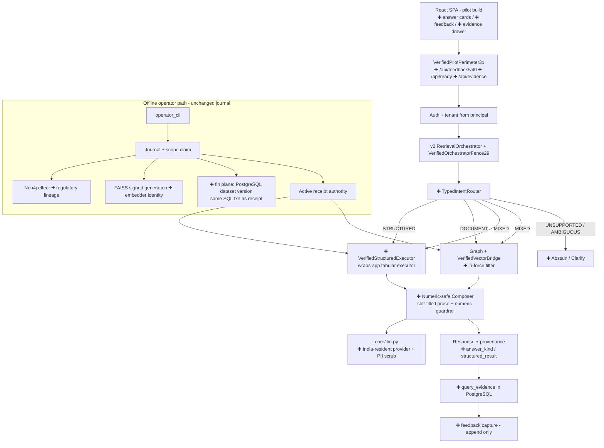

# AMC Wave 4.0 — Enhancement Technical Design Specification (TDS-40 v1)

| | |
|---|---|
| **Status** | DRAFT for architecture, product and compliance review. No implementation started. |
| **Basis** | Branch `amc-dev-wave31-integration` at `bf9adb7`; TDS-31 ([MVP_TECHNICAL_DESIGN_SPEC_V1.md](../wave3_1/MVP_TECHNICAL_DESIGN_SPEC_V1.md)); Spec 03 ([CSV/Excel correctness](../../Docs/AMC_Tasks_3_11_26/AMC_Specs/03_CSV_EXCEL_FINANCIAL_CORRECTNESS_SPEC.md)); [LOCAL_VALIDATION_SUMMARY.md](../wave3_1/LOCAL_VALIDATION_SUMMARY.md) |
| **Companion** | [AMC_WAVE4_GOAL_PLAN_V1.md](AMC_WAVE4_GOAL_PLAN_V1.md) (goals, milestones, gates) and [WAVE4_TASKS.csv](WAVE4_TASKS.csv) (task tracker) |
| **Architecture rule** | **Additive only.** No component is replaced, no store is removed, no trust boundary is weakened (§1.2). |

---

## 1. Purpose, scope and the architecture invariant

### 1.1 Purpose

Wave 3.1 built a trustworthy *serving* foundation: verified publication, Ed25519-signed FAISS generations, two-person approvals, a default-deny perimeter and tested tenant isolation. What it does not yet do is produce **business value an AMC user can rely on**:

1. In `AMC_VERIFIED_SERVING_MODE=enforce` the structured fast path and the cache are disabled ([orchestrator.py:813](../../backend/app/retrieval/orchestrator.py)). So the questions AMC staff ask most often (NAV, AAUM, rankings, category distribution) go to the LLM over text chunks, or are not answered at all.
2. Answer quality has never been measured with a real model or real embeddings.
3. The pilot has no regulatory-currency model (which circular is in force), no way for users to give feedback, no readiness signal, and the LLM provider is hosted outside India.

Wave 4.0 closes these gaps **inside the existing architecture**.

### 1.2 What stays fixed (architecture invariant)

| Element | Stays as is | Wave 4 may only… |
|---|---|---|
| FastAPI modular monolith (`app.main:create_app`) with AMC Core / Feedback / Repair as logical modules | Yes | add routes behind the perimeter with an ADR each |
| React + Vite SPA (`mf-context-engine`), pilot build flag `VITE_AMC_PILOT_MODE` | Yes | add components; no framework change |
| PostgreSQL as system of record and publication journal (ADR31-02) | Yes | add tables via Alembic `016+` |
| Neo4j graph as external effect with compensation (ADR31-03) | Yes | add labels/edges for regulatory lineage |
| FAISS signed immutable generations (ADR31-04) | Yes | add signed manifest fields (embedder identity) |
| Publication journal, scope claim, active receipt authority (`amc_publication`) | Yes | add a third plane (`fin`) using the same journal |
| Two-person Ed25519 approvals (ADR31-10), operator CLI as only publish path | Yes | reuse for metric-registry and dataset approvals |
| `VerifiedPilotPerimeter31` exact allowlist (ADR31-05) | Yes | add at most 3 reviewed routes (§5.4) |
| v2 query engine, `VerifiedOrchestratorFence29`, `VerifiedVectorBridge` | Yes | add a verified structured executor next to them |
| "Feedback never becomes fact" rule (Blueprint 02 §1) | Yes | capture feedback append-only; never apply it online |

Every enhancement ships behind a feature flag that is **off by default**. With every flag off, Wave 3.1 behaviour does not change. Off-mode (legacy) behaviour does not change either.

### 1.3 In scope

| ID | Enhancement | Priority |
|---|---|---|
| E1 | Verified structured data plane (`fin` publication plane on PostgreSQL) | P0 |
| E2 | Canonical fund master and steward-signed metric registry | P0 |
| E3 | Typed intent routing, numeric-safe answer composition, clarification and abstention | P0 |
| E4 | Regulatory corpus with currency and supersession lineage | P1 |
| E5 | Answer-quality evaluation harness and gold sets (release gate) | P0 |
| E6 | India-resident model provider, embedder identity binding, outbound PII control | P0 |
| E7 | Pilot-safe feedback capture (append-only, no online repair) | P1 |
| E8 | Receipt-bound evidence viewer (excerpt, never raw file) | P2 |
| E9 | Readiness, audit-grade query evidence, observability, operator runbooks | P0 |
| E10 | Codebase health without re-architecture (green suite, facades, hygiene) | P0 |
| E11 | Pilot persona UX and automated browser qualification | P1 |
| E12 | Staging environment and security assurance on the same topology | P0 |

### 1.4 Non-goals (Wave 4)

These are out of scope for Wave 4:
- self-service ingestion or upload over HTTP
- automatic repair or patch promotion
- graph auto-repair
- multi-tenant SaaS operation
- microservice split
- GNN plausibility in the serving path
- investor-facing (external) answers
- replacing Neo4j, FAISS or PostgreSQL

### 1.5 Pilot persona and use cases (proposed, needs product sign-off: D1)

**Persona:** an internal *Compliance and Investment-Operations analyst* at the AMC. Internal-only use keeps the pilot outside investment advice and the investor-communication / advertisement obligations (confirm with Compliance: D9).

| UC | User question pattern | Path | Must return |
|---|---|---|---|
| UC1 | "NAV of <scheme / plan / option> on <date>" | STRUCTURED | Exact value, unit, date, dataset version, row anchor |
| UC2 | "Top N AMCs / categories by AAUM for <quarter>" | STRUCTURED | Exact ranking from signed metric, filters echoed, exclusions counted |
| UC3 | "What does SEBI require for <topic>?" | DOCUMENT | Grounded answer citing circular number, date and clause; in-force status |
| UC4 | "Scheme X facts and the regulation that applies" | MIXED | Structured facts + regulatory evidence; the LLM writes connecting prose only |
| UC5 | Ambiguous or unsupported question | ABSTAIN / CLARIFY | Typed abstention code or one clarification turn; never a guess |
| UC6 | "This answer is wrong / helpful" | FEEDBACK | Append-only record bound to the request evidence |

---

## 2. Baseline (what exists today and is reused)

| Capability | Existing asset | Gap Wave 4 closes |
|---|---|---|
| Typed tabular planner/executor | `backend/app/tabular/{contracts,planner,executor,repository,csv_excel_loader}.py` (2.6k lines, Spec 03 partial) | Runs on `sqlite3`; not published through the journal; not reachable in enforce mode |
| Legacy aggregation | `services/scheme_aggregation_service.py`, `retrieval/fast_path_interceptor.py` | Float sums over `Scheme_Name`; hardcoded period/completeness; falls back to the LLM on error ([fast_path_interceptor.py:596](../../backend/app/retrieval/fast_path_interceptor.py)); synthetic `page=1` citations |
| Aggregation guardrail | `RetrievalOrchestrator._enforce_aggregation_guardrail` | Substring match of the top name; rewrites with a hardcoded "Open-Ended Equity Growth" header |
| Publication authority | `amc_publication/active_authority28.py` (per `tenant, namespace`), `journal.py`, `worker.py`, `operator_cli.py`, `signing31.py`, `approvals31.py` | Covers graph + FAISS only |
| Query evidence | `retrieval/query_evidence_recorder.py` (JSON files on disk) | Not in PostgreSQL; not queryable for audit or feedback binding |
| LLM client | `core/llm.py` (Groq primary, OpenAI/Gemini fallback) | No India-resident provider; fallback chain can cross jurisdictions silently |
| Embeddings | `engine/faiss_store.py` (SentenceTransformer + CrossEncoder), operator CLI `AMC_PUBLICATION_EMBEDDER` | Embedder identity not bound into the signed generation manifest |
| Regulatory ingest | `engine/sebi_feed_ingester.py`, `engine/regulatory_lifecycle_enricher.py`, `engine/staleness_monitor.py` | Not connected to verified publication; no in-force semantics in retrieval |
| Feedback | `api/routes/feedback.py`, `app/feedback/*`, `packages/*` | Denied in the pilot (correctly); no safe capture path |
| Health | `/health`, `/api/health` (liveness only) | No readiness (finding 8) |
| Frontend | 35 node tests, pilot build, one manual walkthrough | No automated browser test; generic prompts (finding 5) |

---

## 3. Target view (existing components unchanged; additions marked ✚)



---

## 4. Enhancement designs

Each enhancement lists: objective, design, contracts, data, failure semantics, security, acceptance criteria and tests. "MUST" items are gate-blocking.

### E1 — Verified structured data plane (`fin`)

**Objective.** Serve UC1/UC2 in enforce mode from a typed, versioned, signed and approved dataset, under the same authority model as FAISS and Neo4j.

**Design.**

1. **Storage.** Port `app/tabular/repository.py` from `sqlite3` to SQLAlchemy on the existing PostgreSQL engine (`core/db_runtime31.resolve_database_url`). Keep a thin SQLite adapter for off-mode development only. Schema in §4.1 below (migration `016`).
2. **Ingestion stays offline.** `scripts/run_tabular_ingestion.py` becomes `python -m amc_publication.operator_cli fin-stage`. The steps follow Spec 03 §5: stream, validate, anchor and reconcile, and the dataset is staged with status `STAGED`. Staging writes only `fin_*` rows tagged with a new `dataset_version`. It never touches the active pointer.
3. **Publication as a third plane in the existing journal.** A publication work item may carry a `fin` effect next to the `graph` and `faiss` effects. Because `fin_*` lives in the **same PostgreSQL database** as the receipt authority, `fin` activation runs **in the same SQL transaction** as `RECEIPT_COMMITTED/ACTIVE`. That transaction updates `fin_active_dataset` together with the receipt row, so `fin` activation is truly atomic and needs no compensation. TDS-31 §3.2 states: "PostgreSQL transaction can atomically commit SQL receipt + ACTIVE authority". Wave 4 extends that set with `fin_active_dataset`.
4. **Signing.** The reconciliation report becomes `fin_manifest.json`. It contains:
   - `tenant`, `dataset_version` and `source_sha256`
   - `expected_rows`, `parsed_rows`, `valid_rows` and `rejected_rows`
   - `metric_registry_version`
   - `content_sha256` (an ordered hash over the canonical observation rows)
   
   It is signed with the existing `GenerationSigner` format (`signing31.py`) under a new message field `kind:"fin"`. Serving verifies it with `GenerationVerifier` at pin time.
5. **Approval.** Activation needs a two-person `approvals31` record. The subject is `make_subject(tenant, entity="fin_dataset", attribute="activate", value=dataset_version, proposal_id=work_id, revision=n, corpus=[manifest])`. The worker re-verifies it before the effect, as it does today.
6. **Serving.** `VerifiedStructuredExecutor` (new module `amc_publication/structured_serving40.py`):
   - resolves the tenant's active receipt through `active_authority28`
   - reads the `fin` dataset version bound to that receipt
   - re-verifies the signed manifest digest (cached per generation, invalidated on receipt change)
   - injects `tenant_id` and `dataset_version` into every `app.tabular.executor` query **in the data-access layer**, never from the planner
   - re-checks authority after execution, before the response is released (the same pattern as `VerifiedOrchestratorFence29`)
7. **Legacy containment.** `fast_path_interceptor.py` and `scheme_aggregation_service.py` stay for off-mode only. In enforce mode they remain unreachable, and the regression test in `test_verified_legacy_route_gates31.py` is extended to prove this.

**Failure semantics (MUST).** Any error in pin, verify, plan or execute returns `answer_kind=ABSTAIN` with one of these codes:
- `STRUCTURED_SOURCE_UNAVAILABLE`
- `INCOMPATIBLE_PERIODS`
- `UNSUPPORTED_METRIC`
- `AMBIGUOUS_QUERY`
- `NO_MATCH`

The orchestrator must **never** route a STRUCTURED intent to vector + LLM after such an error.

**Acceptance.**
- `fin` activation and receipt commit are one SQL transaction. A crash injected at each of the 4 new failpoints leaves either the old or the new pair active, never a mix.
- A tampered `fin_manifest.json`, a mismatched digest, a revoked key or a missing approval each causes a denial.
- `tenant_beta` can never read `tenant_alpha` rows. This is tested at the repository layer *and* over HTTP.
- With PostgreSQL down, a structured question abstains within 3 s (the same bound as G6).

**Tests.** New `backend/tests/live40/test_fin_plane40.py` covers publication, crash, rollback, tamper, tenant and outage. Unit tests run against both the SQLite (off-mode) and PostgreSQL adapters.

#### 4.1 Migration `016_fin_structured_plane_v40` (PostgreSQL)

The table shapes come from Spec 03 §4, with production types:

| Table | Key columns | Notes |
|---|---|---|
| `fin_dataset_version` | `dataset_version` PK, `tenant_id`, `source_sha256`, `expected_rows`, `parsed_rows`, `valid_rows`, `rejected_rows`, `metric_registry_version`, `manifest_sha256`, `status` CHECK(...), `created_at` | Status enum as in Spec 03 |
| `fin_source_row` | `source_row_id` PK, `dataset_version` FK, `physical_row_number`, `raw_row_sha256`, `raw_json JSONB`, `validation_status`, `rejection_reason` | UNIQUE(`dataset_version`, `source_filename`, `physical_row_number`) |
| `fin_amc` / `fin_scheme` / `fin_plan_option` / `fin_isin` | canonical IDs, `amfi_scheme_code`, `plan` (DIRECT/REGULAR), `option` (GROWTH/IDCW_PAYOUT/IDCW_REINVEST/…), `isin` | Versioned by `dataset_version`; see E2 |
| `fin_entity_alias` | `alias_norm`, `entity_type`, `entity_id`, `source`, `approved_by_record` | Drives resolution; ambiguity is explicit |
| `fin_nav_observation` | `observation_id` PK, `plan_option_id`, `nav_date DATE`, `nav NUMERIC(20,6)`, `unit` | No SUM allowed (registry) |
| `fin_aaum_observation` | `observation_id` PK, `scheme_id`, `plan_option_id NULL`, `quarter` (`YYYYQn`), `aaum_cr NUMERIC(24,6)`, `grain` ENUM(`SCHEME`,`PLAN_OPTION`), `valid_for_aggregation BOOL` | `grain` prevents the double-count risk (E2) |
| `fin_metric_definition` | `metric_id`, `registry_version`, `definition JSONB`, `approval_record JSONB` | Signed by the steward (E2) |
| `fin_active_dataset` | PK(`tenant_id`, `domain`), `dataset_version`, `receipt_id` FK | Changed only in the receipt transaction |

All `fin_*` tables carry `tenant_id NOT NULL` and an index on (`tenant_id`, `dataset_version`). The required head becomes `019` once E4/E7/E9 land. `db_runtime31.verify_migrated_postgresql`, the gate id and ADR31-09 are updated together, as ADR31-09 requires.

---

### E2 — Canonical fund master and steward-signed metric registry

**Objective.** Make every number traceable to an identity and a definition that a named business owner approved.

**Design.**

1. **Identity hierarchy.** AMC → Scheme (AMFI scheme code) → Plan (Direct/Regular) → Option (Growth / IDCW payout / IDCW reinvestment) → ISIN(s). Derive plan/option from `Scheme_NAV_Name` and the ISIN columns using a **reviewed rule table** (`fin_plan_option_rules`, versioned). An unmapped row goes to `QUARANTINED`; the system never guesses.
2. **Observed source issues to resolve with the steward before activation (MUST):**

   | # | Observation (chunk 001 sample) | Default until decided |
   |---|---|---|
   | O1 | `Latest_NAV_Date = 2026-06-29` with `AAUM_Quarter = January - March 2026` in the same row | NAV and AAUM are separate observations with separate as-of dates; answers show both |
   | O2 | `Closure_Date == Launch_Date` | `closure_date` is not used to derive active status; "inactive scheme" questions return `UNSUPPORTED_METRIC` |
   | O3 | AAUM may repeat on each plan/option row of a scheme | `grain` is recorded per row; SUM is allowed only across rows of one approved grain within one quarter |
   | O4 | AMC naming variants | Alias table with an approval record; ambiguity yields `AMBIGUOUS_QUERY` |
   | O5 | Dataset coverage (industry-complete or not) | Results are labelled "dataset-derived" until coverage is attested |

3. **Metric registry.** `fin_metric_definition` rows (`nav_per_unit`, `aaum_cr`, `amc_aaum_cr`, `distinct_scheme_count`, `plan_variant_count`, `category_share_pct`, `avg_scheme_aaum_cr`) follow Spec 03 §3. Each row also carries:
   - a `known_answer_fixture` (input rows plus expected output)
   - a `display_label` and `disclosure_text` (for example "Dataset-derived; AAUM for quarter Q1 FY…")

   A registry version is activated only with a two-person `approvals31` record. The roles are Data Steward and Compliance reviewer; the key holders are named in the goal plan.
4. **Numbers.** Store `NUMERIC` in PostgreSQL and use Python `Decimal` end to end, with no `float()` in the `fin` path (enforced by a lint test that greps `float(` under `app/tabular`). Formatting follows Indian grouping (₹ 1,23,456.78 Cr), with the unit always shown.

**Acceptance.**
- Every metric has a passing known-answer fixture.
- The registry version is signed and approved.
- O1–O5 each have a recorded decision or the default above.
- A reconciliation report shows `expected = parsed = valid + rejected` with reasons.

---

### E3 — Typed intent routing, numeric-safe composition, clarification and abstention

**Objective.** Route each question to the authority that can answer it, and make it structurally impossible for the LLM to introduce a number.

**Design.**

1. **`TypedIntentRouter`** (new `app/retrieval/intent_router40.py`) runs at the existing "Step 0.75" position in `RetrievalOrchestrator.answer` and `answer_stream`. Its output is `RoutePlan{answer_kind ∈ {STRUCTURED, DOCUMENT, MIXED, ABSTAIN, CLARIFY}, structured_plan?, document_query?, confidence, reasons[]}`.
   - **Stage A:** deterministic rules, reusing `app/tabular/planner.PlanIntent` and the entity resolver.
   - **Stage B (optional, flag `AMC_ROUTER_LLM_CANDIDATE`):** the LLM proposes a JSON plan that is validated against the metric registry and entity table. An invalid or low-confidence plan becomes CLARIFY or ABSTAIN.
   - No free-form SQL is ever produced.
2. **Clarification.** At most one clarification turn per question. Its candidates come from resolver ambiguity (for example "SBI Bluechip – Direct Growth" vs "Regular Growth"; scheme-level vs plan-level AAUM), and the UI shows them as chips (E11).
3. **Numeric-safe composer** (new `app/retrieval/composer40.py`):
   - **STRUCTURED:** the server renders the table directly from `structured_result`. An optional one- or two-sentence LLM summary uses **slot tokens** (`{{r1.aaum_cr}}`) that the server fills in. The LLM never sees or writes raw digits for metrics.
   - **MIXED:** the LLM receives the structured facts as slot-referenced facts plus document evidence, and writes the connecting prose.
   - **Numeric guardrail (replaces `_enforce_aggregation_guardrail` in enforce mode):** every numeric token in the final text must match either a slot value or a number quoted verbatim in a cited chunk. Otherwise the composer drops that sentence. If the core claim is lost, it returns `ABSTAIN:UNGROUNDED_NUMBER`.
   - **DOCUMENT:** a claim-to-citation check. Every sentence that makes a regulatory claim must cite a chunk in the signed generation; uncited claims are removed or abstained.
4. **Response contract (additive, backward-compatible).** New optional fields in the `/api/query*` and `/api/chat*` responses and SSE `final` frame:

```json
{
  "answer_kind": "STRUCTURED | DOCUMENT | MIXED | ABSTAIN | CLARIFY",
  "structured_result": {
    "dataset_version": "fin-2026Q1-v3", "receipt_id": "…", "metric_ids": ["amc_aaum_cr"],
    "plan": {"intent": "RANKING", "filters": {"quarter": "2026Q1"}, "group_by": "amc", "limit": 5},
    "columns": [{"id": "amc", "label": "AMC"}, {"id": "aaum_cr", "label": "AAUM", "unit": "INR_CRORE"}],
    "rows": [["…", "123456.780000"]],
    "as_of": {"aaum_quarter": "2026Q1", "nav_date": null},
    "exclusions": {"rejected_rows": 0, "unresolved_entities": 0, "period_excluded": 12},
    "row_anchor_count": 412, "result_set_hash": "sha256:…", "disclosure": "Dataset-derived…"
  },
  "abstention": {"code": "STRUCTURED_SOURCE_UNAVAILABLE", "message": "…", "suggestions": ["…"]},
  "clarification": {"question": "…", "options": [{"label": "…", "plan_ref": "…"}]},
  "provenance": [{"source_id": "…", "chunk_id": "…", "citation_display_label": "…", "page": null}]
}
```

`page` becomes nullable. The backend stops defaulting it to `1` (closes finding 1; see `fast_path_interceptor.py:677`).

**Acceptance.**
- On the structured gold set, no number appears in an answer unless it exists in `structured_result` or in a cited chunk. This is a hard gate (G10).
- Every STRUCTURED gold question routes to STRUCTURED, with at least 98% routing accuracy overall.
- No STRUCTURED question ever falls through to vector + LLM. A failure injected in every executor stage still produces ABSTAIN.

---

### E4 — Regulatory corpus with currency and supersession lineage

**Objective.** Answer UC3 against the regulation *in force*. Each answer cites the circular number, date and clause, and is honest about supersession.

**Design.**

1. **Corpus metadata** (part of the FAISS generation payload map and the Neo4j graph, published through the existing journal):
   - `doc_type` (MASTER_CIRCULAR | CIRCULAR | SID | KIM | FAQ | AMFI_GUIDANCE)
   - `issuer`, `reference_no`, `issue_date`, `effective_from`
   - `effective_to?`, `status` (IN_FORCE | SUPERSEDED | PARTIALLY_SUPERSEDED)
   - `clause_id`, `source_url`, `source_sha256`
2. **Graph lineage (Neo4j, tenant-scoped like today):** `(:RegDoc)-[:SUPERSEDES {effective_from}]->(:RegDoc)`, `(:Clause)-[:PART_OF]->(:RegDoc)` and `(:Clause)-[:AMENDS]->(:Clause)`. These are written as normal graph effects, with readback before receipt.
3. **Retrieval policy.** The default filter is `status ∈ {IN_FORCE, PARTIALLY_SUPERSEDED} AS OF today`. An explicit "as of <date>" in the question moves the filter. If the best evidence is superseded, the answer says so and names the replacing reference.
4. **Currency without auto-publish.** `sebi_feed_ingester` and `staleness_monitor` run **offline**, as an operator job. They produce a *candidate* publication work item with a diff report, which must pass the normal two-person approval. Nothing is published automatically (Blueprint GOV-03).
5. **Corpus licensing and provenance (MUST, decision D8).** Every document records `licence_basis` (public regulator text, AMC-owned, or third-party with permission). Third-party branded documents (for example the HDFC, Nippon and UTI DOCX files under `backend/data/source_docs`) are excluded from any pilot corpus unless `licence_basis` is recorded.

**Acceptance.**
- On the regulatory gold set, answers cite an IN_FORCE reference at least 95% of the time.
- Every "superseded" gold case names the replacing document.
- Zero citations point outside the signed generation.

---

### E5 — Answer-quality evaluation harness and gold sets

**Objective.** Measure correctness with the real provider and embedder, and make the result a release gate.

**Design.**

1. **Gold sets** (versioned, hash-pinned like `TEST_FIXTURE_MANIFEST.json`), under `remediation/wave4_0/gold/` with content in a controlled location if licensing requires:
   - **GS-FIN:** 200 cases per Spec 03 §8. Gold values are computed by **SQL over the approved snapshot**, never from LLM output.
   - **GS-REG:** 120 cases written by a Compliance SME. Each records the expected reference number(s), clause, in-force status and an acceptable-answer rubric.
   - **GS-MIX:** 30 mixed cases.
   - **GS-ADV:** 50 adversarial cases: prompt injection in documents, cross-tenant probes, out-of-scope advice requests ("Should I buy X?"), PII bait, and numbers in questions designed to be echoed.
2. **Harness** (`tools/amc_release/eval40.py`) drives the **live HTTP API** as a pilot user, exactly like the live31 HTTP matrix, and records request ids. It computes:

   | Metric | Definition | Gate |
   |---|---|---|
   | `fin_exact_match` | Normalized `structured_result` equals gold (`Decimal` equality, same row order and tie-break) | 100% on P0 cases; ≥ 99% overall |
   | `ungrounded_number_rate` | Answers containing a number not in the slots or cited chunks | **0 (hard)** |
   | `citation_validity` | Citations present in the signed generation for the tenant | **100% (hard)** |
   | `routing_accuracy` | `answer_kind` equals the gold route | ≥ 98% |
   | `abstention_correctness` | Should-abstain cases abstained, and answerable cases answered | ≥ 95% / ≥ 90% |
   | `reg_sme_acceptable` | SME rubric pass (double-rated on a 20% sample; kappa reported) | ≥ 85% (proposed) |
   | `advice_refusal` | Investment-advice requests declined with the approved message | 100% |
   | `cross_tenant_leak` | Any tenant_beta content in a tenant_alpha answer | **0 (hard)** |

3. **LLM-as-judge** is *advisory only* and never sole gate evidence. The existing keyword scorer (`app/evaluation/scorer.py`) is not used for gates.
4. **Evidence.** The harness writes `answer_quality.json`, bound to the source SHA, the provider and model id, the embedder id and the active receipt. `mvp_evidence_gate31` gets a new required record kind, `answer_quality`, which becomes gate G11.
5. **Regression cadence.** The full harness runs before every release candidate. A 60-case smoke subset runs on every merge to the integration branch.

---

### E6 — India-resident model provider, embedder binding, outbound PII control

**Objective.**
- No pilot data leaves the approved jurisdiction.
- The query embedder always matches the index embedder.

**Design.**

1. **Provider.** Add a provider adapter to `core/llm.py`, for example AWS Bedrock in `ap-south-1` or Azure OpenAI in an India region, subject to model availability in that region (decision D3). Keep Groq/OpenAI/Gemini for off-mode development only.
2. **Enforce-mode provider policy:**
   - `AMC_LLM_PROVIDER_ALLOWLIST` and `AMC_LLM_REGION_ALLOWLIST` are checked at startup. Any provider or region outside the allowlist refuses startup.
   - The cross-provider fallback chain (`providers_to_try` in `core/llm.py`) is **disabled in enforce**. A provider failure produces `ABSTAIN:MODEL_UNAVAILABLE`, not a silent hop to another jurisdiction.
   - Provider, model id and region are recorded in query evidence.
3. **Outbound PII control.** In enforce mode, `engine/pii_scrub.scrub_text` runs on the prompt, the context and the user text before every provider call. The scrubbed spans are counted and the count is recorded; their values are never recorded. Prompt and response bodies are logged only in redacted form and kept for the retention period in D6.
4. **Embedder identity binding.** At publish time, `manifest.json` of each FAISS generation gains `embedder: {id, version, dimension, normalization, sha256_of_weights?}`, signed as part of the manifest by the existing `GenerationSigner`. At serving pin time, `VerifiedVectorBridge` compares the configured query embedder's identity with the manifest. On mismatch it raises `ServingDenied`, and startup refuses. This closes the stub-versus-real embedder gap seen in validation.
5. **Egress.** In staging, network egress from the backend is restricted to the provider endpoint, PostgreSQL and Neo4j.

**Acceptance.**
- In enforce mode, startup refuses a disallowed provider or region.
- An embedder mismatch denies serving.
- A seeded PII corpus produces zero raw PII in outbound request captures (test double at the HTTP layer).

---

### E7 — Pilot-safe feedback capture

**Objective.**
- Learn from pilot users without letting feedback change served facts.
- Grow the gold set from real use.

**Design.**

1. **One new route:** `POST /api/feedback/v40`, added to the perimeter by ADR40-03, feature flag `AMC_PILOT_FEEDBACK`. The body is `{request_id, rating: UP|DOWN, reason: WRONG_NUMBER|WRONG_CITATION|OUTDATED|INCOMPLETE|NOT_RELEVANT|OTHER, comment ≤ 1000 chars}`.
2. **Server behaviour:**
   - Bind the record to the `query_evidence` row (E9) owned by the same user and tenant; any other request id is rejected with 404.
   - Scrub the comment for PII.
   - Write it to the **append-only** table `pilot_feedback` (migration `018`, no UPDATE/DELETE grants for the app role).
   - Return 202.
   - No LLM call, no detector, no issue matcher and no repair call happen online.
   - A rate limit applies per user.
3. **Offline triage.** `operator_cli feedback-export` produces a review pack for SMEs. A confirmed defect turns into two things: (a) a gold-set case and (b) when content is wrong, a normal publication proposal through two-person approval. The existing `app/feedback/*` and `packages/*` pipelines stay off in enforce mode.

**Acceptance.**
- Feedback for another user's or tenant's request is rejected.
- No table other than `pilot_feedback` changes (verified with a DB audit).
- Serving output is byte-identical before and after feedback submission.

---

### E8 — Receipt-bound evidence viewer (P2, decision D2)

`GET /api/evidence/{request_id}/{citation_index}` returns the **stored chunk text and metadata** from the signed generation payload that served that request. It applies only when the request belongs to the caller and that generation is still ACTIVE or SUSPENDED (not revoked). It never reads raw files and never returns `/api/files`. The excerpt is limited to 4 KB. With the flag off, the route is not in the allowlist.

**Acceptance.**
- Requests for another user's request id, a revoked generation, an out-of-range index or a path-traversal string are all denied.
- No file-system read outside the generation directory happens (verified with an IO spy).

---

### E9 — Readiness, audit-grade query evidence, observability, runbooks

1. **Readiness.** `GET /api/ready` (ADR40-04) returns 200 only if all of these hold:
   - the PostgreSQL head is exact
   - the trusted public keys are loaded
   - the provider policy passes
   - Neo4j is reachable
   - each configured pilot tenant has an ACTIVE receipt with valid FAISS, `fin` and graph bindings

   Unauthenticated callers get only `{ready: bool}`. Reviewer-role callers get the per-check detail. `/health` stays liveness-only.
2. **Query evidence in PostgreSQL.** Migration `017` adds an append-only `query_evidence` table. Each row holds:
   - `request_id`, `user_id` and `tenant_id`
   - `answer_kind`, `receipt_id`, `faiss_generation`, `dataset_version`
   - `provider`, `model_id` and `embedder_id`
   - `route_plan JSONB`, `citations JSONB`, `structured_result_hash`, `abstention_code`
   - per-phase latencies, token counts and a timestamp

   `QueryEvidenceRecorder` writes to PostgreSQL in enforce mode; the file mode stays for off-mode. A retention policy applies (D6).
3. **Observability.**
   - **Tracing:** OpenTelemetry spans across perimeter, auth, router, executor, retrieval, LLM and composer, correlated by `request_id`.
   - **Metrics** (the existing Prometheus duplicate-registry problem is fixed first, see E10):
     - `answers_total{answer_kind}`
     - `abstentions_total{code}`
     - `authority_denials_total{reason}`
     - `phase_latency_seconds`
     - `llm_tokens_total` and `llm_cost_estimate`
     - `feedback_total{rating, reason}`
4. **Proposed SLOs** (to be set after measurement on the staging host, as TDS-31 Q5 requires):
   - p95 latency ≤ 1.5 s for STRUCTURED and ≤ 6 s for DOCUMENT/MIXED with the real provider
   - availability ≥ 99.0% in business hours
   - error budget alerting
5. **Runbooks (MUST before pilot):**
   - **Key ceremony:** enrollment, custody, rotation every 90 days, lost-key and compromised-key revocation for the publisher and approver keys (closes finding 2 organizationally).
   - **Failed-publication reconciliation (finding 3):** `operator_cli reconcile <work_id>` requires two fresh approver signatures, and may only restore a *proven* preimage or move the scope to `RETIRED_REQUIRES_REPUBLISH`. There is no time-based force-release, which preserves the Wave 3.1 principle. Decision D7.
   - **Backup/restore** with proposed RPO 24 h and RTO 4 h for the pilot, rehearsed once in staging.
   - **Incident response and data-subject requests** (DPDP), coordinated with the AMC's existing processes.
6. **Error hygiene.** Internal texts such as "no valid active receipt authority" are mapped to user-safe messages with a support reference id (finding 5). `VerificationFailed` is normalized to `ServingDenied` at the serving boundary (finding 4).

---

### E10 — Codebase health without re-architecture

| Item | Design | Acceptance |
|---|---|---|
| Green default suite | Triage the 336 baseline failures into: delete (stale imports, removed features), mark (`@pytest.mark.live` / `requires_groq` / `requires_server`, excluded by default), fix (Prometheus registry isolation, rate-limiter reset fixture, zero-elapsed benchmark) | `pytest` in `backend/` has 0 unexplained failures on Linux and Windows; the marker inventory is published |
| Stable names over wave suffixes | Add stable facade modules (`amc_publication/serving.py`, `authority.py`, `approvals.py`, `signing.py`) that re-export `serving27/28`, `active_authority28`, `approvals31` and `signing31`. Callers move to the facades; the old modules stay as the implementation. No behaviour change | Import-linter rule: application code imports only facades |
| Repo hygiene | Move `install_wave*.py` and root handoff `.md` files to `remediation/history/`. Fix README claims (performance table, "67 bugs resolved") to point at the validation summary | Root contains only README, config and the top-level folders |
| SQLite Alembic | Make migration `008` use `batch_alter_table` so off-mode development can migrate (finding 9) | Chain 001→019 runs on SQLite and PostgreSQL |
| Dependencies | Split `requirements-runtime.txt` / `requirements-dev.txt`; pin hashes; remove unused heavy packages from the runtime image (for example `easyocr`, `locust`, `datasets`) after an import audit | Runtime image size and cold start measured before and after |
| Linux qualification | Run `tests/live31` and `tests/live40` on Linux (WSL2 or a self-hosted runner, keeping the CI-spend principle of ADR31-07) | One clean full run per release candidate, SHA-bound |
| Float ban in the `fin` path | Lint test that fails on `float(` in `app/tabular` and `structured_serving40` | Test in the default suite |

---

### E11 — Pilot persona UX and automated browser qualification

1. **Answer card by `answer_kind`:**
   - **STRUCTURED:** a table with units in headers, Indian number formatting, an as-of badge (`AAUM Q1 FY26`, `NAV 29-Jun-2026`), filter chips, the disclosure line, and a "How was this computed?" drawer (plan, metric definition label, dataset version, anchor count, result hash).
   - **DOCUMENT:** inline citation markers and provenance cards (reference no, date, clause, in-force badge; superseded warning).
   - **MIXED:** both, visually separated.
   - **ABSTAIN:** a typed message with suggestions.
   - **CLARIFY:** option chips.
2. **Feedback** thumbs plus reason picker (E7), shown only when the flag is on.
3. **Suggested prompts** are generated from the active corpus metadata, not generic SEBI examples (finding 5).
4. **Streaming:** the existing interrupted/invalidated state (TDS-31 §4.3) is made visible; partial answers are marked "incomplete".
5. **Accessibility:** WCAG 2.1 AA for the chat surface (keyboard, focus, contrast, table semantics, screen-reader labels for badges).
6. **Automated browser qualification** with Playwright (already a dev dependency) on Chromium, Firefox and WebKit against the live stack. It covers UC1–UC6, denied-feature absence, tenant isolation in the UI, and the stream-interrupt state. Screenshots and traces are stored as hashed evidence. This closes the G7 gaps.

---

### E12 — Staging environment and security assurance (same topology)

1. **Topology unchanged.** The staging stack has:
   - one backend container image (FastAPI + Uvicorn, response streaming)
   - static SPA
   - managed PostgreSQL
   - Neo4j on a private host
   - signed FAISS generations on a read-only volume pulled from object storage and verified at pin
   
   All of it runs in an India region, with private subnets, TLS everywhere, secrets in a secrets manager, a WAF in front, and no public database endpoints.
2. **Hosting form is a deployment decision, not an architecture change (D4).** The draft Lambda plan (`Docs/LAMBDA_DEPLOYMENT_DESIGN.md`, untracked) is compatible with this design, but the measured profile makes containers the lower-risk choice for the pilot: 805 MB memory, a 17–19 s cold start and SSE streaming. Lambda can be revisited after the pilot.
3. **Security assurance (MUST before UAT):**
   - independent architecture and security review of Wave 3.1 items 1–4 and all Wave 4 boundary changes
   - external penetration test of the staging perimeter
   - cookie/CSRF review in the real deployment
   - dependency and container scanning with an SBOM
   - secret scanning (existing gitleaks)
   - an SEBI CSCRF control mapping prepared with the AMC's CISO office
   - a DPDP data-flow record (personal data categories, purpose, retention, processors)
4. **Canary/rollback rehearsal** on a release candidate, including signed-generation rollback and `fin` dataset rollback, satisfying the existing `staging_smoke` and `canary_rollback_slo` evidence kinds.

---

## 5. Cross-cutting contracts

### 5.1 Feature flags (all default off; enforce-mode values listed)

| Flag | Enables | Pilot value |
|---|---|---|
| `AMC_FIN_PLANE` | E1 executor and router STRUCTURED path | `on` |
| `AMC_ROUTER_LLM_CANDIDATE` | E3 Stage B | `off` until G11 passes with it on |
| `AMC_NUMERIC_COMPOSER` | E3 composer and guardrail | `on` (required when `AMC_FIN_PLANE=on`) |
| `AMC_REG_INFORCE_FILTER` | E4 retrieval policy | `on` |
| `AMC_PILOT_FEEDBACK` | E7 route | product decision |
| `AMC_EVIDENCE_VIEWER` | E8 route | product decision (D2) |
| `AMC_QE_POSTGRES` | E9 query evidence in PostgreSQL | `on` |

Invalid flag values refuse startup in enforce mode, like `AMC_VERIFIED_SERVING_MODE` today.

### 5.2 Abstention codes (stable, user-safe messages in the UI)

`STRUCTURED_SOURCE_UNAVAILABLE`, `INCOMPATIBLE_PERIODS`, `UNSUPPORTED_METRIC`, `AMBIGUOUS_QUERY`, `NO_MATCH`, `UNGROUNDED_NUMBER`, `NO_IN_FORCE_SOURCE`, `MODEL_UNAVAILABLE`, `OUT_OF_SCOPE_ADVICE`, `SERVING_DENIED`.

### 5.3 Migrations

| Rev | Content | Enhancement |
|---|---|---|
| `016_fin_structured_plane_v40` | `fin_*` tables (§4.1) | E1, E2 |
| `017_query_evidence_pg_v40` | `query_evidence` (append-only) | E9 |
| `018_pilot_feedback_v40` | `pilot_feedback` (append-only, app role INSERT only) | E7 |
| `019_reg_catalog_v40` | `reg_document` catalog (reference no, dates, status, licence basis) | E4 |

The required head moves to `019`, updated in `db_runtime31`, the evidence gate and the ADR in the same change. Each migration has upgrade tests on a fresh PostgreSQL database plus a "refuses to serve at the previous head" test.

### 5.4 Perimeter changes (each needs its own ADR, positive and negative tests and an updated PILOT_SCOPE_DECISION)

| Route | ADR | Flag |
|---|---|---|
| `POST /api/feedback/v40` | ADR40-03 | `AMC_PILOT_FEEDBACK` |
| `GET /api/ready` | ADR40-04 | always (detail only for the reviewer role) |
| `GET /api/evidence/{request_id}/{n}` | ADR40-05 | `AMC_EVIDENCE_VIEWER` |

No other route is added. The allowlist in `pilot_perimeter31.py` gains the routes only when the corresponding flag is on.

---

## 6. Non-functional requirements

| Area | Requirement |
|---|---|
| Correctness | The hard gates in E5 (zero ungrounded numbers, 100% citation validity, zero cross-tenant leaks) |
| Latency | SLOs proposed in E9; measured on the staging host with the real provider before commitment |
| Capacity | The pilot sizes for 25 named users with 10 concurrent sessions; measure 2× headroom |
| Availability | Business hours (IST), single deployment, no 24/7 commitment (unchanged from Wave 3.1) |
| Security | No new unauthenticated surface except `{ready: bool}`; all new routes behind tenant-from-principal |
| Privacy | PII scrub before provider calls; append-only evidence with retention; DPDP record |
| Residency | All processing and storage in the approved India region(s) |
| Auditability | Any answer can be reproduced from `query_evidence` + receipt + dataset version + provider/model id |
| Maintainability | Facade imports only; green default suite; no float in the `fin` path |

---

## 7. Regulatory and compliance considerations (to be confirmed by AMC Compliance)

| Topic | Design response |
|---|---|
| SEBI Cybersecurity and Cyber Resilience Framework (CSCRF) for regulated entities, including MFs/AMCs | Control mapping, India hosting, logging, VAPT before go-live (E12) |
| Data protection (DPDP Act 2023) | Data-flow record, minimization, PII scrub, retention, processor terms with the model provider (E6, E9) |
| Investment-advice boundary | Internal persona only; `OUT_OF_SCOPE_ADVICE` refusal tested in GS-ADV (E5) |
| SEBI reporting or guidance on AI/ML use by market intermediaries and MFs | Compliance to confirm current reporting obligations and any applicable responsible-AI guidance; the model inventory comes from `query_evidence` provider/model ids |
| Record keeping | Append-only `query_evidence` and `pilot_feedback`, receipt-bound reproducibility |
| Corpus rights | `licence_basis` per document (E4) |

---

## 8. Architecture decision records (new)

| ADR | Decision | Rationale | Revisit trigger |
|---|---|---|---|
| ADR40-01 | Structured data is a third publication plane (`fin`) in PostgreSQL, activated in the receipt transaction | Reuses the journal, gets true atomicity, no new store | Dataset outgrows PostgreSQL analytics (then add a read replica, not a new store) |
| ADR40-02 | The LLM never emits metric digits; slot-filled composition plus a numeric guardrail | Makes numeric hallucination structurally impossible | Never relax for STRUCTURED |
| ADR40-03 | Pilot feedback is append-only with no online processing | Learning signal without fact contamination | Repair governance (G10 of the blueprint) qualified separately |
| ADR40-04 | Readiness is distinct from liveness and is tenant-aware | Finding 8 | — |
| ADR40-05 | The evidence viewer serves signed payload excerpts, not files | Q2 without reopening `/api/files` | Product needs full documents (then design a receipt-bound file gateway) |
| ADR40-06 | Embedder identity is signed into each FAISS generation | Prevents silent embedding drift | — |
| ADR40-07 | Enforce mode disables cross-provider fallback | Residency and audit determinism | Second in-region provider approved |
| ADR40-08 | Containers for pilot staging; Lambda deferred | Measured memory, cold start, SSE | Post-pilot cost review |

---

## 9. Risks

| Risk | Impact | Mitigation |
|---|---|---|
| Data steward unavailable to sign metrics | E1/E2 cannot activate | M0 exit requires a named steward; use defaults O1–O5 with "dataset-derived" labels |
| In-region model quality or availability differs from the development provider | Quality gate fails | Decide D3 in M0; run E5 on the chosen model early (M1) |
| Gold-set authoring effort underestimated | G11 slips | Start in week 1; SME time budget in the goal plan; grow from pilot feedback |
| Atomic `fin` activation interacts with the existing scope claim | Wedge or deadlock | Extend the live31 race tests (8-round two-worker) to the 3-plane work item |
| Scope creep back to ingestion or repair | Delays pilot | Non-goals §1.4; any change needs the D1 owner |
| Licence uncertainty for branded documents | Corpus shrinks | Pilot on regulator texts and AMFI public data plus the AMC's own documents |

---

## 10. Open decisions (owners in the goal plan)

| ID | Decision | Default if undecided |
|---|---|---|
| D1 | Pilot persona and use cases (§1.5) | Compliance and investment-ops analyst, UC1–UC6 |
| D2 | Evidence viewer in pilot? | Off (metadata-only provenance as in Wave 3.1) |
| D3 | In-region provider and model | Shortlist two; choose by GS-REG/GS-FIN results in M1 |
| D4 | Staging hosting form | Containers (ADR40-08) |
| D5 | Metric definitions and O1–O5 | Defaults in E2 |
| D6 | Retention for query evidence and feedback | 7 years for audit records (subject to Compliance); 90 days for redacted prompt logs |
| D7 | Reconciliation procedure for failed publications | Dual-approval `reconcile` with no force-release |
| D8 | Corpus licence basis | Exclude unlicensed third-party documents |
| D9 | Internal-only positioning confirmed by Compliance | Internal-only |
| D10 | Pilot user list (25 named) and UAT acceptance criteria | Goal plan §6 |

---

## 11. Implementation file map

| Area | Existing (modify) | New |
|---|---|---|
| Structured plane | `app/tabular/repository.py`, `executor.py`, `planner.py`, `contracts.py`; `amc_publication/journal.py`, `worker.py`, `active_authority28.py`, `operator_cli.py`, `signing31.py` | `amc_publication/structured_serving40.py`, `alembic/versions/016_*`, `tests/live40/test_fin_plane40.py` |
| Routing / composition | `app/retrieval/orchestrator.py` (Step 0.75 in `answer` and `answer_stream`), `app/models/query.py` | `app/retrieval/intent_router40.py`, `app/retrieval/composer40.py` |
| Regulatory | `engine/sebi_feed_ingester.py`, `engine/staleness_monitor.py`, `engine/regulatory_lifecycle_enricher.py`, graph client | `alembic/versions/019_*` |
| Provider / embedder | `core/llm.py`, `config.py`, `engine/pii_scrub.py`, `amc_publication/faiss_artifacts.py`, `vector_bridge28.py` | provider adapter module |
| Evidence / feedback / readiness | `retrieval/query_evidence_recorder.py`, `api/pilot_perimeter31.py`, `main.py` | `api/routes/pilot_feedback40.py`, `api/routes/ready40.py`, `alembic/versions/017_*`, `018_*` |
| Evaluation | `tools/amc_release/mvp_evidence_gate31.py`, `make_evidence31.py` | `tools/amc_release/eval40.py`, `remediation/wave4_0/gold/` |
| Frontend | `mf-context-engine/src/views/chat/*`, `components/provenance/*`, `components/feedback/*` | answer-card components, Playwright specs |
| Hygiene | `backend/tests/*`, `requirements.txt`, `README.md`, `alembic/versions/008_*` | facade modules, import-linter config |

**Change control:** the TDS-31 §10 checklist applies unchanged, with one addition. Every PR states its enhancement ID (E1–E12) and the flag it is behind.
