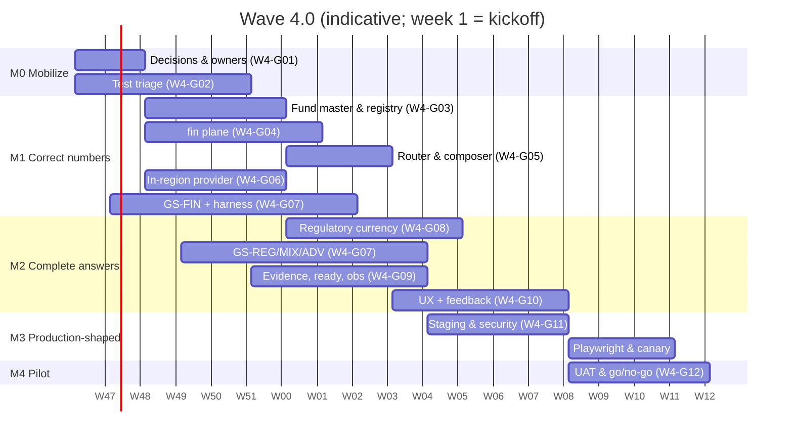

# AMC Wave 4.0 — Goal Plan (GP-40 v1)

| | |
|---|---|
| **Status** | DRAFT for steering-committee review |
| **Design** | [AMC_WAVE4_ENHANCEMENT_SPEC_V1.md](AMC_WAVE4_ENHANCEMENT_SPEC_V1.md) (TDS-40) |
| **Tracker** | [WAVE4_TASKS.csv](WAVE4_TASKS.csv) (same columns as `Docs/AMC_Tasks_3_11_26/AMC_Tasks/tasks.csv`) |
| **Horizon** | 18 weeks from kickoff (estimate; re-plan at each milestone exit) |
| **Architecture** | Unchanged. All work is additive and flag-gated (TDS-40 §1.2) |

---

## 1. North star and outcome goals

**North star:** *An internal AMC compliance and investment-ops analyst gets exact, as-of-dated, cited answers to fund-data and SEBI-regulation questions, or an honest "cannot answer". This holds on a verified, India-hosted deployment that the AMC's risk functions have signed off.*

| # | Outcome | Measure | Target | Evidence |
|---|---|---|---|---|
| O1 | Numbers are exact | `fin_exact_match` on GS-FIN | 100% P0, ≥ 99% overall | `answer_quality.json` (G11) |
| O2 | No invented numbers or sources | `ungrounded_number_rate`, `citation_validity` | 0 and 100% | G10, G11 |
| O3 | Regulatory answers are useful and current | `reg_sme_acceptable`; in-force citation rate | ≥ 85%; ≥ 95% | G11 |
| O4 | Honest refusal | `abstention_correctness`; `advice_refusal` | ≥ 95%; 100% | G11 |
| O5 | Isolation and residency | Cross-tenant leaks; out-of-region calls | 0; 0 | G6, G12 |
| O6 | Operable pilot | Readiness probe, runbooks rehearsed, SLOs measured | All done | G8, G13 |
| O7 | Users find value | UAT task success; time saved per question vs current process; weekly active pilot users | ≥ 80%; ≥ 50% reduction (baseline in M0); ≥ 60% of named users | G14 UAT report |

---

## 2. Goals (mapped to TDS-40 enhancements)

Goal IDs continue the existing tracker (G01–G14 in `tasks.csv`) as **W4-G01 … W4-G12** to avoid collision with gate IDs G0–G14.

| Goal | Title | Enh. | Priority | Depends on | Exit criteria (summary) | Accountable role |
|---|---|---|---|---|---|---|
| W4-G01 | Decisions, ownership and baseline | — | P0 | — | D1–D10 recorded; named owners; G0 signed; baseline time-per-question measured | Product Owner |
| W4-G02 | Green, consolidated codebase | E10 | P0 | — | Default suite 0 unexplained failures on Linux and Windows; facades in place; repo hygiene done | Tech Lead |
| W4-G03 | Canonical fund master and metric registry | E2 | P0 | W4-G01 | O1–O5 decided; registry v1 two-person approved; known-answer fixtures pass | Data Steward |
| W4-G04 | Verified structured data plane | E1 | P0 | W4-G02, W4-G03 | `fin` plane atomic with receipt; signed; tamper/crash/tenant/outage tests pass on live PostgreSQL | Backend Lead |
| W4-G05 | Typed routing and numeric-safe answers | E3 | P0 | W4-G04 | Router and composer in enforce; zero ungrounded numbers on GS-FIN; no fallthrough | Backend Lead |
| W4-G06 | India-resident provider and embedder binding | E6 | P0 | W4-G01 (D3) | Provider allowlist enforced; embedder signed and verified; PII scrub verified | Architect |
| W4-G07 | Gold sets and evaluation gate | E5 | P0 | W4-G01, W4-G03 | GS-FIN 200, GS-REG 120, GS-MIX 30, GS-ADV 50 frozen; harness green; `answer_quality` in the evidence gate | QA Lead + Compliance SME |
| W4-G08 | Regulatory corpus currency | E4 | P1 | W4-G06, W4-G07 | In-force metadata and lineage published; licence basis recorded; offline candidate flow | Compliance SME + Backend |
| W4-G09 | Audit evidence, readiness, observability, runbooks | E9 | P0 | W4-G02 | `query_evidence` in PostgreSQL; `/api/ready`; OTel and metrics; key ceremony and reconcile runbooks rehearsed | SRE / DevOps |
| W4-G10 | Pilot UX, feedback and browser qualification | E11, E7, (E8) | P1 | W4-G05, W4-G09 | Answer cards, feedback capture, WCAG AA, Playwright on 3 engines | Frontend Lead |
| W4-G11 | Staging and security assurance | E12 | P0 | W4-G04…W4-G09 | India-region staging; pen test with no open high findings; CSCRF mapping; DPDP record; canary/rollback rehearsal | Security Lead + DevOps |
| W4-G12 | Pilot UAT and go/no-go | — | P0 | All | UAT with named users; O1–O7 met; independent review; signed go/no-go | Steering Committee |

---

## 3. Milestones and timeline

| Milestone | Weeks | Focus | Exit gate(s) |
|---|---|---|---|
| **M0 — Mobilize** | 1–2 | Decisions D1–D10, named owners and key holders, baseline measurement, test triage start, gold-set authoring kickoff, provider shortlist | G0 (signed), W4-G01 done |
| **M1 — Correct numbers** | 3–8 | Fund master and metric registry, `fin` plane, router and composer, in-region provider, GS-FIN harness | G10 (structured correctness) |
| **M2 — Complete answers** | 7–12 | Regulatory currency, GS-REG/MIX/ADV, query evidence in PostgreSQL, feedback capture, UX answer cards | G11 (answer quality, dry run) |
| **M3 — Production-shaped** | 11–14 | Staging in India region, readiness and observability, runbooks, pen test, Playwright, canary/rollback | G12 (residency/privacy), G13 (operability), existing G7–G9 |
| **M4 — Pilot** | 15–18 | UAT with 25 named users (2 weeks live use), SLO window, independent review, go/no-go | G11 (final), G14 (UAT), G9 |

**Critical path:** W4-G01 (steward named) → W4-G03 (metric registry) → W4-G04 (`fin` plane) → W4-G05 (composer) → G10 → staging (W4-G11) → UAT (W4-G12). The other critical chain is D3 (provider) → W4-G06 → W4-G08/E5 runs on the real model. **Gold-set authoring is the most common hidden critical path; it starts in week 1.**

---

## 4. Gate matrix (extends the Wave 3.1 G0–G9 matrix)

Existing gates G0–G9 keep their definitions in [LOCAL_VALIDATION_SUMMARY.md](../wave3_1/LOCAL_VALIDATION_SUMMARY.md). Wave 4 adds:

| Gate | Name | Pass condition | Evidence record kind |
|---|---|---|---|
| **G10** | Structured correctness | `fin` plane live tests pass on PostgreSQL; GS-FIN 100% P0 / ≥ 99% overall; 0 ungrounded numbers; executor fault injection always abstains | `fin_plane`, `answer_quality` (GS-FIN) |
| **G11** | Answer quality | All E5 thresholds on the chosen in-region model and embedder, SHA- and receipt-bound | `answer_quality` |
| **G12** | Residency and privacy | Provider/region allowlist enforced; 0 out-of-region calls in the staging capture; PII scrub test; DPDP record approved | `residency_privacy` |
| **G13** | Operability | `/api/ready` correct in 6 failure scenarios; key ceremony and reconcile rehearsed; backup/restore within RPO/RTO; dashboards live | `operability40` |
| **G14** | Pilot UAT | UAT plan executed; O7 targets met; defects triaged (0 open P0/P1); product, compliance and risk sign-off | `uat_report` |

The decision vocabulary is unchanged (TDS-31 §7.4). A structurally complete evidence set still yields `EVIDENCE_PRESENT_REQUIRES_INDEPENDENT_REVIEW`.

---

## 5. Roles, staffing and RACI

**Assumed team** (adjust in M0):
- **Engineering:** 1 architect / tech lead, 3 backend engineers, 1 frontend engineer, 1 QA/SDET, 0.5 DevOps/SRE, 0.5 security engineer.
- **From the AMC:** Product Owner, Data Steward (fund operations), Compliance SME (≈ 30% for M0–M2, then 15%), CISO-office reviewer, 25 named pilot users.

| Activity | PO | Tech Lead | Backend | Frontend | QA | DevOps | Security | Data Steward | Compliance |
|---|---|---|---|---|---|---|---|---|---|
| Scope and decisions (D1–D10) | **A** | R | C | C | C | C | C | C | C |
| Metric registry and O1–O5 | C | C | R | — | C | — | — | **A** | C |
| `fin` plane, router, composer | I | **A** | R | — | C | — | C | C | — |
| Provider and residency | C | **A** | R | — | C | R | C | — | C |
| Gold sets | C | C | C | — | **A/R** | — | — | R (GS-FIN) | R (GS-REG) |
| Regulatory corpus and licensing | C | C | R | — | C | — | — | — | **A** |
| Staging, readiness, runbooks | I | C | C | — | C | **A/R** | C | — | — |
| Security review and pen test | I | C | C | C | C | C | **A/R** | — | C |
| UX and Playwright | C | C | — | **A/R** | R | — | — | — | — |
| UAT and go/no-go | **A** | R | C | C | R | C | C | C | R |

**Key holders (must be named in M0):** 1 publisher signing key holder, 2 approver key holders for corpus publication, and 2 for metric-registry approval (Data Steward plus Compliance). They must be different people from the publisher. A key custodian owns enrollment and rotation.

---

## 6. UAT design (M4)

- **Participants:** 25 named internal users from compliance and investment operations, with 10 concurrent sessions as the design load.
- **Script:** 40 scripted tasks across UC1–UC6, plus free use for 2 weeks.
- **Measures:**
  - task success
  - time per question versus the M0 baseline (the current manual process: AMFI sheets, circular search)
  - perceived trust (5-point scale)
  - abstention annoyance rate
  - every feedback item triaged within 2 business days
- **Acceptance:** O7 targets met, plus 0 open P0/P1 defects, plus G10–G13 passed on the UAT build SHA.

---

## 7. Cadence and governance

- **Weekly:** engineering stand-up on the tracker (status values: TODO / IN_PROGRESS / BLOCKED / DONE / VERIFIED).
- **Fortnightly:** steering committee (PO, Tech Lead, Compliance, Data Steward, Security). Agenda: gate status, decisions due, risks.
- **Milestone exit review:** gate evidence is presented with SHA-bound records; decisions are logged in this folder as `DECISION_LOG.md`.
- **Change control:** TDS-31 §10 checklist, plus the enhancement ID and feature flag in every PR. Off-mode regression is kept.
- **Honest reporting rule (carried from Wave 3.1):** no status above `PASS_RUNTIME_LOCAL` without the matching environment; never describe the branch as production-ready before G14.

---

## 8. Risk register

| # | Risk | L | I | Mitigation | Owner |
|---|---|---|---|---|---|
| R1 | Data steward or Compliance SME time not available | M | H | M0 exit requires named people with % allocation; escalate to the sponsor | PO |
| R2 | In-region model underperforms | M | H | Shortlist two models; run GS-REG early in M1; tune prompts and composer before switching | Architect |
| R3 | Gold-set effort underestimated | H | M | Start in week 1; templates from Spec 03 §8; pilot feedback grows the set | QA Lead |
| R4 | 3-plane publication races | L | H | Extend the 8-round race and 6-failpoint crash tests to `fin`; independent review | Backend Lead |
| R5 | Staging environment delayed | M | H | Request infrastructure in M0; containers on the existing topology; no new services | DevOps |
| R6 | Pen-test findings late | M | M | Book the pen test for week 12; fix window in weeks 13–14 | Security |
| R7 | Scope creep (ingestion, repair, investor-facing) | M | H | TDS-40 §1.4 non-goals; changes only through the PO and steering committee | PO |
| R8 | Corpus licensing excludes key documents | M | M | Prefer regulator texts, AMFI public data and the AMC's own documents | Compliance |
| R9 | Test-suite triage reveals real defects | M | M | Track as defects, not skips; P0/P1 fixed before M3 | Tech Lead |

---

## 9. Definition of done (Wave 4.0)

Wave 4.0 is done when all of the following hold:
1. G0–G14 are passed or formally waived by the named owner, with a reason.
2. The pilot ran 2 weeks with named users and met O1–O7.
3. Every new route, plane and flag has positive and negative tests, an ADR and runbook coverage.
4. An independent security and architecture review signed off.
5. Product, Compliance and Risk signed the go/no-go.

Until then, the branch is labelled **ENGINEERING CANDIDATE**.
